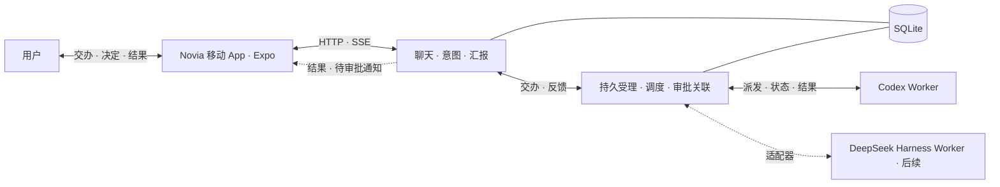

# 诺薇娅 Bot 与会话调度需求

## 产品目标与职责

诺薇娅（Novia）是用户的聊天和交办入口。用户一句话交代目标，Bot 在授权范围内组织执行，完成后在原对话汇报。需要用户判断风险、授权、改变方向或补充关键信息时，Bot 主动询问。日常工作在聊天里完成，看板用于追踪、介入和调试。

诺薇娅主应用负责两件事。**聊天**负责理解意图、保持连续会话和自然语言回复。**交办与汇报**负责持久受理、后台派发、跟踪、审批关联和结果回传。写代码、执行命令、运行工具和管理执行上下文由专业 Worker 负责。Codex、DeepSeek Harness 都可以作为独立执行端。诺薇娅通过适配器连接它们，各执行端沿用自己的模型、工具、权限和原生会话。

诺薇娅独立运行。Aion 的代码、已部署服务和测试是复用来源，按功能逐项核对入口、依赖和权限语义。首个 Worker 使用 Codex，DeepSeek Harness 作为后续 Worker 接入。Novia 自身的推理回传规则由后端模型适配层处理。

## 首版范围与交互

- **固定聊天。** 首版建议先开放内置 Bot `novia`，数据从第一天按用户、Bot 和固定会话归属保存。手机打开 Novia 后进入最新消息，向上加载历史，切回前台、换设备和重启后继续同一对话。自建 Bot、切换入口和每 Bot 独立看板可在闭环稳定后加入。 [Hermes Bot Mode](https://hermes-agent.nousresearch.com/docs/user-guide/bot-mode) · [Aion 消息列表](../AionUi/packages/desktop/src/renderer/pages/conversation/Messages/MessageList.tsx)
- **上下文管理。** 原始消息、附件和交办引用完整保留。首个闭环从最近消息构造聊天上下文。需要压缩时，在同一会话保存摘要和覆盖边界，之后使用摘要与最近消息。对话里的 `/new`、`/clear`、`/reset` 与 `/compact` 统一走上下文压缩入口，历史仍可回查。
- **交办与结果。** 用户通过聊天交办、补充、追问、撤回或审批。Bot 确认已受理后继续聊天。任务完成、失败或无法自动恢复时，在原对话给出自然语言反馈与可访问的成果。用户只在追问或调试时查看交办详情。
- **定时与记忆。** Bot 管理定时任务属于首版核心能力，在首条手动交办跑通后接入同一条链路。长期记忆复用已有 Mem0 MCP，按 Bot 归属访问，固定会话回查提供轻量入口和兜底。

## 首版 UI 与跨端布局

- **移动端以参考图为视觉基准。** 首版使用随应用发布的固定插画和深紫、淡紫配色。全屏插画一直延伸到屏幕底部，聊天区及控件之间透出背景。消息、结果卡、输入区和抽屉用局部的圆角半透明面板保证文字和按钮可辨认。长消息正常滚动，输入区适配安全区和键盘。 [移动端参考图](novia/mobile-reference.jpg)
- **左抽屉是业务与状态，右抽屉是系统与设置。** 左侧首版展示对话记录、交办记录和定时任务，右侧放已实现的设置。常态收起抽屉，保留完整聊天视野。交办结果和待审批事项优先以消息或卡片进入原对话，点击卡片可以查看结果或原操作。
- **PC 端沿用移动端的视觉和导航。** 优先从同一 Expo 工程验证桌面浏览器版。中间保留沉浸聊天，两侧可收起。宽屏下左侧可停靠业务导航，右侧按需打开设置或当前交办详情。初版详情只放状态、执行者和结果，后续可以扩展进度、执行记录和产物列表。较窄时恢复抽屉。 [PC 端设计图](novia/desktop-concept.png)

### 背景与主题的扩展边界

背景素材、界面主题和对话内容分开管理。移动端与 PC 共用主题语义色，包括文字、面板、边框、主操作和各类状态色。背景单独记录素材引用及构图焦点，客户端按窗口比例裁切。对比度由各控件自身的面板底色和透明度控制，面板外完整露出插画。图片加载失败时回退到默认背景色，弱化透明效果时仍保有可读面板。

后续动态生图作为异步任务产生新背景素材，完成后经同一素材入口加载。自动取色从图片生成候选配色，再检查文字和操作控件对比度，保留默认主题作为回退。更换背景或主题只更新外观配置，原对话、任务与导航状态可继续使用。生图和取色均排在首期之后。

## 首版技术选型

| 部分 | 建议选型 | 落地边界 |
| --- | --- | --- |
| 运行方式 | **Node.js 24 LTS + TypeScript + pnpm** | 一个应用工程和一个 Novia 服务进程。服务端和客户端共用语言与数据类型，执行端由适配器独立启动和管理。 |
| 客户端 | **Expo + React Native + TypeScript** | 先在一台常用手机验证聊天和通知跳转。PC 端优先验证同一工程的 Web 导出，复用消息与卡片数据、主题和 API 客户端，按宽度调整导航与详情布局。 [Expo 开发构建](https://docs.expo.dev/develop/development-builds/introduction/) · [Expo Web 发布](https://docs.expo.dev/guides/publishing-websites/) |
| 服务端 | **Fastify + HTTP JSON + SSE** | HTTP 提交输入和查询历史。客户端在前台通过 SSE 收消息和状态，重连按持久消息游标补读。聊天、调度和 Worker 对接在同一进程内按模块组织。 [Fastify TypeScript 文档](https://fastify.dev/docs/latest/Reference/TypeScript/) |
| 持久化 | **SQLite + `node:sqlite`** | 用短事务保存聊天、交办、审批、定时触发和待反馈事件。交办表兼作持久队列，同一事务提交终态与待反馈。固定并验证 Node 24 版本，`node:sqlite` 在该版本线处于发布候选阶段。 [Node 24 SQLite 文档](https://nodejs.org/download/release/latest-v24.x/docs/api/sqlite.html) · [SQLite 事务隔离](https://www.sqlite.org/isolation.html) |
| 聊天模型 | **Vercel AI SDK Core + Novia 薄封装** | 先接一个可配置的模型端点，支持连续对话，后续供结构化交办意图和结果转述使用。服务端校验模型输出的动作、目标和权限。首版单 Worker 可按配置派发。 |
| 首个 Worker | **本机 `codex app-server`，经 stdio JSON-RPC** | 沿用 Codex 原生配置和登录。保存 thread ID 和 turn ID，按原线程续接、订阅终态并回答对应审批请求。固定验收通过的 CLI 版本。 [OpenAI Docs 的 Codex App Server](https://learn.chatgpt.com/docs/app-server) |

首版部署目标是单机和单用户。服务端运行依赖收敛为 Node.js、内置 SQLite 和已安装的 Worker。手机只访问 Novia API，服务端完成登录与数据归属校验。Worker 连接、凭据、工作目录和权限由服务端管理。后台服务按 Aion 的本机运维约定提供启动、停止、重启、状态和健康检查。

### Chat Completions 推理回传

- Novia 自身使用 OpenAI 兼容 Chat Completions 时，同一个用户轮次内，模型调用工具并收到工具结果后，续跑请求保留本轮产生的推理及工具记录。推理字段按供应商协议映射，通常为 `reasoning_content`，网关使用 `reason_content` 时适用同一规则。
- 收到下一条普通用户消息时，发给模型的新请求过滤全部历史推理，包括之前工具轮的推理。正文、工具调用 ID、参数和工具结果按原顺序保留。如果新轮后来调用工具，续跑只回传新轮自身的推理。过滤作用于发送给模型的请求副本，保留原始会话记录。
- 该规则在 Novia 后端的模型适配层执行。其他模型协议和外部 Worker 沿用各自的回传策略。用模拟端点抓取实际请求体，再在配置的目标网关验收。网关拒绝时按现有错误路径反馈。

### Expo 源码与发布边界

- 手机和 PC 共用一套 Expo 工程、聊天页面、主题和 API 客户端。布局用 `useWindowDimensions` 在运行时响应窗口宽度，切换抽屉或停靠面板时保留当前对话与输入。确有平台差异的推送、凭据存储等能力通过独立的平台模块接入。 [React Native 窗口尺寸](https://reactnative.dev/docs/useWindowDimensions) · [Expo 平台模块](https://docs.expo.dev/router/advanced/platform-specific-modules/)
- 开发时安装一次包含所需原生模块的开发构建，聊天布局和样式用开发服务器迭代。发布时分别构建 iOS、Android 和 Web 产物。兼容现有原生运行时的界面代码与资源可在配置 Expo Update 后单独发布，新增原生模块或修改原生配置时重新构建 App。背景素材和主题配置后续可由服务端提供，客户端运行时加载。 [Expo 开发流程](https://docs.expo.dev/get-started/start-developing/) · [Expo Update 运行时版本](https://docs.expo.dev/eas-update/runtime-versions/)

### 原生客户端与通知

- App 在前台用 `expo/fetch` 读取 SSE，切回前台或重连后从服务端按游标补读已落盘消息。移动端通过 HTTPS 调用 API，登录凭据保存在 `expo-secure-store`。 [Expo 流式 Fetch](https://docs.expo.dev/versions/latest/sdk/expo/#expofetch-api) · [Expo SecureStore](https://docs.expo.dev/versions/latest/sdk/securestore/)
- 交办结果和待审批问题先写入原对话，再用 `expo-notifications` 提醒手机用户。通知使用简短提示和消息标识，点击后打开原对话并从服务端读取详情。手机锁屏、App 退出或通知权限关闭期间，交办和定时仍由服务端执行，打开 App 后可补读结果。 [Expo 推送配置](https://docs.expo.dev/push-notifications/push-notifications-setup/)
- 第一个闭环用开发构建连到实际服务。随后在真机验证锁屏收通知、点击通知回到原对话、拒绝通知权限后回前台补读。远程推送使用开发构建和目标平台的推送凭据。 [Expo 开发构建 FAQ](https://docs.expo.dev/develop/development-builds/faq/#remote-push-notifications)

## 架构图

## 异步交办与 Worker 对接

1. **受理。** 一次 Bot 对话可以产生零项、一项或多项交办。每项独立保存目标、必要背景、授权附件、来源消息或定时触发，以及明确指向的原交办。按来源与该项稳定标识去重。提交成功才回复已受理，部分失败时按项说明，已入队的事项照常推进。
2. **派发。** 后台按序认领并记录目标。明确续作时使用原 Worker 线程，独立目标新开线程。目标忙时按受理顺序等待，不同线程可在配置的并发范围内执行。无可用 Worker 时记录异常并通知 Bot。交办、补充、替换和撤回都走同一个入口，取消前核对目标轮次。
3. **执行。** 适配器提供启动或续接、读取运行状态、处理原调用审批和取消等实际支持的能力。Novia 保存交办 ID 与执行端的线程、轮次和请求标识。执行端事件只更新对应的执行记录。新增第二种 Worker 时，按两个执行端的实际差异确定共享接口。
4. **结算。** 成功、失败、撤回及需处理的异常都进入原 Bot 的统一入站。每项任务独立结算，先完成的先汇报。若任务有尚未可读取的产物，等产物可交付后再结算成功。用户可按原请求追问单项或整体进度。

### 恢复与统一反馈

- 已受理的任务和待反馈事件保存在 SQLite。Bot 忙时，反馈在统一入站等待，空闲后作为标记来源的独立输入处理。回复落盘后确认消费。结果事件去重，客户端重连可补读已落盘消息。
- 认领、派发和终态分开记录。重启后继续处理未派发任务和未汇报的终态。发送执行请求后失联，按已记录的线程和轮次查询原执行端，结果或副作用仍不明时标记待核对，由 Bot 报告并请用户决定下一步。已发出的操作以原执行记录为准。
- Worker 的会话压缩、模型请求、工具调度和实例生命周期由执行端管理。后续看板从交办、审批和执行记录读取状态，按 Bot 隔离。需要人工介入的异常直接回原对话。

### 独立审批链

Worker 的审批请求先登记，关联用户、Bot、交办、线程、轮次和请求 ID，再通知原 Bot。Bot 说明操作和影响，理解明确的允许或拒绝。答复含糊或有多个可能的审批对象时先澄清。服务端校验答复归属与活跃调用后，把一次性决定送回原请求。已取消、过期或重启后已失效的请求向用户说明，后续操作如需审批重新发起。审批等待期间，聊天与其他交办继续。

### Bot 定时任务与长期记忆

- 用户在对话里创建、查看、修改、暂停、恢复和删除定时任务。明确任务内容、时区与下次执行时间。到期以「任务 ID + 计划触发时间」持久登记，重启后补处理尚未消费的触发。Bot 或目标会话忙时保留等待。同一定时任务的上次执行尚未结束时，后续触发按顺序等待。需要执行的工作使用同一交办队列，结果回到原对话。
- Mem0 按可信用户和 Bot 身份隔离，保留记忆开关与删除确认。用户问原话、精确参数时可直接查固定会话。长期事实优先查 Mem0，服务不可用或结果不足时回查原消息。Worker 的记忆按其自身配置管理。 [Aion 已有记忆能力](memory-roadmap.md#当前能力) · [MCP 接入与验收](memory-mcp-backlog.md)

## Aion 复用范围

| 已有能力 | 诺薇娅的接法 |
| --- | --- |
| **Web 消息列表和产物体验** | 评估复用平台无关的消息类型、历史分页、附件与重连逻辑。现有 Web 组件提供交互参考，手机页面用 React Native 组件实现。 [消息列表](../AionUi/packages/desktop/src/renderer/pages/conversation/Messages/MessageList.tsx) · [Aion Web 开发](../AionUi/docs/contributing/development.md) |
| **消息队列、归属校验、定时与审批** | 复用经过验证的状态语义、边界用例和可独立接入的逻辑。首版应用服务用 TypeScript 落地队列和协议映射。 [队列](../AionCore/crates/aionui-session-message/src/queue.rs) · [会话与审批](../AionCore/crates/aionui-conversation/src/service.rs) · [Cron](../AionCore/crates/aionui-cron/src/executor.rs) |
| **异步生图 MCP** | 复用独立服务。接入生图 Worker 时关联 `image_submit` 返回的任务 ID、原交办和可访问的产物引用。按原 ID 查状态并取结果，遇到 `submission_uncertain` 进入待核对。 [生图 MCP](../aion-openai-image-mcp/README.md) · [异步生图验收](../AionCore/crates/aionui-app/tests/async_image_e2e.rs) |
| **Mem0 和 Dots Bridge** | Mem0 直接接入已有服务。需要 Dot 入口时，适配既有 Bridge 到统一入站，复用消息去重与附件归属的经验。 [Mem0 记录](memory-mcp-backlog.md) · [Dots 接入](../AionCore/DOTS-BRIDGE.md) |
| **角色、提示词、Skill 和模型配置** | Bot 只保留聊天与交办所需的角色设定。Worker 的工具、Skill、模型和会话由其原生配置提供，后续按实际需求接入现有 Aion 助手或抽取配置能力。 [助手配置刷新](../AionCore/crates/aionui-conversation/src/assistant_runtime.rs) · [Aion 提示词组装](../aionrs/crates/aion-agent/src/context.rs) |
| **工具链、归档和看板** | 复用长工具链、断流与结果核对的验收用例。执行端负责会话归档，Novia 保存可续接的引用。后续看板可复用 Aion 的卡片、分列和状态呈现。 [推理回传旧实现](../aionrs/crates/aion-agent/src/reasoning_history.rs) · [归档](../AionCore/crates/aionui-sidebar/src/service.rs) · [团队看板](../AionUi/packages/desktop/src/renderer/pages/team/activity/TeamActivityView.tsx) |
| **独立本机服务** | 沿用 Aion 的进程管理、健康检查、日志和本地数据隔离约定。 [Aion 服务管理脚本](../manage-services.py) |

DeepSeek Harness 后续作为独立 Worker，通过其 TypeScript SDK 或已验证的进程接口接入。接入时验证线程续接、结果归属、审批和重启恢复。 [Harness 本地 SDK 说明](../../dsh/deepseek-harness/packages/sdk/client/README.md)

## 实施计划

每次交付一个可从正常入口验收的功能。**首个可运行版本只包含后端 Provider、薄封装和基础连续对话**，用 HTTP 或 CLI 验收。第二批加入基础聊天页面与实时 SSE，再单独加入持久化、重连补读和完整交互。下表保留原工作项的编号前缀，便于对照施工记录。

| 工作项 | 内容与目标 | 验收标准 |
| --- | --- | --- |
| 01A Provider 与后端连续对话 | 接入一个真实模型端点，实现薄封装和固定会话的基础聊天入口。首批会话可用进程内存。 | 经同一会话连发两轮，第二轮能引用第一轮给出的信息。另开测试会话时上下文独立。模拟 Provider 超时可返回可辨认的错误。 |
| 01B 基础聊天页面与 SSE | Expo 页面接入发送消息和 SSE，展示生成中的回复与最终状态。 | 手机开发构建可连续聊天。人为延迟模型响应时，页面能逐步显示内容。模拟流失败时可见失败状态。 |
| 01C SQLite 与会话恢复 | 持久保存固定会话、消息及可补读事件，接入重启恢复和 SSE 重连。 | 服务重启后仍回到同一会话。断线期间新增的已保存消息重连后可补读，顺序正确且无重复。 |
| 01D 历史分页 | 为固定会话增加向上加载旧消息和滚动位置恢复。 | 多页历史可连续加载，加载后阅读位置稳定，期间收到新消息也可正常浏览。 |
| 01E 沉浸式聊天与双抽屉 | 按参考图实现固定背景、半透明卡片和双抽屉，适配键盘与安全区。 | 打开键盘或切换抽屉仍保留草稿。插画延伸至屏幕底部，素材加载失败时控件仍可辨认。 |
| 01F Chat Completions 推理回传 | 在模型适配层实现同轮工具续跑与新用户轮的推理过滤。用模拟工具结果验收，可独立于 Worker。 | 抓取请求验证本轮工具续跑带推理，新用户轮无历史推理，工具调用、ID、参数和结果完整。再用配置的目标网关验证。 |
| 02A 持久交办受理 | 先完成单项受理，再支持一句话拆多项、按项去重和快速确认。 | Worker 暂停时仍可接单和继续聊天。重复输入复用原受理记录，一项受理失败时其他项仍可推进。 |
| 02B 模拟 Worker 派发与结算 | 用可控执行端验证队列认领、目标忙时等待及单项结算。 | 两项交办分别认领。忙的目标线程排队，另一项可先完成。重启后待执行项仍可推进。 |
| 02C 回原对话汇报 | 接入持久待反馈事件、Bot 统一入站和结果卡片。 | 两项结果分别自动回原对话，先完成的先汇报。重复事件或重启后每项只出现一次汇报。 |
| 03A Codex 真实执行 | 用真实 Codex 适配器执行一项交办，保存线程和轮次 ID。 | 在已授权的测试工作目录完成实际任务，结果自动回原对话。用 `novia-admin smoke --live` 验证闭环。 |
| 03B 原线程续接与恢复核对 | 按交办关联续用原线程，失联后核对已记录的执行。 | 对同一项任务补充要求时续接原线程。执行中断后按 ID 核对，结果不明时报告待核对。 |
| 04A 聊天审批 | 关联 Worker 原生审批和用户答复。 | 在原对话批准或拒绝一次实际请求。含糊答复先澄清，失效或重复答复无法授权其他调用。 |
| 04B 取消交办 | 支持撤回排队任务和取消执行中轮次。 | 取消只作用于指定任务或轮次，其他交办继续。 |
| 05A 对话管理定时规则 | 支持创建、查看、修改、暂停、恢复和删除定时任务。 | 原对话可管理规则，展示时区与下次执行时间，含糊时间先澄清。 |
| 05B 持久触发与调度 | 将到期事件持久化并接入交办队列。 | 跨过触发时间后重启，同一触发只受理一次。前次未结束时等待，完成后回原对话。 |
| 06A 固定会话回查 | 支持定位当前固定会话的原话和精确参数。 | 能从旧消息中找到指定内容并定位原消息。 |
| 06B 上下文压缩 | 在原会话保存摘要与覆盖边界，兼容现有压缩命令。 | 压缩后连续对话能使用摘要，原消息仍可回查。 |
| 06C Mem0 长期记忆 | 接入现有 Mem0 MCP，并以固定会话回查兜底。 | 按当前 Bot 权限读写记忆，Mem0 不可用时仍能回查历史。 |
| 07 原生通知 | 注册已登录设备，将结果和待审批消息映射到通知及对话跳转。 | 锁屏时收到通知，点击后打开原消息。通知关闭或连接中断时，回到 App 仍能补读。 |
| 08 PC 版布局验证 | 复用 Expo 工程导出 Web，验证宽屏停靠面板、窄屏抽屉和连续可见的背景插画。 | 拖动窗口时可在两种布局间切换，保留当前对话和草稿。手机与 PC 打开同一固定对话时，消息与交办状态一致。 |
| 后续扩展 | 接入 DeepSeek Harness 与异步生图 Worker，再按实际需要开放自建 Bot、隔离看板、动态背景和自动取色。 | 第二种 Worker 通过同一交办路径返回结果。不同 Bot 的会话、交办和反馈按归属隔离。 |

03A 完成后进行第一条跨端联验「手机发一句话 → Novia 确认 → 用户继续聊天 → Codex 执行 → 结果回到原对话」。后续每批按本项标准验收，并回归已通过的主线。日志记录交办、线程和轮次的关联、状态、原因及耗时。
