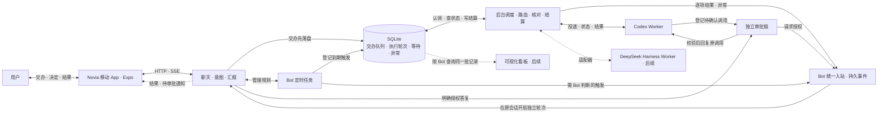

# 诺薇娅 Bot 与会话调度需求

## 产品目标与职责

诺薇娅（Novia）是用户的聊天和交办入口。用户一句话交代目标，Bot 在授权范围内组织执行，完成后在原对话汇报。需要用户判断风险、授权、改变方向或补充关键信息时，Bot 主动询问。日常工作在聊天里完成，看板用于追踪、介入和调试。

诺薇娅主应用负责两件事。**聊天**负责理解意图、保持连续会话和自然语言回复。**交办与汇报**负责持久受理、后台派发、跟踪、审批关联和结果回传。写代码、执行命令、运行工具和管理执行上下文由专业 Worker 负责。Codex、DeepSeek Harness 都可以作为独立执行端。诺薇娅通过适配器连接它们，各执行端沿用自己的模型、工具、权限和原生会话。

诺薇娅独立运行。Aion 的代码、已部署服务和测试是复用来源，按功能逐项核对入口、依赖和权限语义。首个 Worker 使用 Codex，DeepSeek Harness 作为后续 Worker 接入。Novia 自身的推理回传规则由后端模型适配层处理。

## 产品范围与交付顺序

首个可运行批次只交付后端连续对话。首版核心闭环再逐项交付聊天、持久交办、看板数据、调度与恢复、审批、定时任务和 Mem0。自建 Bot、更多 Worker 及可视化看板继续作为独立工作项交付。独立部署改变的是执行端接法；产品交互、状态和验收仍按本文定义。

- **固定聊天。** 第一个可用入口是内置 Bot `novia`（诺薇娅），在 Bot 列表中固定首位。用户可以创建其他 Bot，各 Bot 共用产品能力，分别设置名称、角色、聊天模型和授权范围。服务端按登录用户和 Bot 唯一绑定固定会话，并发首次打开也返回同一会话 ID。手机打开选中的 Bot 后进入最新消息，向上加载历史，切回前台、换设备和重启后继续同一对话。会话、交办、定时规则、反馈、看板和记忆按用户与 Bot 隔离。 [Hermes Bot Mode](https://hermes-agent.nousresearch.com/docs/user-guide/bot-mode) · [Aion 消息列表](../AionUi/packages/desktop/src/renderer/pages/conversation/Messages/MessageList.tsx)
- **上下文管理。** 原始消息、附件和交办引用完整保留。首个闭环从最近消息构造聊天上下文。页头压缩入口和 `/new`、`/clear`、`/reset`、`/compact` 统一压缩原会话，保存摘要与覆盖边界，之后使用摘要与最近消息。压缩与聊天共用轮次控制，忙时提示稍后重试；失败保留原上下文并在原对话反馈。
- **交办与结果。** 用户通过聊天交办、补充、追问、撤回或审批。Bot 确认已受理后继续聊天。任务完成、失败或无法自动恢复时，在原对话给出自然语言反馈与可访问的成果。用户只在追问或调试时查看交办详情。
- **定时与记忆。** Bot 管理定时任务属于首版核心能力，在首条手动交办跑通后接入同一条链路。长期记忆复用已有 Mem0 MCP，按 Bot 归属访问，固定会话回查提供轻量入口和兜底。

## 首版 UI 与跨端布局

- **移动端以参考图为视觉基准。** 首版使用随应用发布的固定插画和深紫、淡紫配色。全屏插画一直延伸到屏幕底部，聊天区及控件之间透出背景。消息、结果卡、输入区和抽屉用局部的圆角半透明面板保证文字和按钮可辨认。长消息正常滚动，输入区适配安全区和键盘。 [移动端参考图](novia/mobile-reference.jpg)
- **左抽屉是业务与状态，右抽屉是系统与设置。** 左侧随功能交付开放 Bot 列表、对话记录、交办记录和定时任务，右侧放已实现的设置。常态收起抽屉，保留完整聊天视野。交办结果和待审批事项优先以消息或卡片进入原对话，点击卡片可以查看结果或原操作。可视化看板后续从左抽屉进入。
- **PC 端沿用移动端的视觉和导航。** 优先从同一 Expo 工程验证桌面浏览器版。中间保留沉浸聊天，两侧可收起。宽屏下左侧可停靠业务导航，右侧按需打开设置或当前交办详情。初版详情只放状态、执行者和结果，后续可以扩展进度、执行记录和产物列表。较窄时恢复抽屉。 [PC 端设计图](novia/desktop-concept.png)

### 背景与主题的扩展边界

背景素材、界面主题和对话内容分开管理。移动端与 PC 共用主题语义色，包括文字、面板、边框、主操作和各类状态色。背景单独记录素材引用及构图焦点，客户端按窗口比例裁切。对比度由各控件自身的面板底色和透明度控制，面板外完整露出插画。图片加载失败时回退到默认背景色，弱化透明效果时仍保有可读面板。

后续动态生图作为异步任务产生新背景素材，完成后经同一素材入口加载。自动取色从图片生成候选配色，再检查文字和操作控件对比度，保留默认主题作为回退。更换背景或主题只更新外观配置，原对话、任务与导航状态可继续使用。生图和取色均排在首期之后。

## 首版技术选型

| 部分 | 建议选型 | 落地边界 |
| --- | --- | --- |
| 运行方式 | **Node.js 24 LTS + TypeScript + pnpm** | 一个应用工程和一个 Novia 服务进程。服务端和客户端共用语言与数据类型，执行端由适配器独立启动和管理。 |
| 客户端 | **Expo + React Native + TypeScript** | 先在一台常用手机验证聊天和通知跳转。PC 端优先验证同一工程的 Web 导出，复用消息与卡片数据、主题和 API 客户端，按宽度调整导航与详情布局。 [Expo 开发构建](https://docs.expo.dev/develop/development-builds/introduction/) · [Expo Web 发布](https://docs.expo.dev/guides/publishing-websites/) |
| 服务端 | **Fastify + HTTP JSON + SSE** | HTTP 提交输入和查询历史。客户端在前台通过 SSE 收消息和状态，重连按持久消息游标补读。聊天、调度和 Worker 对接在同一进程内按模块组织。 [Fastify TypeScript 文档](https://fastify.dev/docs/latest/Reference/TypeScript/) |
| 持久化 | **SQLite + `node:sqlite`** | 用短事务保存聊天、交办、审批、定时触发和待反馈事件。交办表兼作持久队列，同一事务提交终态与待反馈。固定并验证 Node 24 版本，`node:sqlite` 在该版本线处于发布候选阶段。 [Node 24 SQLite 文档](https://nodejs.org/download/release/latest-v24.x/docs/api/sqlite.html) · [SQLite 事务隔离](https://www.sqlite.org/isolation.html) |
| 聊天模型 | **Vercel AI SDK Core + Novia 薄封装** | 先接一个可配置的模型端点，支持连续对话，后续供结构化交办意图和结果转述使用。服务端校验模型输出的动作、目标和权限。首版单 Worker 可按配置派发。 |
| 首个 Worker | **本机 `codex app-server`，经 stdio JSON-RPC** | 沿用 Codex 原生配置和登录。保存 thread ID 和 turn ID，按原线程续接、订阅终态并回答对应审批请求。固定验收通过的 CLI 版本。 [OpenAI Docs 的 Codex App Server](https://learn.chatgpt.com/docs/app-server) |

首版部署目标是单机和单用户。服务端运行依赖收敛为 Node.js、内置 SQLite 和已安装的 Worker。手机只访问 Novia API，服务端完成登录与数据归属校验。Worker 连接、凭据、工作目录和权限由服务端管理。后台服务按 Aion 的本机运维约定提供启动、停止、重启、状态和健康检查。

### Chat Completions 推理回传

- Novia 自身使用 OpenAI 兼容 Chat Completions 时，同一个用户轮次内，模型调用工具并收到工具结果后，续跑请求保留本轮产生的推理及工具记录。推理字段按供应商协议映射，通常为 `reasoning_content`，网关使用 `reason_content` 时适用同一规则。
- 收到下一条普通用户消息时，发给模型的新请求过滤全部历史推理，包括之前工具轮的推理。正文、工具调用 ID、参数和工具结果按原顺序保留。如果新轮后来调用工具，续跑只回传新轮自身的推理。过滤作用于发送给模型的请求副本，保留原始会话记录。
- 该规则在 Novia 后端的模型适配层执行。其他模型协议和外部 Worker 沿用各自的回传策略。用模拟端点抓取实际请求体，再在配置的目标网关验收。网关拒绝时按现有错误路径反馈。

### Expo 源码与发布边界

- 手机和 PC 共用一套 Expo 工程、聊天页面、主题和 API 客户端。布局用 `useWindowDimensions` 在运行时响应窗口宽度，切换抽屉或停靠面板时保留当前对话与输入。确有平台差异的推送、凭据存储等能力通过独立的平台模块接入。 [React Native 窗口尺寸](https://reactnative.dev/docs/useWindowDimensions) · [Expo 平台模块](https://docs.expo.dev/router/advanced/platform-specific-modules/)
- 开发时安装一次包含所需原生模块的开发构建，聊天布局和样式用开发服务器迭代。发布时分别构建 iOS、Android 和 Web 产物。兼容现有原生运行时的界面代码与资源可在配置 Expo Update 后单独发布，新增原生模块或修改原生配置时重新构建 App。背景素材和主题配置后续可由服务端提供，客户端运行时加载。 [Expo 开发流程](https://docs.expo.dev/get-started/start-developing/) · [Expo Update 运行时版本](https://docs.expo.dev/eas-update/runtime-versions/)

### 原生客户端与通知

- App 在前台用 `expo/fetch` 读取 SSE，切回前台或重连后从服务端按游标补读已落盘消息。移动端通过 HTTPS 调用 API，登录凭据保存在 `expo-secure-store`。 [Expo 流式 Fetch](https://docs.expo.dev/versions/latest/sdk/expo/#expofetch-api) · [Expo SecureStore](https://docs.expo.dev/versions/latest/sdk/securestore/)
- 交办结果和待审批问题先写入原对话，再用 `expo-notifications` 提醒手机用户。通知使用简短提示和消息标识，点击后打开原对话并从服务端读取详情。手机锁屏、App 退出或通知权限关闭期间，交办和定时仍由服务端执行，打开 App 后可补读结果。 [Expo 推送配置](https://docs.expo.dev/push-notifications/push-notifications-setup/)
- 第一个闭环用开发构建连到实际服务。随后在真机验证锁屏收通知、点击通知回到原对话、拒绝通知权限后回前台补读。远程推送使用开发构建和目标平台的推送凭据。 [Expo 开发构建 FAQ](https://docs.expo.dev/develop/development-builds/faq/#remote-push-notifications)

## 架构图

## 异步交办与 Worker 对接

1. **受理。** 一次 Bot 对话可以产生零项、一项或多项交办。每项独立保存目标、必要背景、授权附件、来源消息或定时触发，以及明确指向的原交办。按来源与该项稳定标识去重。提交成功才回复已受理，部分失败时按项说明，已入队的事项照常推进。
2. **派发。** 调度模块按序作出路由决策，先记录决定，再异步投递。需要等待某个线程或外部结果时，记录等待条件并继续处理其他交办。调度依序消费与 Worker 在不同线程执行是两个阶段；同一线程一次只执行一轮。用户通过 Bot 交办，后续看板的补充和撤回也经过同一队列。
3. **执行。** 适配器提供启动或续接、读取运行状态、处理原调用审批和取消等实际支持的能力。Novia 保存交办 ID 与执行端的线程、轮次和请求标识。执行端事件只更新对应的执行记录。新增第二种 Worker 时，按两个执行端的实际差异确定共享接口。
4. **结算。** 成功、失败、撤回及需处理的异常都进入原 Bot 的统一入站。每项任务独立结算，先完成的先汇报。若任务有尚未可读取的产物，等产物可交付后再结算成功。用户可按原请求追问单项或整体进度。

### 交办看板数据

看板首先是 SQLite 中供调度和恢复读取的业务状态，从 **02A 持久受理、02B 模拟派发** 开始建设。一项交办对应一张卡。同一来源拆出的任务有独立的状态与结果，可按来源一起查询。交办记录同时作为持久队列；Bot 查进度、后台核对和后续可视化看板读取同一套记录。

| 记录 | 调度与恢复所需信息 |
| --- | --- |
| 交办 | 交办 ID、所属用户和 Bot、来源消息或定时触发、原交办引用、去重标识、受理顺序、目标和授权背景、当前状态及等待条件、已选 Worker 与线程、结果引用。 |
| 执行记录 | 交办 ID、Novia 执行 ID、Worker 与线程、执行端轮次和请求 ID（取得后保存）、实际状态、时间、错误与结果。一次交办可有多次执行记录，只有当前关联的执行能推进交办状态。 |
| Worker 与受管线程 | Worker 的配置与调度资格、适配器报告的可用性、线程归属、最后活动时间和恢复引用；由当前认领与执行端状态核对线程是否占用。每次投递前核对资格、线程状态和可用额度。 |
| 关联事项 | 审批、用户答复、定时触发、异步产物、异常和待反馈事件保留稳定引用，由各自模块保存明细，交办通过引用得知在等什么或如何恢复。 |

最低状态包括**待分配、待执行、执行中、等待、待核对、已完成、失败、已取消**。等待记录具体条件，例如目标线程忙、待审批、待材料、待产物；只有条件解除后才推进。审批期间若原轮仍运行，则继续占用原线程；已结束轮次仅等待外部产物时，按真实线程状态判断是否可接下一轮。目标忙按同线程受理顺序等待；没有合格 Worker 与 Worker 暂忙分别处理。认领和建立 Novia 执行记录在短事务中完成，外部投递在事务外执行。已发送但未确认的请求先核对原执行，再决定是否恢复，避免重复副作用。

可视化看板按用户和 Bot 查询，按 Worker 分列，未分配的任务单列。一张卡展示进度、等待原因、当前执行和结果，可定位原请求及有权限访问的成果。同一个 Worker 为多个 Bot 服务时，各 Bot 只看到自己的卡和续接候选。需要时可从卡片补充或撤回，动作仍进入统一交办入口。是否开放 Worker 原生会话跳转与直聊，按执行端能力单独决定。可借用 Aion Team 的分列和卡片交互；Team 的成员任务依赖服务于共同目标，Novia 的交办默认独立推进和结算。

### 调度分工与路由

| 子任务 | 归属与职责 |
| --- | --- |
| 队列与推进 | 代码负责持久受理、按序认领、等待条件、去重和恢复。 |
| 交办决策 | 读取原请求和有权续用的候选，区分新目标、补充、替换和撤回，建议 Worker 与线程。首个 Codex 闭环使用配置和明确关联做路由；需要更复杂语义时接入独立的后台决策实现。 |
| 执行控制 | 代码校验权限、Worker 资格、目标线程和当前轮次，再保存决定并投递或取消。 |
| 生命周期维护 | 代码周期性核对受管 Worker、线程、轮次和后台任务，补齐遗漏事件，执行已定义的恢复规则。 |
| 异常决策 | 代码先记录事实，涉及换 Worker、改变执行方案或请求用户决策时，由独立决策接口提出建议。 |
| 反馈投递 | 代码把结算、异常和待决事项写入 Bot 统一入站，Bot 负责自然语言汇报。 |

交办决策与异常决策分别定义输入和输出，可共用同一个后台模型，也可逐步分到不同 Agent。后台决策在调度模块内运行，拥有独立于 Bot 聊天的执行生命周期，无需独立聊天入口。后续在 Bot 的「调度与看板」设置中管理候选 Worker、通用兜底及调度模型，模型默认跟随 Bot，可单独覆盖。决策超时或建议失效时，该项保留可恢复状态；代码维护、已完成的反馈和其他不受影响的交办继续运行。

明确延续同一主题、目标或对象时，优先复用该 Bot 已有的受管线程。前一项已保存的路由可供后一项续接，无需等待前一项执行完成。独立目标选择合适的已配置 Worker 并新开线程；没有匹配的职能时可使用已配置的通用 Worker。多个候选会造成明显不同的执行结果时，由 Bot 澄清。没有可用 Worker 且无法自动恢复时，记录异常并回报原 Bot。用户明确要求替换时，核对并取消指定轮次，待确认终止后优先处理替换指令；只撤销明确被替代的等待项。若目标轮次已变化或取消结果不明，先核对并反馈。

### 生命周期核对与统一反馈

- **恢复与核对。** 重启后继续待分配、待执行和未汇报的任务。周期维护按已知线程、轮次和后台任务 ID 核对运行状态，补齐遗漏的终态，识别 Worker 不可用、启动失败、中断、长期无进展或恢复失败。适配器查不到实际结果，且副作用可能已发生时，标记待核对，由 Bot 说明现状和下一步。迟到事件只能更新对应执行记录。
- **异常与反馈。** 成功、失败、取消，以及受管 Worker 的异常，统一生成持久事件送往原 Bot；已自动恢复的异常也留记录并送入站，可随结果说明。重复探测复用同一异常事件。交办终态与待反馈事件一起提交。找不到任何可用 Worker 也要反馈，不能只留在看板。
- **粘滞消息。** 后台事件带稳定 ID、可信来源及交办、审批或触发关联。Bot 忙时保留，空闲后按序作为原固定会话的一轮独立输入处理。回复持久保存后确认消费；失败或重启可恢复，同一事件的回复及衍生交办分别去重。聊天只展示自然语言和授权成果；用户询问进度时 Bot 可按来源查询各项状态。需用户决定的业务问题关联原交办重新入队；工具授权走审批链。

### Worker 身份与归档恢复

Worker 是可持续使用的职能身份，同一个执行端可以配置多位 Worker，各有职责边界、Profile 或原生配置引用、适用 Bot 和独立线程。保留工作方式、输出约定、风格及确认过的参考资料引用。恢复时沿用身份与原线程，读取已保存的进度、成果和必要历史。配置和模型可变更，执行记录保留实际使用的版本或引用，便于排查恢复后表现差异。角色规则、技能与工具归各自执行端；接入可变更的配置时，验收下一轮生效、已有会话覆盖和变更可追溯。共享项目事实如需开放，明确项目 scope 和访问权限；Worker 职能和会话恢复仍依赖自己的配置及记录。Bot 与 Worker 的记忆各自授权。

保留原设计的后台 LRU 归档与续接目标。适配器确认支持归档、释放和按原线程恢复后，由维护任务基于看板状态挑选最久未活动且可安全恢复的受管线程，复用执行端归档。执行中、待投递或审批、尚有未保存内容或结果不明的线程跳过。记录自动与手动归档的来源；自动归档可在再次命中时恢复原线程，手动归档由用户恢复。适配器能力未验证前保留线程和恢复引用，归档与原生实例管理交给执行端。恢复失败通过统一入站反馈。模型请求、工具执行和底层 Provider 调度仍由各执行端管理。

### 独立审批链

Worker 的审批请求先登记，关联用户、Bot、交办、线程、轮次和请求 ID，再通知原 Bot。Bot 说明操作和影响，理解明确的允许或拒绝。答复含糊或有多个可能的审批对象时先澄清。服务端校验经认证的答复者、原审批及活跃调用，记录原答复与处理结果，把一次性决定送回原请求。已取消、过期或重启后已失效的请求向用户说明，后续操作如需审批重新发起。审批等待期间，聊天与其他交办继续。

### Bot 定时任务与长期记忆

- 用户在对话里创建、查看、修改、暂停、恢复和删除定时任务。明确任务内容、时区与下次执行时间，含糊时先澄清。到期以「任务 ID + 计划触发时间」持久登记，重启后补处理尚未消费的触发。Bot 或目标会话忙时保留等待；同一定时任务的上次执行尚未结束时，后续触发按顺序等待。需要 Bot 判断或直接回复的触发进统一入站，需要 Worker 执行的工作走同一交办队列。一次触发可关联多项交办，各项分别回原对话汇报。运行记录可定位本次触发及其交办，调度的状态核对由维护任务独立触发。
- 内置及自建 Bot 都使用现有 Mem0，按可信用户和 Bot 身份隔离，保留记忆开关、工具权限和删除确认；已授权定时轮次也按执行时的同一权限和开关访问。长期事实优先查 Mem0，关闭、服务不可用或结果不足时回查原消息。用户问原话、精确参数时可直接查当前固定会话，返回有限摘录及原消息引用，两处都找不到时请用户补充。Worker 的记忆按其自身配置管理。 [Aion 已有记忆能力](memory-roadmap.md#当前能力) · [MCP 接入与验收](memory-mcp-backlog.md)

## Aion 复用范围

| 已有能力 | 诺薇娅的接法 |
| --- | --- |
| **Web 消息列表和产物体验** | 评估复用平台无关的消息类型、历史分页、附件与重连逻辑。现有 Web 组件提供交互参考，手机页面用 React Native 组件实现。 [消息列表](../AionUi/packages/desktop/src/renderer/pages/conversation/Messages/MessageList.tsx) · [Aion Web 开发](../AionUi/docs/contributing/development.md) |
| **消息队列、归属校验、定时与审批** | Aion 的跨会话投递复用正常发消息入口，忙时进入内存队列。Novia 复用校验和异步投递的语义，在 TypeScript 调度模块补足目标未确定时的持久受理、按项撤回和重启核对。定时复用时间与认领用例，补齐固定会话和持久等待。 [投递](../AionCore/crates/aionui-session-message/src/service.rs) · [队列](../AionCore/crates/aionui-session-message/src/queue.rs) · [会话与审批](../AionCore/crates/aionui-conversation/src/service.rs) · [Cron](../AionCore/crates/aionui-cron/src/executor.rs) |
| **异步生图 MCP** | 复用独立服务。接入生图 Worker 时关联 `image_submit` 返回的任务 ID、原交办和可访问的产物引用。按原 ID 查状态并取结果，遇到 `submission_uncertain` 进入待核对。 [生图 MCP](../aion-openai-image-mcp/README.md) · [异步生图验收](../AionCore/crates/aionui-app/tests/async_image_e2e.rs) |
| **Mem0 和 Dots Bridge** | 复用 Mem0 服务、已有工具说明及分区权限用例。需要 Dot 入口时，保留 Bridge 异步回信、主动推送、附件与每个安装实例的接收游标，映射到统一入站。 [Mem0 记录](memory-mcp-backlog.md) · [Dots 接入](../AionCore/DOTS-BRIDGE.md) |
| **角色、提示词、Skill 和模型配置** | Bot 只保留聊天与交办所需的角色设定。Worker 的工具、Skill、模型和会话由其原生配置提供，后续按实际需求接入现有 Aion 助手或抽取配置能力。 [助手配置刷新](../AionCore/crates/aionui-conversation/src/assistant_runtime.rs) · [Aion 提示词组装](../aionrs/crates/aion-agent/src/context.rs) |
| **工具链、归档和看板** | 复用长工具链、断流与结果核对的验收用例。执行端负责实际归档，Novia 保存可续接的引用并在适配器支持时安排回收。团队任务按 Team 保存成员和依赖，Novia 看板按 Bot 保存独立交办；可复用卡片、分列和状态呈现。 [推理回传旧实现](../aionrs/crates/aion-agent/src/reasoning_history.rs) · [归档](../AionCore/crates/aionui-sidebar/src/service.rs) · [团队任务](../AionCore/crates/aionui-team/src/task_board.rs) · [团队看板](../AionUi/packages/desktop/src/renderer/pages/team/activity/TeamActivityView.tsx) |
| **聊天细节和 Codex 会话维护** | 复用工具分组、图片预览和重连后的原图引用等交互与回归用例，按 Expo 端重新实现。Codex 原生历史删除、会话绑定清理属于执行端的维护操作，接入时单独核对。 [工具卡](../AionUi/packages/desktop/src/renderer/pages/conversation/Messages/ToolCards/MessageToolGroup.tsx) · [Codex 历史](../AionCore/crates/aionui-conversation/src/codex_history.rs) |
| **独立本机服务** | 沿用 Aion 的进程管理、健康检查、日志和本地数据隔离约定。 [Aion 服务管理脚本](../manage-services.py) |

DeepSeek Harness 后续作为独立 Worker，通过其 TypeScript SDK 或已验证的进程接口接入。接入时验证线程续接、结果归属、审批和重启恢复。 [Harness 本地 SDK 说明](../../dsh/deepseek-harness/packages/sdk/client/README.md)

### 异步产物交付

以已有异步生图 MCP 为首个验收。提交前保存稳定请求 ID，拿到任务 ID 后关联交办与 Worker 轮次。Worker 可以结束本轮，交办在产物可访问前仍等待。恢复按原 ID 查状态和取结果，遇到 `submission_uncertain` 先核对，不自动重复发起付费生成。成功后产物、来源会话和原图引用可供同一 Bot 追问或续编，读取按归属校验。由哪个适配器消费后台任务状态，接入时结合 Worker 能暴露的事件决定；独立生图服务保持原接口。

## 旧版需求对照与待决事项

对照早期 Aion 方案（`03fda17`）和切换为独立轻量应用前的完整 PRD（`858b5af`）。保留原版的产品行为，按下表区分交付时点和实现变更。

| 旧版能力 | 当前处理 |
| --- | --- |
| 长期 Bot、固定会话、连续上下文 | 保留。先验证内置 Bot，随后补自建与切换；保留同会话压缩、历史定位和数据隔离。 |
| 调度 Agent、队列、生命周期维护 | 保留职责和扩展点。首条链路由代码处理明确路由，后续再接可配置后台决策；队列、维护、反馈保持独立运行。 |
| 看板、结果回查、异常与用户介入 | 看板数据从交办首批开始，调度、查进度与恢复直接使用；可视化分列与卡片后置。保留逐项汇报、独立审批、异常统一入站和待核对。 |
| 职能 Worker、会话顺序、归档 | 保留职能身份与原线程续接。原先复用 Aion 或 Harness 宿主归档；现在按执行端能力接入。共用项目事实须另定授权边界。 |
| 定时、Mem0、异步生图、Dots | 定时和 Mem0 仍是首版核心。生图与 Bridge 保留原有复用方向，分别接入统一交办与入站；沿用任务恢复、权限和去重验收。 |
| 固定 Aion Bot 后端、Harness 统一运行时、Provider 队列 | 实现已调整：Novia 独立运行，Codex 先接，Harness 作为 Worker 后接。沿用模型端正常会话策略；底层模型通信和并发调度不在本需求内。 |

以下决策不阻塞首条聊天和交办闭环。开放相关功能前明确：

- **自建 Bot 停用与删除。** 建议先支持停用，停止新交办和新触发，已受理工作及回报仍保留在原 Bot；删除如何处理在途工作、历史和长期记忆，另定明确策略。
- **Worker 会话的直接访问。** 可视化看板先提供状态、原消息和成果定位。是否允许跳到原生会话直聊，取决于适配器能否校验归属、观测原生轮次占用并避免与队列冲突；Bot 交办始终经过队列。
- **Worker 的项目 scope 与归档能力。** 先用 Bot、Worker 的现有记忆分区和显式授权附件。项目共享记忆的访问和写入规则、各执行端能否实际释放并恢复原线程，都需要单独验证后开放。

## 实施计划

每次交付一个可从正常入口验收的功能。**首个可运行版本只包含后端 Provider、薄封装和基础连续对话**，用 HTTP 或 CLI 验收。第二批加入基础聊天页面与实时 SSE，再单独加入持久化、重连补读和完整交互。02A–02B 开始建设看板数据，03C 补足持续核对；可视化看板在 09B 独立交付。下表保留原工作项的编号，新增能力可按前置条件独立排期。

| 工作项 | 内容与目标 | 验收标准 |
| --- | --- | --- |
| 01A Provider 与后端连续对话 | 接入一个真实模型端点，实现薄封装和固定会话的基础聊天入口。首批会话可用进程内存。 | 经同一会话连发两轮，第二轮能引用第一轮给出的信息。另开测试会话时上下文独立。模拟 Provider 超时可返回可辨认的错误。 |
| 01B 基础聊天页面与 SSE | Expo 页面接入发送消息和 SSE，展示生成中的回复与最终状态。 | 手机开发构建可连续聊天。人为延迟模型响应时，页面能逐步显示内容。模拟流失败时可见失败状态。 |
| 01C SQLite 与会话恢复 | 持久保存固定会话、消息及可补读事件，接入重启恢复和 SSE 重连。 | 服务重启后仍回到同一会话。断线期间新增的已保存消息重连后可补读，顺序正确且无重复。 |
| 01D 历史分页 | 为固定会话增加向上加载旧消息和滚动位置恢复。 | 多页历史可连续加载，加载后阅读位置稳定，期间收到新消息也可正常浏览。 |
| 01E 沉浸式聊天与双抽屉 | 按参考图实现固定背景、半透明卡片和双抽屉，适配键盘与安全区。 | 打开键盘或切换抽屉仍保留草稿。插画延伸至屏幕底部，素材加载失败时控件仍可辨认。 |
| 01F Chat Completions 推理回传 | 在模型适配层实现同轮工具续跑与新用户轮的推理过滤。用模拟工具结果验收，可独立于 Worker。 | 抓取请求验证本轮工具续跑带推理，新用户轮无历史推理，工具调用、ID、参数和结果完整。再用配置的目标网关验证。 |
| 02A 持久交办受理 | 按 Bot 保存可调度的看板任务、来源、受理顺序和稳定去重标识。支持一句话拆多项与快速确认。 | 暂停 Worker 后仍可接单和继续聊天。按来源查出独立任务；重复提交复用已有回执，一项写入失败时其他项仍推进；重启后记录可查。 |
| 02B 模拟 Worker 派发与结算 | 接入 Worker 可用性、执行记录与等待条件，以相同状态驱动认领、派发和结算。 | 重复唤醒只认领一次；忙线程按序等待，另一线程可先完成。模拟无 Worker、旧轮次迟到和重启，能分别查到异常、原执行记录和可继续的任务。 |
| 02C 回原对话汇报 | 接入持久待反馈事件、Bot 统一入站和结果卡片。 | Bot 忙时保留事件，空闲后开独立轮次。两项结果分别自动回原对话，先完成的先汇报。重复事件、模型失败或重启后每项只出现一次汇报。 |
| 02D 对话内查询交办进度 | Bot 通过同一看板数据按来源或单项查询进度、等待原因和授权结果。 | 一条消息拆出的任务分别执行、等待或完成，Bot 能说明各项状态并定位成果；其他 Bot 的交办无法查询。 |
| 03A Codex 真实执行 | 用真实 Codex 适配器执行一项交办，保存线程和轮次 ID。 | 在已授权的测试工作目录完成实际任务，结果自动回原对话。用 `novia-admin smoke --live` 验证闭环。 |
| 03B 原线程续接与恢复核对 | 按交办关联续用原线程，失联后核对已记录的执行。 | 对同一项任务补充要求时续接原线程。执行中断后按 ID 核对，结果不明时报告待核对。 |
| 03C 生命周期巡检与异常回报 | 周期核对受管 Worker、线程、轮次和已接入的后台任务，补齐遗漏状态，向原 Bot 报告异常。 | 模拟启动失败、失联、遗漏事件和自动恢复；同一异常去重上报，副作用不明不重发，调度决策不可用时仍能核对并回报。 |
| 03D Worker 职能与按 Bot 配置 | 维护持久 Worker 身份、职责、执行配置引用、可用范围及通用兜底，投递前核对最新资格。 | 同一执行端下两个职能身份能绑定不同线程；禁用一个后不再分派新任务；原身份、历史和配置可追溯。 |
| 03E 后台语义调度 | 分离交办路由和异常判断接口，支持按 Bot 配置模型与候选 Worker。 | 同主题续用，独立目标新开，候选歧义请 Bot 澄清；模型超时或返回越界目标不阻塞巡检和反馈。 |
| 04A 聊天审批 | 关联 Worker 原生审批和用户答复。 | 在原对话批准或拒绝一次实际请求。含糊答复先澄清，失效或重复答复无法授权其他调用。 |
| 04B 取消交办 | 支持撤回排队任务和取消执行中轮次。 | 取消只作用于指定任务或轮次，其他交办继续。 |
| 04C 补充与替换交办 | 普通补充按序等待，明确替换先核对和终止旧轮次，之后在原线程优先执行。 | 忙时补充按序推进；要求重做只替换指定工作，轮次刚结束或取消结果不明时不误伤新轮次。 |
| 05A 对话管理定时规则 | 支持创建、查看、修改、暂停、恢复和删除定时任务。 | 原对话可管理规则，展示时区与下次执行时间，含糊时间先澄清。 |
| 05B 持久触发与调度 | 将到期事件持久化，按需进入 Bot 统一入站或交办队列，保存运行记录与各项交办的关联。 | 跨过触发时间后重启，同一触发只受理一次。Bot、Worker 或前次运行忙时分别等待；一次触发拆多项后分别回原对话。 |
| 06A 固定会话回查 | 支持定位当前固定会话的原话和精确参数。 | 能从旧消息中找到指定内容并定位原消息。 |
| 06B 上下文压缩 | 在原会话保存摘要与覆盖边界，页头和兼容命令走同一入口。 | 保留会话 ID、原消息和附件。忙时有提示，压缩失败仍能使用原上下文。 |
| 06C Mem0 长期记忆 | 接入现有 Mem0 MCP，并以固定会话回查兜底。 | 聊天和定时轮次均受当前 Bot 权限与开关约束，删除需确认；关闭、不可用或结果不足时能回查历史。 |
| 07 原生通知 | 注册已登录设备，将结果和待审批消息映射到通知及对话跳转。 | 锁屏时收到通知，点击后打开原消息。通知关闭或连接中断时，回到 App 仍能补读。 |
| 08 PC 版布局验证 | 复用 Expo 工程导出 Web，验证宽屏停靠面板、窄屏抽屉和连续可见的背景插画。 | 拖动窗口时可在两种布局间切换，保留当前对话和草稿。手机与 PC 打开同一固定对话时，消息与交办状态一致。 |
| 09A 自建 Bot 与切换 | 通过 Bot 列表创建及切换不同定义，内置 novia 固定在首位，使用同一套聊天与调度能力。 | 创建第二个 Bot 后，分别聊天、交办、管理定时和记忆，刷新和重启后各回原会话，数据与反馈隔离。 |
| 09B 可视化交办看板 | 在后续阶段把 02A–03C 的同一份数据展示为分列和卡片，接入已交付的交办操作。 | 两个 Bot 共享 Worker 时只看到自己的卡。一条消息拆出的任务分卡显示；刷新恢复状态，可定位原消息，从卡片撤回仍经原队列。 |
| 09C DeepSeek Harness Worker | 用第二种真实执行端验证 Worker 适配边界。 | 通过同一队列完成交办，验证原线程续接、审批、结果归属和重启核对。 |
| 09D 异步产物交付 | 接入已有生图 MCP 的异步任务引用、产物恢复和结果访问。 | Worker 结束后仍等待生图，重启后查同一任务，产物可访问才汇报；提交状态不明时不重复生成。 |
| 09E Worker 归档与恢复 | 验证适配器能力后，维护任务按看板状态归档并释放安全的空闲线程。 | 跳过执行中或待核对的线程；自动归档后续用原线程，手动归档按原入口恢复；验证与新消息竞争以及恢复失败上报。 |
| 后续扩展 | Dots Bridge、项目共享记忆、动态背景和自动取色按需另排。 | 分别验证入口与数据归属、项目授权边界和背景加载失败的界面回退。 |

03A 完成后进行第一条跨端联验「手机发一句话 → Novia 确认 → 用户继续聊天 → Codex 执行 → 结果回到原对话」。后续每批按本项标准验收，并回归已通过的主线。日志记录交办、线程和轮次的关联、状态、原因及耗时，省略请求正文、记忆内容、附件和凭据。

核心能力联验增加「一句话拆出两项 → 一项先汇报 → 另一项在聊天审批后继续 → 定时任务到期 → 服务重启 → 各项只受理和结算一次」。同时注入断流与遗漏事件，确认长工具链能定位原执行结果，无法核对的副作用交由 Bot 说明。多 Bot 和可视化看板交付后，复测共享 Worker 时的会话、定时、反馈和卡片隔离。
