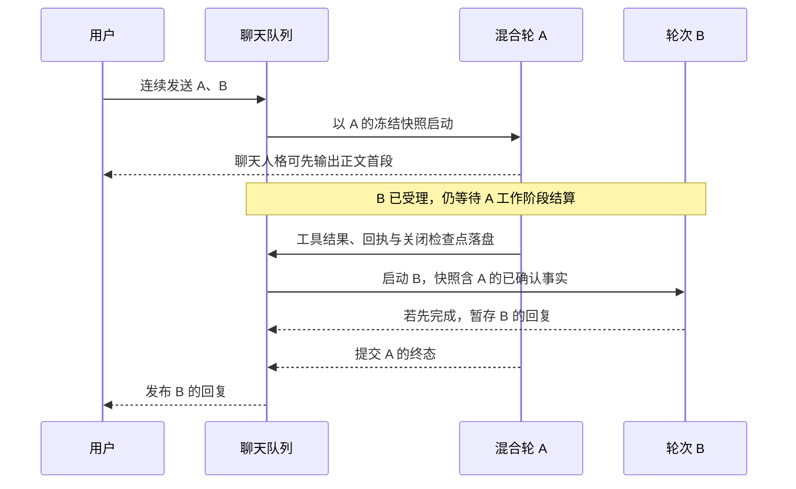
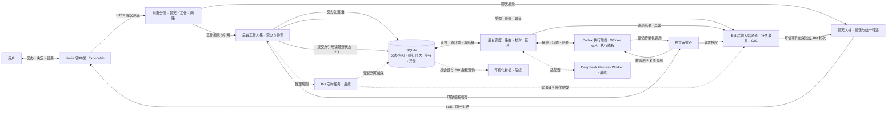

# 诺薇娅 Bot 与会话调度需求

## 产品目标与职责

诺薇娅（Novia）是用户的聊天和交办入口。用户一句话交代目标，Bot 在授权范围内组织执行，完成后在原对话汇报。需要用户判断风险、授权、改变方向或补充关键信息时，Bot 主动询问。日常工作在聊天里完成，看板用于追踪、介入和调试。

诺薇娅主应用负责两件事。**聊天**负责理解意图、保持连续会话和自然语言回复。**交办与汇报**负责持久受理、后台派发、跟踪、审批关联和结果回传。写代码、执行命令、运行工具和管理执行上下文由专业 Worker 负责。Codex、DeepSeek Harness 都可以作为独立执行端。诺薇娅通过适配器连接它们，各执行端沿用自己的模型、工具、权限和原生会话。

Bot 的业务能力限于聊天、交办、监听后台事件和汇报，以及协调所需的会话内进度查询、审批和取消。查外部资料、读写文件、执行命令等具体工作交给 Worker。首版只流式输出已进入最终答复阶段的正文，阶段性结论的生成留待后续设计。Worker 已确认的实质进展仍可经专用入站回报。

诺薇娅作为独立项目维护自己的前端、后端、数据和协议。首个 Worker 使用 Codex，DeepSeek Harness 作为后续 Worker 接入。Aion 提供现有使用场景和回归用例参考。已独立部署的服务按各自协议接入。Novia 自身的推理回传规则由后端模型适配层处理。

## 产品范围与交付顺序

**首版以真实 Codex 的最小可用闭环为交付目标。** 用户从一条持续私聊交办，Bot 快速确认已落盘，后台派给配置好的 Codex。执行中用户可以继续聊天、查看状态、回应必要审批或停止指定任务。Codex 完成、失败或状态不明时，结果回到原对话，客户端断线或服务重启后仍能查到。首个开发批次从后端连续对话开始，首版发布以 03F 联验为准。

- **一个 Bot 对应一条持续私聊。** Bot 是人设入口，内置 `novia`（诺薇娅）固定在首位。后续用户可创建不同人设，分别设置名称、角色、聊天模型和授权范围。服务端按用户与 Bot 唯一绑定私聊，并发首次打开也返回同一会话 ID。切换 Bot 时进入对应私聊，切回前台、换设备和重启后继续原会话。后续群聊是单独的共享会话，由用户邀请多个 Bot 加入。Codex 执行线程留在 Worker 侧，按任务需要新开或续接。
- **上下文管理。** 首期使用递归摘要加最近 N 轮原文。原始消息、附件和交办引用完整保留，每轮固定摘要版本和历史边界。页头入口和 `/new`、`/clear`、`/reset`、`/compact` 统一压缩原会话。自动和手动压缩共用 06B 的摘要策略。
- **交办与结果。** 用户通过聊天交办、补充、追问、撤回或审批。Bot 确认已受理后继续聊天。任务完成、失败或无法自动恢复时，在原对话给出自然语言反馈与可访问的成果。用户只在追问或调试时查看交办详情。
- **后续交付。** 定时任务与 Mem0 仍是产品需求，放在首版手动交办闭环之后。自建 Bot、群聊、可视化看板、更多 Worker 与原生通知也分别验收。首版保留可回放的消息和交办数据，后续功能从相同入口和状态接入。

## 首版对话与汇报质量

用户在同一条私聊里可以闲聊、讨论方案、请 Bot 查证或执行，再回来追问结果。各 Bot 的称呼、语气和表达方式由各自角色定义决定。它们共用同一套交互行为：接住话题、延续前文约束、判断是否交办、跟踪任务并汇报结果。角色扮演与真实世界信息分别表达，涉及实际查询、操作和结果的说法以可核对证据为准。

| 用户意图 | Bot 应有的表现 |
| --- | --- |
| 闲聊、问方案、表达看法 | 直接接话或回答。用户在讨论部署、比较方案或说「我觉得可以」时，结合前文判断是在交流还是在明确委托。 |
| 请求查证或执行 | 区分一般解释、需要外部证据的查证和有副作用的操作。可直接解释的先回答。需要检查实时资料、机器或文件时，按已配置的能力和权限交办，回报注明实际证据及适用范围。缺少能力时说明可确认的部分和需要补的证据。 |
| 补充、追问、同意、重试、停止 | 结合当前会话的相关消息、任务状态和有效审批，判断指代的是方案、交办还是某项操作。例如「重试」关联原交办，「我已重启」先理解为用户报告的状态，「允许执行」只有指向有效的具体审批时才能提交授权。目标或权限有实质歧义时，问一个能消除歧义的问题。 |
| 一条消息包含聊天与交办 | 聊天人格可先自然接话，工作受理结果经持久入站在同一对话汇报。聊天正文和受理回执关联同一条用户消息。 |

首版上下文由递归摘要、最近对话、已绑定的交办引用和当前轮所需的授权事实组成。Bot 理解用户指代，服务端按用户、会话和责任 Bot 查原请求、当前状态、结果或有效审批。任务状态保存在交办与执行记录，按需读取。长历史回查和 Mem0 分别由 06A、06C 交付。

对于后台工作，受理后简短说明接下来的动作。执行中有实质新进展、遇到阻碍、需要用户决定，或用户主动追问时，按已记录的状态给更新。责任 Bot 把后端结构化事实转成原会话里的自然语言，先说用户关心的结论，再补必要的依据、尚未解决的事项和可用产物。遇到失败或部分完成，交代已做到哪一步、影响和可行的下一步。原始 JSON、内部状态码和日志留在服务端。文件、命令结果、来源或验证范围应能追溯到这次执行。

以 Dots 真实聊天样本 052、067、089 检查表达效果：异步操作区分受理、交付和核对结果，调查的阶段性发现说明证据范围，执行结果交代实际动作和验证。原导出只有用户可见回复，执行事实用独立的模拟或真实 Worker 记录核对。各 Bot 沿用各自人设。 [Dots 聊天对照验证](../../novia/demo/dots-chat-review.md)

### 聊天人格与后台工作人格

用户仍与同一个 Bot 在一条持续会话里交流。前置模型读取当前原话、近期对话和交办索引，选择进入聊天、工作或两路。混合消息按两路返回原话摘录和必要的消息引用，由服务端核对摘录与来源。同一条消息可同时关联两路，按原消息 ID 追溯，用户可见历史统一保存。

聊天人格维护称呼、人设、关系和最近对话，负责所有用户可见表达。工作人格维护与任务有关的原话、约束、授权、交办引用和执行状态，可单独配置更擅长任务判断的模型。它负责识别新交办、查状态、补充条件或请求澄清，通过现有受理入口交给 Worker。受理及权限校验由服务端负责。

工作人格的受理回执、需确认事项和异常与 Worker 反馈一样进入 Bot 持久入站，由聊天人格转述。初期一句受理确认也走这一条路径。同一用户轮次的一批交办回执可合成一次转述，各项仍有独立记录和引用。混合消息可先接话，随后在同一对话确认回执；工作人格输出的内部正文留在后台。用户回复按原轮次关联，后端转述沿用独立的入站顺序。后续调试面板可以分别查看两路上下文及交接记录。

D11 已使用真实 DeepSeek Flash、临时 SQLite 和模拟 Worker 验证 3 组、6 轮。正式接入按 02F–02I 逐步交付，首版通过 03F 联验。前置、聊天和工作默认复用现有 Provider 配置，工作模型支持独立覆盖。 [双流对话验证](../../novia/demo/bot-context-routing/README.md)

#### 分流决策与三路上下文

`POST /turns` 保存完整原话，轮次启动时冻结对话历史、已有交办和有效待决事项的读取边界。按同一个 `turnId` 从这份快照为各路组装输入。用户原话在会话中只保存和显示一次，后端通过原消息 ID 关联摘录及回执。

| 请求 | 输入组装与职责 |
| --- | --- |
| 前置分流 | 固定分流规则、近期少量已提交的可见消息、当前用户明确回复的旧消息（如有）、相关交办的 ID、短目标、状态与待确认事项、本轮完整原话。索引包含已落盘但确认消息还未发布的交办。分流只输出聊天、工作或两路，以及各路原话片段和相关消息引用。 |
| 聊天人格 | 固定人设、可用的递归摘要、最近 N 轮可见对话及本轮聊天摘录。工作回执和 Worker 反馈通过独立入站请求，使用同一人设转述。 |
| 工作人格 | 固定工作规则、已授权的历史引用及适用摘要、相关交办与约束、当前业务状态和本轮工作摘录。同轮续跑在这份冻结输入后追加本轮已落盘的工具调用与结果。实际读写前按业务入口校验最新状态与授权。 |

同一片段可分给两路。服务端按原消息定位片段并检查引用归属和快照边界，保存实际采用的决定和各路输入引用。分流的近期窗口独立于聊天保留的 N 轮，02G 用 D11 的最近 6 条可见消息作为回放基线，再用短句和跨轮指代样本确定配置。摘要接入前可用原文和持久引用组装。各路请求把稳定指令及可复用历史放在前面，实时索引和本轮输入放在后面。前置分流无法使用时，在任一路开始前交回现有处理路径一次。

## 首版界面与后续跨端布局

- **首版基本操作。** 先交付可持续聊天的 Expo Web 页面，以桌面浏览器和手机视口模拟验收。页面能发送、查看历史、显示受理与结果、回应审批和停止任务。重连后补读已落盘的反馈。固定插画、深紫配色和完整双抽屉按 01E 单独验收。插画延伸到屏幕底部，聊天控件之间露出背景，卡片用局部半透明面板保证文字可读。原生键盘与安全区留在原生构建验收。 [移动端参考图](novia/mobile-reference.jpg)
- **左抽屉是业务与状态，右抽屉是系统与设置。** 左侧随功能交付开放 Bot 列表、对话记录、交办记录和定时任务，右侧放已实现的设置。常态收起抽屉，保留完整聊天视野。交办结果和待审批事项优先以消息或卡片进入原对话，点击卡片可以查看结果或原操作。可视化看板后续从左抽屉进入。
- **PC 端沿用移动端的视觉和导航。** 优先从同一 Expo 工程验证桌面浏览器版。中间保留沉浸聊天，两侧可收起。宽屏下左侧可停靠业务导航，右侧按需打开设置或当前交办详情。初版详情只放状态、执行者和结果，后续可以扩展进度、执行记录和产物列表。较窄时恢复抽屉。 [PC 端设计图](novia/desktop-concept.png)

### 背景与主题的扩展边界

背景素材、界面主题和对话内容分开管理。移动端与 PC 共用主题语义色，包括文字、面板、边框、主操作和各类状态色。背景单独记录素材引用及构图焦点，客户端按窗口比例裁切。对比度由各控件自身的面板底色和透明度控制，面板外完整露出插画。图片加载失败时回退到默认背景色，弱化透明效果时仍保有可读面板。

后续动态生图作为异步任务产生新背景素材，完成后经同一素材入口加载。自动取色从图片生成候选配色，再检查文字和操作控件对比度，保留默认主题作为回退。更换背景或主题只更新外观配置，原对话、任务与导航状态可继续使用。生图和取色均排在首期之后。

## 首版技术选型

| 部分 | 建议选型 | 落地边界 |
| --- | --- | --- |
| 运行方式 | **Node.js 24 LTS + TypeScript + pnpm** | 一个应用工程和一个 Novia 服务进程。服务端和客户端共用语言与数据类型，执行端由适配器独立启动和管理。 |
| 客户端 | **Expo + React Native + TypeScript** | 首版用同一工程的 Web 导出验证聊天、派活和回传。浏览器模拟手机宽度和网络切换，桌面宽屏验证导航与详情布局。原生通知独立验收。 [Expo Web 发布](https://docs.expo.dev/guides/publishing-websites/) |
| 服务端 | **Fastify + HTTP JSON + SSE** | HTTP 异步受理输入，服务端独立完成生成。SSE 提供会话快照、增量和终态。浏览器重连时通过持久游标补读已落盘事件，再从快照接续当前回复。聊天、调度和 Worker 对接在同一进程内按模块组织。 [Fastify TypeScript 文档](https://fastify.dev/docs/latest/Reference/TypeScript/) |
| 持久化 | **SQLite + `node:sqlite`** | 用短事务保存聊天、交办、审批、定时触发和待反馈事件。交办表兼作持久队列，同一事务提交终态与待反馈。固定并验证 Node 24 版本，`node:sqlite` 在该版本线处于发布候选阶段。 [Node 24 SQLite 文档](https://nodejs.org/download/release/latest-v24.x/docs/api/sqlite.html) · [SQLite 事务隔离](https://www.sqlite.org/isolation.html) |
| 聊天模型 | **Vercel AI SDK Core + Novia 薄封装** | 基础聊天、分流、工作判断与结果转述复用 Provider 接口。工作人格调用交办与协调工具，服务端校验参数和权限。首版单 Worker 可按配置派发。 |
| 首个 Worker 执行后端 | **本机 `codex app-server`，经 stdio JSON-RPC** | 沿用 Codex 原生配置和登录。保存 thread ID 和 turn ID，按原线程续接、订阅终态并回答对应审批请求。固定验收通过的 CLI 版本。 [OpenAI Docs 的 Codex App Server](https://learn.chatgpt.com/docs/app-server) |

首版部署目标是单机和单用户。服务端运行依赖为 Node.js、内置 SQLite 和已安装的 Codex。手机只访问 Novia API，服务端完成身份校验和授权。Codex 的启动参数、凭据、允许的工作目录、沙箱和审批策略由部署配置提供。Bot 选择已授权的配置，模型文本不能授予新的工作目录或权限。后台服务提供独立启动、停止、重启、状态与健康检查。

### Chat Completions 推理回传

- **现状与冲突。** 01F 按请求消息数组中最后一条 `user` 定位工具续跑的推理边界，现有单用户轮次模式下成立。连续输入落盘后，消息存储顺序、回复显示顺序和工具记录的所属轮次可以分离。用最后一条 `user` 判定归属，可能在后续用户消息入队后误删当前工具步骤的推理，也可能因旧工具记录晚写入而把它的推理发给新轮。01H 必须在 01I 开放重叠之前完成。
- **保留条件。** 聊天层提供本次请求的 `activeTurnId` 和用途，并为模型历史中的工具步骤保留所属 `turnId`。仅当一条助手消息确实发起工具调用、对应工具结果已成组持久化，且该步骤属于当前用户轮、请求用于该轮续跑时，模型适配层才在请求副本上保留该步骤的推理。同轮完成工具后的正文请求仍是续跑，适用相同条件。新用户轮的首个请求和后台转述请求过滤全部历史推理；新轮调用工具后仅回传新轮自己的工具步骤推理。普通正文的推理不加入后续上下文。
- **配对与上游字段。** 每次请求使用自己的冻结快照及续跑记录。历史正文、工具调用 ID、参数和配对结果保留，按来源轮次和步骤组装；工具调用 ID 可跨轮重复，关联由服务端轮次和步骤确定。缺少结果的步骤留在恢复检查点，配齐后再进入模型上下文。适配层统一处理 `reasoning_content`、`reason_content` 和兼容别名 `reasoning`，只在满足保留条件时使用所配置的一个字段。内部轮次标识仅用于组装请求，原始持久记录保留。其他模型协议与外部 Worker 沿用各自策略。

| 实际发送的请求 | 推理字段 | 工具记录 |
| --- | --- | --- |
| A 工具续跑或 A 工具结算后的正文请求，B 已入队 | 仅 A 的工具步骤推理 | 保留快照内的历史和 A 已配对的调用与结果 |
| B 首次请求，A 正在输出正文 | 全部过滤 | 保留 A 已结算的调用与结果 |
| B 调用工具后的续跑 | 仅 B 的工具步骤推理 | 保留 A 的历史及 B 已配对的调用与结果 |
| 后端事件触发的转述请求 | 全部过滤 | 可引用冻结快照内已确认的结果与可信事件事实 |

双流接入后，前置分流、聊天与入站转述均过滤历史推理。工作人格续跑只保留同一 `turnId` 下本工作轮的已配对工具步骤推理。两路通过持久引用与事实记录传递业务上下文。

### 连续输入、上下文快照与回复顺序

1. **先收消息。** 聊天模块通过现有异步 HTTP 入口 `POST /turns` 按会话持久受理，给每条输入稳定的消息 ID、`turnId` 和会话内受理顺序。用户可在回复期间继续发送，页面显示已受理的输入及等待状态。同一客户端按发送顺序提交，多端以服务端受理顺序为准。相同请求标识重放返回同一回执。聊天输入队列与交办队列各自推进。旧同步入口沿用原响应方式，会话已有排队或在途用户轮次时返回忙。
2. **开始时冻结上下文。** 用户轮次按受理顺序启动。首次启动前在 SQLite 记录本轮输入、上下文选择边界与必要引用，足以在恢复时按同一版本重建模型输入。快照可包含截至本条的近期用户消息、已提交的 Bot 回复和前轮已结算的工具调用及结果，即使该前轮的正文仍在生成。模型历史按来源用户轮归组，每组依次放原话、已配对工具步骤及已提交回复。后端转述保留独立消息身份。后续排队的输入、尚在流式输出的正文和未提交的结果不进入快照。模型遇到依赖未完成正文的追问时，依据已确认事实回答或澄清。
3. **满足放行条件后启动下一轮。** 同一会话同时最多两个在途用户轮次，其中最多一轮处于允许受理交办或写入审批、取消等业务操作的阶段。所有工具调用结束并结算后，服务端持久记录工作阶段关闭。纯聊天轮在无工具的正文流发出首段可见文本后放行；混合轮等待工作阶段关闭及聊天正文首段，两者都满足才放行；纯工作轮在工作阶段持久结算后放行，入站独立生成回执。已结束或失败的路径以持久终态结算，释放轮次占用。工作模型生成的文字及推理结束信号均不能替代工作检查点。01I 记录首段正文和下一轮启动的实测耗时。
4. **按来源发布和恢复。** 每个用户回复绑定自己的轮次及来源消息。后一轮可生成，若先完成则持久暂存完整回复，待前轮成功或失败落定后再发布；后一轮的增量也等待自己的发布顺位。后端转述走独立入站，单独按事件顺序提交。聊天与转述只在写入会话时使用短事务分配消息顺序和持久 SSE 游标；已启动轮次的快照保持冻结。重启后继续未开始的队列项，按 02A 检查点恢复可续跑的工具步骤；工具阶段已关闭的轮次只恢复正文，复用持久回执。客户端用恢复快照替换该轮旧的未提交文本。已有待发布结果直接按序发布。无可恢复检查点的在途轮次保留原话并提示重试。含交办回执的回复沿用 02A 的回执核对和兜底，超时或流失败时也应按已核实回执说明受理结果。

原单路处理保留 01F 的工具续跑方式。启用重叠时，单路回退轮先持久关闭工具阶段，再由独立的无工具正文流提供首段可见文本。

### 递归摘要与最近 N 轮

1. **保留最近 N 轮。** N 可配置，首期默认 12 个已结算的用户轮次，沿用当前历史窗口的量级。按来源用户轮次计数，工具步骤和独立入站消息各自保留来源与提交顺序，均不单独占一轮。保留窗口内的已提交原话、回复和完整工具调用与结果配对。当前输入及同轮工具续跑按冻结快照加入。
2. **递归更新旧历史。** 第一次压缩总结保留窗口之前的已提交历史。之后以「上次摘要 + 上次覆盖边界之后、且位于最近 N 轮之前的新增内容」生成新摘要。摘要保留对话背景、已确认事实、偏好、决策、待解决事项及来源引用，长度受摘要预算限制。聊天与工作按各自范围取用摘要，当前任务状态、授权和审批仍从业务记录核实。压缩按完整消息组推进，晚到的后台汇报按实际提交顺序保留，即使关联的用户轮已压缩。原记录和附件引用完整保留。
3. **按批次压缩。** 日常输入在稳定的摘要后追加，允许累积尚未纳入摘要的旧轮次。达到可配置的上下文预算阈值或用户主动压缩时，将可纳入的旧轮次批量总结，压缩后保留最近 N 轮。阈值按模型实际上下文窗口和输出预算设置，预留生成空间。最近窗口本身超预算时，先缩减可选检索背景，再按完整轮次收窄请求并保留来源供回查。当前输入仍放不下时给出明确提示。
4. **保存版本与覆盖边界。** SQLite 原子提交新摘要、覆盖边界及版本。只纳入已持久化且归属已确认的内容，提交前检查基准摘要版本，避免并发覆盖。已经开始的轮次沿用原快照，新轮读取最新已提交版本。手动入口遇会话忙时提示稍后重试。自动压缩在可确定的已提交边界生成摘要。压缩失败沿用上个有效版本和仍可用的原文，按模型预算处理本轮，并保留失败信息。

### 模型请求前缀与缓存验收

- **固定前缀先行。** 同一模型、同一路径的请求依次放置稳定的角色指令、已提交摘要和按原顺序排列的近期历史，最后附本轮原话、临时任务索引、检索结果和状态等动态内容。工具定义及顺序在同一请求路径内保持稳定，工具权限按实际能力设置。将当前工作提示中逐轮拼接的背景摘录移出系统指令，放到请求末尾。摘要只在压缩成功时替换版本，同一版本内尽量复用已提交历史。
- **按端点能力尽力命中。** OpenAI 按实际 API 和模型的前缀匹配、长度及缓存边界规则验收。只有端点支持且适用时才设置稳定的 `prompt_cache_key`。DeepSeek 官方端点默认启用上下文缓存，命中取决于是否完整匹配已持久化的前缀。兼容网关的缓存能力及统计以该端点实测为准。模型、工具集、摘要版本和滑动窗口变化都可能缩短可复用前缀。权限校验与 01F、01H 的推理过滤优先于缓存。 [OpenAI Docs · Prompt caching](https://developers.openai.com/api/docs/guides/prompt-caching) · [DeepSeek · Context Caching](https://api-docs.deepseek.com/guides/kv_cache/)
- **检查实际请求和用量。** 01H 检查模型适配后的实际请求体，覆盖相邻轮追加、同轮工具续跑与入站转述。02I 复核聊天、工作和入站各路径的请求。06B 增加压缩前后及继续追加的用例，区分缓存字段缺失和零命中。真实端点按可用配置复跑，记录输入 token 和缓存 token。OpenAI Chat Completions 读取 `usage.prompt_tokens_details.cached_tokens`，DeepSeek 读取 `usage.prompt_cache_hit_tokens` 和 `usage.prompt_cache_miss_tokens`。字段缺失记为不可观测，避免 SDK 默认零值掩盖字段缺失。验收要求前缀构造正确、功能及用量记录可核对，实际命中为尽力而为。 [OpenAI Docs · Chat Completions](https://developers.openai.com/api/reference/resources/chat/subresources/completions/methods/create) · [DeepSeek · 缓存命中统计](https://api-docs.deepseek.com/guides/kv_cache/#checking-cache-hit-status)

### Expo 源码与发布边界

- 手机和 PC 共用一套 Expo 工程、聊天页面、主题和 API 客户端。布局用 `useWindowDimensions` 在运行时响应窗口宽度，切换抽屉或停靠面板时保留当前对话与输入。确有平台差异的推送、凭据存储等能力通过独立的平台模块接入。 [React Native 窗口尺寸](https://reactnative.dev/docs/useWindowDimensions) · [Expo 平台模块](https://docs.expo.dev/router/advanced/platform-specific-modules/)
- 开发时安装一次包含所需原生模块的开发构建，聊天布局和样式用开发服务器迭代。发布时分别构建 iOS、Android 和 Web 产物。兼容现有原生运行时的界面代码与资源可在配置 Expo Update 后单独发布，新增原生模块或修改原生配置时重新构建 App。背景素材和主题配置后续可由服务端提供，客户端运行时加载。 [Expo 开发流程](https://docs.expo.dev/get-started/start-developing/) · [Expo Update 运行时版本](https://docs.expo.dev/eas-update/runtime-versions/)

### 原生客户端与通知

- 客户端在前台用 `expo/fetch` 订阅 SSE。受理后的异步轮次在浏览器断开时继续生成。切回前台或重连时，按持久游标补读事件，再用快照接回排队输入、可见的在途文本和实时增量。服务进程重启时按轮次检查点和发布顺位恢复。Web 使用 Better Auth 的预置账号与 HttpOnly Cookie。原生阶段通过 HTTPS 调用同一 API，凭据保存在 `expo-secure-store`。接入 GitHub OAuth 时由已有用户显式绑定，沿用原用户 ID 和会话。 [Expo 流式 Fetch](https://docs.expo.dev/versions/latest/sdk/expo/#expofetch-api) · [Expo SecureStore](https://docs.expo.dev/versions/latest/sdk/securestore/)
- 交办结果和待审批问题先写入原对话，再用 `expo-notifications` 提醒手机用户。通知使用简短提示和消息标识，点击后打开原对话并从服务端读取详情。手机锁屏、App 退出或通知权限关闭期间，交办和定时仍由服务端执行，打开 App 后可补读结果。 [Expo 推送配置](https://docs.expo.dev/push-notifications/push-notifications-setup/)
- 第一个闭环用 Expo Web 连到实际服务。07 在具备设备时用原生开发构建验证锁屏收通知、点击通知回到原对话、拒绝通知权限后回前台补读。远程推送使用目标平台的推送凭据。 [Expo 开发构建 FAQ](https://docs.expo.dev/develop/development-builds/faq/#remote-push-notifications)

## 架构图

## Bot、私聊与群聊的数据边界

Bot 保存人设和能力配置，会话保存可见历史和输入顺序。私聊与群聊使用同一会话 ID、消息契约和 SSE 机制。首版只创建内置 Bot 的私聊，先确定以下主键、关联和权限边界。群成员管理、@ 解析和群聊入口随 09F 交付。

| 记录 | 关系与约束 |
| --- | --- |
| Bot | 有独立 `bot_id`、所有者和人设配置。私聊绑定约束为每个 `(user_id, bot_id)` 唯一，并发创建时复用已有记录。 |
| 会话与参与者 | 会话有独立 `conversation_id`、所有者与类型 `direct` 或 `group`。群聊通过成员关系关联有权限的人和 Bot，同一个 Bot 可以参加不同群。成员权限由服务端校验。首轮群聊按一个用户与多个 Bot 验收。 |
| 消息 | 保存所属会话、稳定消息 ID、会话内顺序、作者和同会话回复引用。与交办有关的 Bot 消息由服务端绑定一个或多个交办 ID。后台汇报另关联来源事件。作者类型区分用户、Bot 与系统。历史、草稿与 SSE 游标按会话处理。 |
| Bot 轮次 | 保存目标会话、应答 Bot、触发消息或可信后台事件。触发与应答 Bot 的关联可去重。用户轮另保存受理顺序、上下文选择引用和恢复检查点；回复按轮次关联来源。群聊上下文和摘要按群保存，私聊历史和私有 Mem0 留在私聊权限范围内。 |
| 交办与回传 | 区分提出任务的用户、负责的 Bot、来源会话与来源消息或定时触发，受理时确定回传会话。Worker 执行记录另存。结果、审批与异常沿已保存的会话和 Bot 路由，发布前再次检查权限。 |

群聊初版以用户显式 @ 一位 Bot 为触发。被点名的 Bot 以自己的身份在群中回复，并可用同一交办入口派给 Codex。Bot 的发言与任务反馈只追加群消息，自动触发由受控入口决定，避免群成员相互唤起。群内补充、停止和审批关联具体交办，校验请求人及相应授权。原群权限发生变化时先保留待处理记录，避免把群内容自动发往私聊或其他群。多人授权、一次 @ 多位 Bot 与主动协作的规则后续另定。

## 异步交办与 Worker 对接

1. **受理。** Bot 在当前对话中判断是否需要交办。有独立工作时调用交办工具，每次提交一项，立即拿到受理回执或可处理的错误。模型可在同一个用户轮次内根据工具结果继续提交下一项，然后向用户汇报本轮的受理情况。普通聊天可直接回复。服务端校验目标、来源、工作目录授权及续作引用。每项独立提交，部分失败按项说明，已入队的事项照常推进。
2. **派发。** 调度模块按序作出路由决策，先记录决定，再异步投递。需要等待某个线程或外部结果时，记录等待条件并继续处理其他交办。调度依序消费与 Worker 在不同线程执行是两个阶段；同一线程一次只执行一轮。用户通过 Bot 交办，后续看板的补充和撤回也经过同一队列。
3. **执行。** 适配器提供启动或续接、读取运行状态、处理原调用审批和取消等实际支持的能力。Novia 保存交办 ID 与执行端的线程、轮次和请求标识。执行端事件只更新对应的执行记录。新增第二种 Worker 时，按两个执行端的实际差异确定共享接口。
4. **结算。** 成功、失败、撤回及需处理的异常都进入来源会话的统一入站，由负责的 Bot 汇报。每项任务独立结算，先完成的先汇报。首版至少返回实际执行摘要及配置工作目录内有用的相对路径，适用时包含验证结果或失败原因。聊天中的状态以持久执行记录为准。涉及外部异步产物时，等产物可交付后再结算成功。

### 交办工具与初始任务包

每次调用提交一份可独立理解的任务包。Bot 摘出完成这一项任务所需的上下文，服务端受理时保存快照，供后台调度和 Worker 使用。

| 信息 | 首版内容 |
| --- | --- |
| 目标与交付 | 要做什么、预期交付物、需要遵守的条件。例如「先检查备份，只有失败才重试」。 |
| 用户原话 | 摘抄和本项任务直接相关的原输入，保留具体要求、约束和专有名词。原话与 Bot 的整理分开保存。服务端按来源消息校验摘录及权限。 |
| 必要背景与引用 | 提取当前对话中会改变执行方式的背景。已有相关且授权可用的记忆、附件、原交办或产物可以随包引用，注明来源。首版从已加载上下文取用，自动检索和长历史补全随记忆功能迭代。 |
| 归属与授权 | 请求用户、责任 Bot、来源与回传会话、来源消息或定时触发、单项标识由服务端在受理时绑定。02A 保存待分配交办，调度在认领时绑定已授权的 Worker 和工作区。原话、背景和记忆作为任务材料，权限与审批仍由服务端判断。 |

客户端用原请求 ID 重试时复用原消息和轮次。服务端保存完整工具调用检查点，将交办和受理回执一并持久化。调用重放复用原回执。已有工具检查点的异步轮次在服务重启后从原调用和工具结果续跑。参数不完整或权限校验失败时，工具返回明确错误，Bot 可补齐信息或请用户澄清。工具返回交办 ID 和当前受理状态，Worker 的实际执行及结果走后台。工具续跑设有次数上限，达到上限时按已经拿到的回执回复。

### 交办看板数据

看板首先是 SQLite 中供调度和恢复读取的业务状态，从 **02A 持久受理、02B 模拟派发** 开始建设。一项交办对应一张卡。同一来源拆出的任务有独立的状态与结果，可按来源一起查询。交办记录同时作为持久队列；Bot 查进度、后台核对和后续可视化看板读取同一套记录。

| 记录 | 调度与恢复所需信息 |
| --- | --- |
| 交办 | 交办 ID、请求用户、责任 Bot、来源与回传会话、来源消息或定时触发、去重标识、受理顺序、初始任务包、当前状态及等待条件、已选 Worker 与线程、结果引用。 |
| 执行记录 | 交办 ID、Novia 执行 ID、Worker 与线程、执行端轮次和请求 ID（取得后保存）、实际状态、时间、错误与结果。一次交办可有多次执行记录，只有当前关联的执行能推进交办状态。 |
| Worker 与受管线程 | Worker 的配置与调度资格、适配器报告的可用性、线程归属、最后活动时间和恢复引用；由当前认领与执行端状态核对线程是否占用。每次投递前核对资格、线程状态和可用额度。 |
| 关联事项 | 审批、用户答复、定时触发、异步产物、异常和待反馈事件保留稳定引用，由各自模块保存明细，交办通过引用得知在等什么或如何恢复。 |

最低状态包括**待分配、待执行、执行中、等待、待核对、已完成、失败、已取消**。等待记录具体条件，例如目标线程忙、待审批、待材料、待产物；只有条件解除后才推进。审批期间若原轮仍运行，则继续占用原线程；已结束轮次仅等待外部产物时，按真实线程状态判断是否可接下一轮。目标忙按同线程受理顺序等待；没有合格 Worker 与 Worker 暂忙分别处理。认领和建立 Novia 执行记录在短事务中完成，外部投递在事务外执行。已发送但未确认的请求先核对原执行，再决定是否恢复，避免重复副作用。

可视化看板先校验来源会话权限，再按会话或责任 Bot 筛选，按 Worker 分列，未分配的任务单列。一张卡展示进度、等待原因、当前执行和结果，可定位原请求及有权限访问的成果。需要时可从卡片补充或撤回，动作仍进入统一交办入口。是否开放 Worker 原生会话跳转与直聊，按执行端能力单独决定。Novia 的交办默认独立推进和结算。

### 聊天中的交办引用与进度查询

1. **建立可持久追溯的引用。** 受理时沿用交办的来源消息 ID、交办 ID 和工具回执。Bot 的受理回复、后台汇报或查进度回复落盘时，服务端按已校验的回执、事件或查询结果绑定实际涉及的交办 ID。一条消息可关联多项任务，一项任务也可有多条回复。引用独立于回复正文存入 SQLite，按消息和交办双向查询。客户端需要定位或展示卡片时可读取已校验的引用。旧消息可从原轮次的持久回执或交办来源关系补取。
2. **解析「刚才那项」。** 先用用户明确给出的编号、名称或被回复消息的引用。如果用户只说「刚才那个」，在当前会话和责任 Bot 范围内，从用户最近交办或明确提到的事项中取少量候选，给 Bot 提供编号、目标摘要及关联消息。候选优先按用户最近的相关消息定位，异步汇报的到达顺序只用于回看。唯一可定位时直接查询。若同一句话拆成两项，用户问「刚才那两项」就逐项查询，用户问「刚才那个」且两项都合理时，用任务名称问一次。
3. **读取当前事实。** Bot 经只读工具按已授权的交办 ID 读取看板所用的交办与执行记录，获取最新状态、等待原因、结果和可访问产物。工具历史的受理回执可帮助找到编号。进度以查询时的持久状态为准，用户在对话中即可完成操作。模型只能在当前会话的授权候选中解释指代，服务端再次校验查询对象及访问权限。

### 调度分工与路由

| 子任务 | 归属与职责 |
| --- | --- |
| 队列与推进 | 代码负责持久受理、按序认领、等待条件、去重和恢复。 |
| 交办决策 | 读取原请求和有权续用的候选，区分新目标、补充、替换和撤回，建议 Worker 与线程。首个 Codex 闭环使用配置和明确关联做路由；需要更复杂语义时接入独立的后台决策实现。 |
| 执行控制 | 代码校验权限、Worker 资格、目标线程和当前轮次，再保存决定并投递或取消。 |
| 生命周期维护 | 代码周期性核对受管 Worker、线程、轮次和后台任务，补齐遗漏事件，执行已定义的恢复规则。 |
| 异常决策 | 代码先记录事实，涉及换 Worker、改变执行方案或请求用户决策时，由独立决策接口提出建议。 |
| 反馈投递 | 代码把结算、异常和待决事项写入 Bot 统一入站，Bot 负责自然语言汇报。 |

交办决策与异常决策分别定义输入和输出，可共用同一个后台模型，也可逐步分到不同 Agent。路由判断读取任务包、已授权 Worker 的职责与能力、有权续用的近期交办摘要及当前线程状态。异常判断读取失败阶段、可核对事实、副作用是否可确认和允许的后续动作。模型提出候选 ID 和理由，代码复核最新权限、工作区及占用，持久保存采用的路由。后台决策独立于 Bot 聊天运行，无需独立聊天入口。后续在 Bot 的「调度与看板」设置中管理候选 Worker、通用兜底及调度模型，模型默认跟随 Bot，可单独覆盖。决策超时或建议失效时，该项保留可恢复状态，代码维护和反馈继续运行。

首版独立任务新开 Codex 线程，明确引用原交办的续作沿用原线程。复用时核对来源会话、责任 Bot 和工作目录授权，并验证启动与恢复采用相同权限策略。前一项已保存的路由可供后一项续接，目标线程忙时记录等待。原线程失效时回原会话说明并请用户决定是否新开。后续再支持按主题选择合适的职能 Worker 或已配置的通用 Worker，候选不明时由 Bot 澄清。没有符合授权条件的 Worker 时，交办以失败结算并登记原会话入站事件。补齐配置后由用户重新交办。合格 Worker 暂忙时，原交办继续按序等待。首版支持撤回排队项和停止指定执行。后续的自动替换先核对和停止指定轮次，确认终止后才优先派发替换项，其他等待项保留。

### 生命周期核对与统一反馈

- **恢复与核对。** 重启后继续待分配、待执行和未汇报的任务。断连或重启时先按已知线程与轮次核对。已发送但未收到确认、拿不到可验证的执行结果且可能有副作用时，标记待核对并提示用户，保留原执行记录，等待明确处理。迟到事件只更新对应记录，不能覆盖新轮次。后续巡检再覆盖长期无进展及不同执行端的后台任务。
- **异常归属与回报。** 调度、投递、执行、核对、转述等环节的异常均应有可追踪记录。能关联交办或受管 Worker 对应责任 Bot 的异常，按可信归属尽量写入统一入站。无合格 Worker、执行失败、状态不明和需用户决定的情况逐项汇报。已恢复的短暂异常可随结果说明，重复探测合并为同一事件。暂时无法确定责任会话或 SQLite 不可写时，先留下可诊断记录，恢复后在能核实归属和事实时补报。全局故障用运维诊断保留。
- **Bot 后端入站通道。** 后端生产者将受理、需澄清、完成、失败、取消、实质进展、异常、审批和需 Bot 处理的定时触发作为带稳定 ID 的可信事件写入持久入站。交办受理或终态和对应事件同事务提交。事件携带来源、回传会话、责任 Bot、适用的交办、执行或审批引用，工作人格产生的事件另绑定原用户轮次。聊天模块按会话的入站事件顺序核对权限，以事件和已确认上下文的冻结快照触发独立 Bot 转述轮。转述轮无工具调用权限，可与用户轮次并行生成，仅在提交消息时共用会话写入顺序。
- **汇报与确认。** 转述轮以已核实的事件事实和当前状态生成自然语言。提交时核对权限与状态，状态已变则按最新事实重新转述或兜底。若同一执行的「待核对」尚未发布而终态已到达，按终态事件的顺序发布一条汇报并确认两个事件，已发表的状态仍保留为历史。汇报只追加 Bot 消息，在同一 SQLite 事务中核对并写入消息、可信引用、持久 SSE 事件和消费确认。重放复用原消息。模型失败时用已核实字段生成可读的兜底回复。工具授权继续走独立审批链。

### Worker 身份与归档恢复

Worker 是可持续使用的职能身份，同一个执行端可以配置多位 Worker，各有职责边界、Profile 或原生配置引用、适用 Bot 和独立线程。保留工作方式、输出约定、风格及确认过的参考资料引用。恢复时沿用身份与原线程，读取已保存的进度、成果和必要历史。配置和模型可变更，执行记录保留实际使用的版本或引用，便于排查恢复后表现差异。角色规则、技能与工具归各自执行端；接入可变更的配置时，验收下一轮生效、已有会话覆盖和变更可追溯。共享项目事实如需开放，明确项目 scope 和访问权限；Worker 职能和会话恢复仍依赖自己的配置及记录。Bot 与 Worker 的记忆各自授权。

Codex 是执行后端。首版配置一个 Codex Worker，后续同一后端可挂多个 Worker 定义，各自绑定固定的授权工作区和原生配置引用。一个 Worker 可在同一工作区维护多个 Codex 线程。Codex 管理线程历史，Novia 保存 Worker、工作区、线程和交办的关联，使用线程 ID 续接。文件类任务的执行和产物默认落在配置的工作区，纯查询和文本结果直接随交办回传。独立线程无需创建会话子目录。 [OpenAI Docs · Codex App Server](https://learn.chatgpt.com/docs/app-server#threads)

保留原设计的后台 LRU 归档与续接目标。适配器确认支持归档、释放和按原线程恢复后，由维护任务基于看板状态挑选最久未活动且可安全恢复的受管线程，复用执行端归档。执行中、待投递或审批、尚有未保存内容或结果不明的线程跳过。记录自动与手动归档的来源；自动归档可在再次命中时恢复原线程，手动归档由用户恢复。适配器能力未验证前保留线程和恢复引用，归档与原生实例管理交给执行端。恢复失败通过统一入站反馈。模型请求、工具执行和底层 Provider 调度仍由各执行端管理。

### 独立审批链

Worker 的审批请求先登记，关联原会话、用户、责任 Bot、交办、线程、轮次和请求 ID，再由 Bot 说明操作和影响。首版支持对明确请求批准或拒绝，可通过绑定该请求的卡片操作或明确答复。多个可能的对象或答复含糊时先澄清。服务端校验认证身份、会话权限、原审批及活跃调用，记录原答复与处理结果，把一次性决定送回原请求。已取消、过期或重启后已失效的请求向用户说明，后续操作如需审批重新发起。等待审批期间，用户可继续聊天。

### Bot 定时任务与长期记忆

- 用户在对话里创建、查看、修改、暂停、恢复和删除定时任务。明确任务内容、时区与下次执行时间，含糊时先澄清。到期以「任务 ID + 计划触发时间」持久登记，重启后补处理尚未消费的触发。触发消费能力不足，或同一定时任务的上次执行尚未结束时，后续触发按顺序等待。需要 Bot 判断或直接回复的触发进统一入站，需要 Worker 执行的工作走同一交办队列；涉及新增交办的判断使用业务授权入口。一次触发可关联多项交办，各项分别回原对话汇报。运行记录可定位本次触发及其交办，调度的状态核对由维护任务独立触发。
- 内置及自建 Bot 都使用现有 Mem0，按可信用户和 Bot 身份隔离，保留记忆开关、工具权限和删除确认；已授权定时轮次也按执行时的同一权限和开关访问。长期事实优先查 Mem0，关闭、服务不可用或结果不足时回查原消息。用户问原话、精确参数时可直接查当前固定会话，返回有限摘录及原消息引用，两处都找不到时请用户补充。Worker 的记忆按其自身配置管理。 [Aion 已有记忆能力](memory-roadmap.md#当前能力) · [MCP 接入与验收](memory-mcp-backlog.md)

## 独立实现与外部服务

Novia 自己维护会话、交办队列、审批、执行记录和客户端。首版直接对接 Codex App Server。Aion 只作为现有交办、终态、审批和重启场景的对照，其 Web、Rust 后端、数据库和 Team 看板不列为构建或运行依赖。实现时可参考实际投递和线程恢复的边界。 [Aion 投递路径](../AionCore/crates/aionui-session-message/src/service.rs) · [Aion Codex 协议接入](../AionCore/crates/aionui-session/src/backend/codex_conn.rs)

后续按协议接入独立运行的 Mem0 MCP 与异步生图 MCP。Dots Bridge 作为可选渠道接到统一入站。 [Mem0 记录](memory-mcp-backlog.md) · [生图 MCP](../aion-openai-image-mcp/README.md) · [Dots 接入](../AionCore/DOTS-BRIDGE.md)

DeepSeek Harness 后续作为独立 Worker，通过其 TypeScript SDK 或已验证的进程接口接入。接入时验证线程续接、结果归属、审批和重启恢复。 [Harness 本地 SDK 说明](../../dsh/deepseek-harness/packages/sdk/client/README.md)

### 异步产物交付

以已有异步生图 MCP 为首个验收。提交前保存稳定请求 ID，拿到任务 ID 后关联交办与 Worker 轮次。Worker 可以结束本轮，交办在产物可访问前仍等待。恢复按原 ID 查状态和取结果，遇到 `submission_uncertain` 先核对，不自动重复发起付费生成。成功后产物、来源会话和原图引用可供同一 Bot 追问或续编，读取按归属校验。由哪个适配器消费后台任务状态，接入时结合 Worker 能暴露的事件决定；独立生图服务保持原接口。

## 旧版需求对照与待决事项

对照早期 Aion 方案（`03fda17`）和切换为独立轻量应用前的完整 PRD（`858b5af`）。保留原版的产品行为，按下表区分交付时点和实现变更。

| 旧版能力 | 当前处理 |
| --- | --- |
| 长期 Bot、固定会话、连续上下文 | 一个 Bot 唯一对应一条持续私聊。先验证内置 Bot，随后加自建与切换。同一人设可成为多个群的成员，各群有独立历史。 |
| 调度 Agent、队列、生命周期维护 | 保留职责和扩展点。首条链路由代码处理明确路由，后续再接可配置后台决策；队列、维护、反馈保持独立运行。 |
| 看板、结果回查、异常与用户介入 | 看板数据从交办首批开始，调度、查进度与恢复直接使用；可视化分列与卡片后置。保留逐项汇报、独立审批、异常统一入站和待核对。 |
| 职能 Worker、会话顺序、归档 | 保留职能身份与原线程续接。原先复用 Aion 或 Harness 宿主归档；现在按执行端能力接入。共用项目事实须另定授权边界。 |
| 定时、Mem0、异步生图、Dots | 定时和 Mem0 在首版手动交办闭环之后独立交付。生图和 Bridge 按服务协议接入，分别验收恢复、权限和去重。 |
| 固定 Aion Bot 后端、Harness 统一运行时、Provider 队列 | 实现已调整：Novia 独立运行，Codex 先接，Harness 作为 Worker 后接。沿用模型端正常会话策略；底层模型通信和并发调度不在本需求内。 |

以下决策不阻塞首条聊天和交办闭环。开放相关功能前明确：

- **自建 Bot 停用与删除。** 建议先支持停用，停止新交办和新触发，已受理工作及回报仍保留在原 Bot；删除如何处理在途工作、历史和长期记忆，另定明确策略。
- **Worker 会话的直接访问。** 可视化看板先提供状态、原消息和成果定位。是否允许跳到原生会话直聊，取决于适配器能否校验归属、观测原生轮次占用并避免与队列冲突；Bot 交办始终经过队列。
- **Worker 的项目 scope 与归档能力。** 先用 Bot、Worker 的现有记忆分区和显式授权附件。项目共享记忆的访问和写入规则、各执行端能否实际释放并恢复原线程，都需要单独验证后开放。
- **群聊触发与授权。** 先按一个用户、多个 Bot、每条用户消息点名一位 Bot 设计。开放多用户协作前，再确定哪些人能审批、查看任务结果和管理成员。Bot 之间主动交接的触发方式与次数限制也需另定。

## 实施计划

### 首版 Codex 垂直闭环

01A–01C、01F、01G、02A–02C、02F 已验收。双流下一步推进 01H 冻结快照。02G 验证分流，02H 接上两路与工作回执，01I 再开放跨用户轮次的重叠，02I 联验双流。06B 在 02H 接通两路后落地递归摘要与缓存检查，可与 01I 和 02I 分开验收。02D 进度查询和 03A 真实 Codex 已有各自的前置条件，可独立推进。03F 汇总验收双流、上下文压缩、真实执行、续接恢复、审批与取消。

| 工作项 | 前置 | 内容与目标 | 验收标准 |
| --- | --- | --- | --- |
| 01A Provider 与后端连续对话 | 起点 | 接入真实聊天模型和薄封装，给内置 Bot 加载固定人设。先用独立会话 ID 验证连续对话，首批可用进程内存。 | 同一私聊能自然承接闲聊，也能回答带前文约束的技术追问。模拟超时有明确反馈，其他会话的历史不会混入。 |
| 01B 基础聊天页面与 SSE | 01A | Expo Web 接入异步发送与独立 SSE 订阅。使用内存保存当前轮次、会话快照与受理回执。 | 完成两轮连续对话并看到逐步生成。浏览器断开或刷新后，后台生成继续。重新连接可接回在途文本或最终结果，重试丢失的回执只触发一次生成。 |
| 01C SQLite 与会话恢复 | 01A，和 01B 联验 | 在 01B 的异步与订阅边界上落 SQLite。保存私聊绑定、作者、顺序、提交去重与可补读事件。通过 Better Auth 预置账号登录，使用稳定用户 ID 校验会话归属。 | 并发打开返回同一会话 ID。重复发送只受理一次。重启后补读已落盘消息，在途轮次标为中断。未登录或其他用户无法读取。 |
| 01F Chat Completions 推理回传 | 01A | 在模型适配层实现兼容 Chat Completions 的同轮工具续跑和新用户轮推理过滤。 | 实际发出的请求在本轮工具续跑时保留推理，新用户轮过滤历史推理，工具调用和结果完整。 |
| 01G 持久连续输入与顺序回复 | 01B、01C、02A | 服务端复用会话轮次和异步受理入口，落盘聊天队列、顺序和去重回执。客户端通过 HTTP/SSE 按轮次合并待受理、排队、生成和终态，先保持一次只生成一条用户回复，模型历史沿用已完成轮次与本轮输入。 | 在 Expo Web 桌面和手机视口连发三条，首条仍在生成时后两条可见且已受理，按受理顺序回复。首条工具续跑的请求体仍只看到首条及其既有历史。覆盖双端发送、回执重放、断线和重启，已受理输入与交办无重复。 |
| 01H 冻结上下文与按轮次隔离推理 | 01F、01G | 聊天层持久化上下文选择及步骤归属，模型适配层按本次请求的用途和 `turnId` 过滤发送副本。沿用工具检查点，预留摘要版本引用，按稳定前缀和动态后缀组装请求。 | 拦截实际请求体，交错组装 A、B 与事件转述。覆盖字段别名、重复工具 ID、未配对步骤、重启重建及相邻轮的稳定前缀。A 续跑只带 A，B 首请求和事件转述均无推理，B 续跑只带 B。在首版真实网关复跑。 |
| 01I 工具结算后重叠正文与下一轮 | 02H | 按双流语义开放下一用户轮次。混合轮同时检查工作阶段结算及聊天正文首段，纯工作轮以工作持久结算为准。后一轮按来源顺序发布用户回复，入站独立提交。 | A 聊天流开始而工作未结算时，B 仍等待。放行后 B 能引用 A 的已落盘交办。覆盖纯工作轮、正文流超时、意外工具调用、待发布结果恢复及交办不重放。 |
| 02A 持久交办受理 | 01C，按 Provider 适用 01F | 给 Bot 接入单项交办工具。每次调用提交初始任务包并持久入队，在同一用户轮次内可以调用多次。 | 普通聊天无需调用工具。明确交办时，队列中有目标、必要原话和上下文。输入两项明确工作时得到两个回执，其中一项写入失败时保留另一项。重放复用回执，后台暂停消费时仍可受理。已有工具检查点的轮次在服务重启后复用原回执并完成汇报。 |
| 02B 模拟 Worker 派发与结算 | 02A | 用模拟 Worker 驱动同一看板数据，验证认领、执行关联、等待、结算和待反馈。 | 每项只认领一次，同线程忙时按序等待，另一线程可先完成。任务终态与待反馈同时持久化。无合格 Worker 时该项失败并生成一条入站事件。投递状态不明时保留原执行，先核对后推进。 |
| 02C 回原对话汇报 | 02B | 接通专用 Bot 后端入站。事件触发独立、无工具的转述轮，模型输入使用已提交正文和已核实业务事实，只与用户轮次共享会话提交顺序。原子保存 Bot 消息、引用、SSE 事件及消费确认，补齐可归属的异常上报。 | 用户轮次生成时，原会话仍可收到自然语言反馈。断线、重启、重复事件或转述失败后可补读且不重复。尚未发表的待核对与同执行终态可合并。注入可定位交办的异常，原 Bot 收到一次回报。多项独立结算按事件顺序回报。 |
| 02D 对话内查询交办进度 | 02B、02C 的消息引用 | 结合显式编号、消息引用与会话内近期交办解析指代，经只读工具查询当前状态、等待原因、执行摘要和授权产物。 | 「检查刚才的任务进度」查到唯一目标且不会创建新任务。多项指代不清时澄清，明确问多项时逐项返回。插入无关后台回复、超出近期文本历史或旧受理回执时仍按持久引用核对。跨会话访问受限。 |
| 02F 工作回执与澄清统一入站 | 02A、02C | 扩展现有 `conversation_inbox` 和 `message.appended`。受理、澄清与异常按来源用户轮次归属，支持一条消息关联多项交办，也支持尚无交办 ID 的澄清。 | 以持久测试事件验收一项受理、多项受理、无交办澄清及 Worker 终态。多项受理一次转述，事件及引用逐项确认，重启、重放和跨会话校验通过。 |
| 02G 前置分流与上下文快照 | 01H | 按 `turnId` 持久化分流决定、两路原话范围、授权引用和快照边界。先只记录分流和选取结果，仍由原入口处理实际消息。 | 真实 Dots 样本覆盖纯聊、纯工作、混合、明确引用旧消息及回执尚未显示时的跨轮指代。校验原话范围、引用归属和稳定前缀，恢复时使用已保存决定。分流无效或超时可继续由原入口处理。 |
| 02H 后台工作与聊天人格接入 | 02F、02G | 工作人格复用 02A 逐项受理，工作回执和澄清进入 02F。聊天人格并行接话及无工具转述，统一复用原会话与 SSE。工作模型可独立配置，接入先通过服务端配置在测试实例启用。 | 混合轮可在工作结算前接话，受理后追加同一 Bot 的确认。纯聊无交办，纯工作轮仅由入站生成 Bot 回复。能补充尚未派发任务的条件，权限和重放校验通过。 |
| 02I 双流会话联验 | 01I、02D | 在正式 HTTP/SSE 与 Expo Web 接上任务进度查询，回放 D11 及脱敏 Dots 样本。记录分流、首段正文、受理落盘和回执可见耗时。 | 桌面与手机视口验证混合输入、追问、重连、重启与消息归属。核对回执批次、证据边界和无重复副作用。与同一模型的原链路做对照，确认通过后对测试实例启用双流。 |
| 03A Codex 真实执行 | 02B、02C | 用 Codex App Server 替换模拟执行端。记录线程、轮次和实际结果，验证聊天到真实执行的后台闭环。 | 经正式 HTTP 入口让 Codex 在授权测试目录修改文件并验证。用户在执行中可继续聊天。原会话收到有实际执行内容的反馈。 |
| 03B 原线程续接与恢复核对 | 03A | 明确引用原交办时续用原 Codex 线程。断连与启动恢复按执行记录核对原线程与轮次。 | 同一任务补充沿用原线程。分别模拟派发回执丢失、终态回传丢失和服务重启。已确认结果补回，副作用不明进入待核对。 |
| 04A 聊天审批 | 01B、03A | 接实际 Codex 审批请求。用户从原对话确认或拒绝绑定具体请求的一次性授权，双流由工作人格使用同一审批入口。 | 真实审批可同意或拒绝，模糊答复先澄清，重复或失效答复不能批准其他轮次。等待审批时仍可聊天。 |
| 04B 取消交办 | 01B、03A | 从原对话撤回排队项或停止指定 Codex 轮次，收到确认后更新状态。双流由工作人格使用同一取消入口。 | 只停止指定任务或轮次。并发完成时保留真实终态，取消结果不明可核对。 |
| 06B 上下文压缩 | 02H | 共用 01H 的快照与模型请求组装，生成可恢复的递归摘要，保留最近 N 轮原文。模型预算触发与手动入口使用同一策略。 | 连续压缩两次后仍能承接偏好和原交办，保留完整历史及最近窗口。覆盖晚到汇报、超预算、压缩失败和重启。审查压缩前后实际请求的前缀并记录端点缓存用量。 |
| 03F 首版 Codex 派活联验 | 02I、03B、04A、04B、06B | Expo Web 与真实服务全链路验收。提供本机启停、状态和健康检查，记录版本及测试配置。 | 在桌面与手机视口以混合原话交办并连续发送，验证上下文压缩后还能查进度和收结果。验证实际执行、审批、拒绝或停止、失败回报，以及断线和重启后的补读。用 CLI 经相同 HTTP 和 SSE 复核。 |

Expo Web 联验从普通用户入口发起。用一个可验证的测试任务覆盖「发送 → 已受理 → 后台执行 → 原会话收到结果」，再分别触发审批、失败、取消、重连和服务重启。恢复时确认没有重复派发，状态不明的任务可查。日志保留交办、线程和轮次的关联、状态、原因及耗时，省略请求正文、记忆内容、附件和凭据。

首版联验还要覆盖一段交错的私聊。用户先闲聊和讨论方案，中间明确交办，在执行期间继续聊，最后用一句简短的话追问进度。检查 Bot 能否承接前文、区分讨论和交办、正确关联任务，以及用实际证据说清结果。这些验收条件适用于不同角色的 Bot。

03F 的普通对话验收使用脱敏的真实 Dots 多轮片段，保留当时已经给出的设备、目标和约束。普通用户输入不提示 Bot 切换聊天模式、交办数量或拆分方法。独立核对自然语言回复、持久任务包和 Worker 结果；导出里缺失的后台事实由测试 Worker 提供。 [回放与判定](../../novia/demo/dots-chat-review.md)

### 双流实施细节

1. **02F 扩展现有入站。** `chat/inbox.ts` 统一工作与 Worker 事件入口，`chat/store.ts` 提交带零个或多个交办引用的汇报。工作事件校验原用户消息、`turnId`、责任 Bot 和回传会话，已有交办事件继续核对交办及执行引用。受理与事件同事务提交，以来源轮次和受理记录去重。工作阶段持久结算后，同轮已落盘的受理可合成一条回执，保留每项关联。未关闭的批次不阻塞独立 Worker 结果，较迟发出的回执按提交前核实的状态转述。消息、事件引用和消费确认沿用同一事务。单项确认也经模型转述，失败时复用 02C 的事实兜底。 [02F 实施方案](../../novia/docs/02f-work-inbox-plan.md) · [02F 接口契约](../../novia/novia-server/contracts/02f-work-inbox.md)
2. **02G 记录分流与两路快照。** 轮到队首分流时，把同一私聊中连续、已受理且未启动的输入一次冻结，最多 4 条、合计 4,000 字符。按受理顺序保留每条原话及 ID，队首立即启动。首个请求发出后到达的输入留给下一次分流。按[三路上下文](#分流决策与三路上下文)持久化成员、快照和分流决定。02G 保留逐条回复，02H 再用合并决定驱动两路。分流超时或无效时沿原顺序逐条处理。
3. **02H 接通同轮两路。** 工作人格以原 `turnId` 续跑已配对的工具步骤，落盘新交办和工具回执。补充待分配任务时，在同一事务核对目标仍未被调度认领并追加约束；如果认领先完成，当前如实说明约束尚未生效，已派发工作的补充由 04C 处理。聊天人格可在工作完成前生成并保存正文，入站承担受理、澄清、失败和结果。用户轮持久记录两路各自的完成状态，重启后复用已提交正文或工作回执。纯工作轮保存只有用户原话的轮次，用现有 SSE 通道明确结束等待状态，后台确认作为独立消息追加。客户端复用会话、消息 ID 和 SSE 游标，按来源关联用户消息、聊天正文和工作回执，用户只看见原 Bot。
4. **01I 与 02I 验证时序和恢复。** 先验证同一轮的并行接话和后台交办，再允许下一用户轮重叠。联验同时覆盖入队后未回执、聊天已显示而工作未完成、收到回执后重启。使用保温杯与排查、Cloudflare 的「先别重启」、两项独立交办和失败才重试作为固定回放。结果中「未发现崩溃报告」应保留这一证据边界。按同一模型、同一批输入对照原链路，记录漏派、误派、各路调用数、首段可见正文、受理落盘和回执可见耗时。调试先留服务端轮次、事件引用及耗时，双路上下文面板后续接入 09B。每个工作项验收后按工作区规则分别提交并记录 commit。

### 实现依据

| 对应工作项 | 已验证、可复用的做法 | 正式实现仍需验收 |
| --- | --- | --- |
| 01A | AI SDK 通过兼容端点访问 DeepSeek Flash。两轮标记回查、流式增量和超时已实跑，模型偶尔返回空文本。 | 通过正式 HTTP 入口验证连续对话，给空文本和超时提供可辨认的失败状态。 |
| 01B、01C | 导出的 Expo Web 页面通过 `expo/fetch` 消费 SSE。浏览器模拟断网后按最后处理的事件 ID 重连，补回离线期间的消息，并跳过重复送达的事件。 | 接入持久消息和会话鉴权，验收断流、重启后补读和前台恢复。 |
| 01C、02B、02C | SQLite 以一个事务保存任务终态和待反馈事件。真实进程在提交前退出时两者都回滚，提交后退出时两者都可读。反馈落盘后、确认前退出时，按事件 ID 重放可复用原消息，按消息游标仍能补读。 | 用正式服务验证任务归属、并发认领、重启补读及反馈失败恢复。 |
| 01F | 兼容端点接受同轮工具推理回传和跨轮过滤。工具轮可能没有推理字段，后续普通轮仍需保留工具调用和结果。 | 在正式适配层核对实际请求体及多次工具调用的历史。 |
| 01G–01I | 复用 01C 的异步受理、SQLite 与 SSE，以及 02A 的工具步骤和回执检查点。单轮运行时的请求体过滤已通过 01F。 | 对照当前单活动轮次与最后 `user` 边界，验收多条受理、快照隔离、模型工具关闭、重叠时序和顺序恢复。 |
| 02A、02D、02E | 模型按需调用交办工具，拿到一项回执后再提交下一项。保存原话、背景和授权引用。已有调用重放复用回执，首项入队失败可继续第二项。后续普通追问能读回两项编号。 | 恢复整个会话工具轮，按权限查询进度，并验证多项真实 Worker 执行与独立汇报。 |
| 02C、03F | 受理、进展、部分完成、失败、成功和待核对均可转述。真实 Flash 与 Codex 已完成执行中聊天、追问和文件结果回传。 | 在 Expo Web 使用持久会话、真实回执和实际执行结果复核。 |
| 02F–02I | D11 通过 3 组、6 轮。混合输入按原话摘录后，闲聊与工作约束各自到达；受理批次经同一入站转述。 | 用正式入口复核轮次恢复、权限、消息顺序与耗时。分别检查事实、推断和未知，记录同模型原链路对照。 |
| 03A、03B | Codex App Server 能返回线程、轮次与可核对的文件结果。断连后曾读到轮次中断但文件已写入，需分别核对执行状态与实际副作用。 | 通过正式调度与反馈链路验证断连恢复，避免在副作用不明时重复执行。 |
| 04A、04B | 真实批准和拒绝均已实跑，旧答复未作用于新审批。按轮次中断时以真实终态结算，完成后迟到的中断保留完成结果。 | 在原会话验收请求绑定、身份和过期处理，以及停止与终态竞争。 |

### 后续独立交付

后续工作按前置安排。跨端外观、定时、长期记忆、群聊和可视化看板在首版闭环之外验收。对话和交办的数据边界随 01C 与 02A 确立，等到 09F 再交付群聊的成员管理与触发能力。

| 工作项 | 前置 | 内容与目标 | 验收标准 |
| --- | --- | --- | --- |
| 01D 历史分页 | 01B、01C | 为固定会话增加向上加载旧消息和滚动位置恢复。 | 多页历史可连续加载，加载后阅读位置稳定，期间收到新消息也可正常浏览。 |
| 01E 沉浸式聊天与双抽屉 | 01B | 按参考图实现固定背景、半透明卡片和双抽屉，适配键盘与安全区。 | 打开键盘或切换抽屉仍保留草稿。插画延伸至屏幕底部，素材加载失败时控件仍可辨认。 |
| 02E 一条消息拆分多项交办 | 02H、02D、03A | 在首版双流受理基础上，改进复杂目标拆分与上下文选取，用真实 Worker 验收多项执行与反馈。 | 回放含观点、闲聊、隐含查证、明确操作和条件约束的脱敏历史。讨论得到回应，交办按可独立交付的目标入队，同一工作流的步骤与条件保留在原任务包。重复回放同一场景，核对任务包、回复及是否误派或漏派。独立任务各自汇报，一项失败时其他项继续。 |
| 03C 生命周期巡检与异常回报 | 03B、02C | 周期核对受管 Worker、线程、轮次和已接入的后台任务，通过统一入站补报此前无法核实的异常。 | 模拟启动失败、失联、遗漏事件和自动恢复。可归属异常去重上报，暂时无法落盘的异常可追踪并在恢复后补报。副作用不明时保留原执行，调度决策不可用时仍能核对并回报。 |
| 03D Worker 职能与按 Bot 配置 | 03A | 维护持久 Worker 身份、职责、执行配置引用、可用范围及通用兜底，投递前核对最新资格。 | 同一执行端下两个职能身份能绑定不同线程；禁用一个后不再分派新任务；原身份、历史和配置可追溯。 |
| 03E 后台语义调度 | 03D、03C | 分离交办路由和异常判断接口，支持按 Bot 配置模型与候选 Worker。 | 同主题续用，独立目标新开，候选歧义请 Bot 澄清；模型超时或返回越界目标不阻塞巡检和反馈。 |
| 04C 补充与替换交办 | 03B、04B | 普通补充按序等待，明确替换先核对和终止旧轮次，之后在原线程优先执行。 | 忙时补充按序推进；要求重做只替换指定工作，轮次刚结束或取消结果不明时不误伤新轮次。 |
| 05A 对话管理定时规则 | 01C | 支持创建、查看、修改、暂停、恢复和删除定时任务。 | 原对话可管理规则，展示时区与下次执行时间，含糊时间先澄清。 |
| 05B 持久触发与调度 | 05A、02A、02C | 将到期事件持久化，按需进入 Bot 统一入站或交办队列，保存运行记录与各项交办的关联。 | 跨过触发时间后重启，同一触发只受理一次。Bot、Worker 或前次运行忙时分别等待；一次触发拆多项后分别回原对话。 |
| 06A 固定会话回查 | 01C | 支持定位当前固定会话的原话和精确参数。 | 能从旧消息中找到指定内容并定位原消息。 |
| 06C Mem0 长期记忆 | 06A，联验定时需 05B | 接入现有 Mem0 MCP，并以固定会话回查兜底。 | 聊天和定时轮次均受当前 Bot 权限与开关约束，删除需确认；关闭、不可用或结果不足时能回查历史。 |
| 07 原生通知 | 01B、01C、02C、04A | 注册已登录设备，将结果和待审批消息映射到通知及对话跳转。 | 锁屏时收到通知，点击后打开原消息。通知关闭或连接中断时，回到 App 仍能补读。 |
| 08 PC 版布局验证 | 01E、02D | 复用 Expo 工程导出 Web，验证宽屏停靠面板、窄屏抽屉和连续可见的背景插画。 | 拖动窗口时可在两种布局间切换，保留当前对话和草稿。两种浏览器视口打开同一固定对话时，消息与交办状态一致。 |
| 09A 自建 Bot 与切换 | 01B、01C、02C。定时与记忆联验需 05B、06C | 通过 Bot 列表创建及切换不同人设，内置 novia 固定在首位。每个 Bot 只有一条持续私聊。 | 创建第二个 Bot 后分别聊天和交办，刷新或重启后各回原私聊。反馈与历史隔离。接入定时及记忆后验证相同的归属。 |
| 09B 可视化交办看板 | 02D、03B，分 Bot 联验需 09A，双流调试需 02I | 把交办数据展示为分列和卡片，接入已交付的交办操作。调试时按原用户轮次查看两路选取的上下文及入站记录。 | 两个 Bot 共享 Worker 时只看到自己的卡。一条消息拆出的任务分卡显示；刷新恢复状态，可定位原消息，从卡片撤回仍经原队列。 |
| 09C DeepSeek Harness Worker | 03B、04A | 用第二种真实执行端验证 Worker 适配边界。 | 通过同一队列完成交办，验证原线程续接、审批、结果归属和重启核对。 |
| 09D 异步产物交付 | 03B、02C | 接入已有生图 MCP 的异步任务引用、产物恢复和结果访问。 | Worker 结束后仍等待生图，重启后查同一任务，产物可访问才汇报；提交状态不明时不重复生成。 |
| 09E Worker 归档与恢复 | 03C，适配器支持归档与恢复 | 验证适配器能力后，维护任务按看板状态归档并释放安全的空闲线程。 | 跳过执行中或待核对的线程；自动归档后续用原线程，手动归档按原入口恢复；验证与新消息竞争以及恢复失败上报。 |
| 09F 多 Bot 群聊 | 09A、02C、03B、04A、04B | 增加群聊成员、消息作者、明确 @ 触发和群内交办回传，沿用统一消息与 SSE。 | 创建一个用户和两个 Bot 的群。仅被点名者响应，可派活、审批、停止并回群汇报。验证私聊和其他群内容隔离、反馈不自动唤起 Bot，移除成员后不会越权回传。 |
| 后续扩展 | 按各能力安排 | Dots Bridge、项目共享记忆、动态背景和自动取色按需排期。 | 分别验收入口与数据归属、项目授权边界及背景加载失败后的回退。 |
