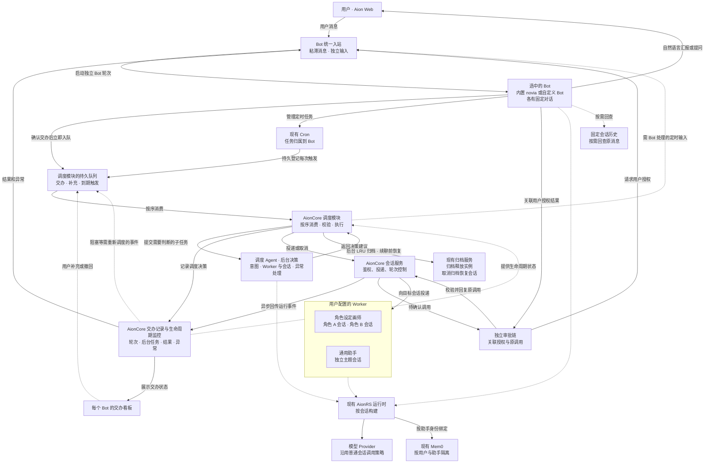

# Aion Bot 与会话调度需求

## 产品目标与首版范围

Aion 的 Bot 是用户的对话和交办入口，按老板与秘书的方式协作：用户一句话交代目标，Bot 在授权范围内组织执行、处理可自行解决的问题，并在完成或确认无法完成时汇报。只有涉及需要用户判断的风险、授权、方向变更或关键缺失信息时，才主动请用户决定。日常使用在 Bot 对话里完成；需要追踪细节或调试时再打开看板。

每个 Bot 有一条固定对话、自己的交办看板，并接入 Mem0 长期记忆。首个 Bot 是固定内置的 `novia`（诺薇娅），用户也可以创建其他 Bot。所有 Bot 使用同一套能力，名称、角色定义、模型和技能等可按 Bot 配置。

首版面向登录后的 Aion Web 用户，Bot、调度 Agent 和 Worker 都使用 AionRS。用户手动创建职能助手和可选的通用兜底助手，为各 Bot 配置可用的 Worker。每次交办由后台调度选择合适的助手和会话。一个 Worker 对应一个已有助手身份，可以有多个独立主题会话。没有可用 Worker 属于交办异常，由调度模块通知原 Bot。

## 首版入口与详情页

- **侧栏入口。** 在侧栏设置与普通对话、Team 同级的 Bot 区域，列出 Bot 并提供「新建 Bot」入口。内置 Bot 固定列在首位，中文界面显示「诺薇娅」，英文界面显示 `novia`。新建 Bot 复用助手编辑器，保存独立的助手定义并绑定内置 Bot 后端。 [现有侧栏](../AionUi/packages/desktop/src/renderer/components/layout/Sider/index.tsx) · [现有助手编辑器](../AionUi/packages/desktop/src/renderer/hooks/assistant/useAssistantEditor.ts)
- **详情页。** 点击 Bot 进入 `/bots/:id`，直接打开它的固定聊天。复用现有会话布局、消息列表和 AionRS 输入框。页头显示 Bot 名称，提供「交办看板」和「压缩上下文」，从页头菜单可查看该 Bot 的定时任务及运行记录。打开看板时在同一详情页切换内容，返回时接着看原消息。交办后的简短确认、需用户决定的事项和结果都回到聊天。用户主动追问时，Bot 可以查看交办记录并汇报进度。
- **固定对话。** 参考 Hermes Bot Mode，点击同一个 Bot 始终回到同一条对话。服务端按登录用户和 Bot 身份首次创建并绑定会话，并发打开时返回同一个会话 ID。打开已有对话时显示最新消息，向上滚动加载旧消息并保持阅读位置。刷新、换设备或重启后继续原会话。 [Hermes Bot Mode](https://hermes-agent.nousresearch.com/docs/user-guide/bot-mode) · [消息列表向上分页](../AionUi/packages/desktop/src/renderer/pages/conversation/Messages/MessageList.tsx)

### 连续会话与上下文压缩

- 原始消息、附件引用和交办记录随每个 Bot 的固定会话保留。AionRS 按现有策略自动压缩模型上下文，旧消息仍可向上翻阅。压缩完成后，下一轮在原会话中使用压缩后的上下文。
- 「压缩上下文」与 `/compact` 走同一个操作。Bot 输入框中的 `/new`、`/clear`、`/reset` 也转到该操作。服务端按固定会话身份处理兼容命令和重置入口，保证操作只压缩上下文。压缩共用会话的轮次控制。当前轮忙时提示完成后再试，压缩结果在原对话中反馈。
- 以原会话身份恢复运行实例。压缩失败时保留原有上下文并反馈。会话保留机制须保有每个 Bot 的恢复状态，旧存档数量清理应避开固定会话的恢复数据。普通会话与 Worker 的归档、删除和新建入口管理各自的会话。 [现有压缩命令](../aionrs/crates/aion-agent/src/commands/compact.rs) · [现有清空命令](../aionrs/crates/aion-agent/src/commands/clear.rs) · [会话重置与历史服务](../AionCore/crates/aionui-conversation/src/service.rs) · [会话存档保留](../aionrs/crates/aion-agent/src/session.rs)

## 架构图

调度创建的 Worker 会话参与 LRU。因 LRU 归档的会话可在续聊时恢复，用户手动归档的会话由用户恢复。

## Bot 后端

在 AionCore 注册一个内置 Bot 后端，所有 Bot 共用。以现有 Aion CLI 对应的内置 AionRS 后端为基础，使用独立的后端 ID 和相同的 AionRS 运行类型，复用引擎构建、普通会话、工具权限和记忆接入。服务端按会话绑定的后端身份启用 Bot 的交办能力，按助手定义区分各 Bot。Worker 使用现有 AionRS 后端。

Bot 后端负责日常聊天、向调度模块提交交办、管理定时任务，以及处理回到固定会话的消息。AionCore 的调度模块负责交办队列、持久受理、后台消费和反馈投递。需要语义判断时，调度模块调用随 AionCore 运行的后台调度 Agent。调度 Agent 复用 AionRS，有独立于 Bot 聊天的执行生命周期。用户通过 Bot 对话和看板使用调度能力。

在「助手 → 对应 Bot → 调度与看板」配置可参与调度的 Worker、通用兜底助手和调度模型。调度模型默认跟随该 Bot，可从已有模型中单独选择。配置按用户与 Bot 保存，由后台调度按交办归属读取。

## 异步交办

Bot 自行处理日常对话和可及时完成的操作。耗时工作或需要专门助手处理的工作由 Bot 提交给调度模块。调度模块在同一次受理中持久保存目标、必要背景、有权使用的附件引用、交办记录及待消费状态，并关联所属用户与 Bot、来源消息或定时触发记录，以及已明确指向的原交办。受理回执可在聊天断线或重启后找回。Bot 收到持久受理结果后简短确认「已接收」并结束当前轮次。入队失败时说明未受理。Worker 的选择、会话准备和实际执行均在后台进行。

Bot 对话中的新交办和后续指令、定时任务发起的交办，以及看板上的补充和撤回，统一由调度模块入队并处理。明确指向已有交办时，将卡片或会话关联作为调度依据。用户可以从看板打开已有 Worker 会话普通直聊。Bot 的交办统一走队列。

调度模块按队列顺序逐项完成路由，必要时调用调度 Agent，保存目标或等待原因后继续消费下一项。需要等待会话、审批、产物或用户答复的交办由代码维护状态，条件变化后再继续。调度结果先保存再投递，Worker 的执行由各自会话异步推进。

交办在受理时落盘，后台先记录调度结果再投递。 [DeepSeek Super-agent 的 Stored work](https://github.com/deepseek-ai/dsh-superagent-prototype/blob/main/docs/003-execution.md#stored-work)

## 调度模块内部分工

调度模块统一管理队列和交办状态，把处理过程拆成可独立调用的子任务。首版由一个调度 Agent 承担需要模型判断的子任务。

| 子任务 | 职责 |
| --- | --- |
| 队列与推进 | 代码负责持久受理、按序认领、记录等待条件、重启恢复和去重。每项交办的进度以调度模块持久保存的记录为准。 |
| 交办决策 | 调度 Agent 识别新目标、补充、替换或撤回，判断是否延续原会话，选择合适的 Worker。 |
| 异常决策 | 代码登记异常并处理已有恢复规则。涉及换人、改方案或请求用户决定时，调度 Agent 根据异常事实和可用选项提出下一步。 |
| 会话执行 | 代码校验目标会话、轮次和权限，按决策执行投递、等待或取消。 |
| 生命周期维护 | 代码定期核对会话与后台任务，按看板状态筛选可安全回收的会话，执行归档和恢复。 |
| 反馈投递 | 代码从交办终态、异常和待决事项生成可追踪的粘滞消息，投递到原 Bot 的统一入站。Bot 负责把消息转成用户能理解的汇报或问题。 |

各类决策子任务使用独立的输入和结果类型。调度模块按交办加载已授权的相关信息，提供原请求、候选会话或异常事实等当前子任务所需的上下文。调度 Agent 返回建议动作和对应目标。调度模块在执行前按最新状态校验目标、权限和轮次，持久记录有效决策，再调用现有会话或归档服务。模型超时或决策失效时，保留该交办的状态供重试，生命周期核对和已产生结果的反馈继续运行。

决策接口按职责由 AionCore 组装。首版各决策子任务可共用一个调度 Agent，后续可把交办决策、异常处置等分别交给不同 Agent。各 Agent 使用对应的输入和决策接口，队列顺序、交办状态写入、实际操作和反馈仍由调度模块统一管理。

## Bot 统一入站与反馈

- **粘滞消息。** 每项交办的终态都由调度模块异步反馈给发起交办的 Bot，包括成功、失败和撤回。所有受管 Worker 的异常也上报 Bot，包括已自动恢复的异常。需要用户决定的问题、审批请求和需要 Bot 处理的定时触发复用同一个入站接口。消息关联稳定的事件 ID、来源、所属用户与 Bot，以及适用的交办、轮次、审批或产物引用。
- **独立输入。** 用户消息与后台事件从同一个 Bot 会话入口进入轮次。服务端先持久保存粘滞消息。Bot 忙时等待，空闲时按序把每条粘滞消息作为一轮独立输入交给同一固定会话，运行方式与收到一条用户输入相同。服务端标记系统来源，用户发来的文本使用用户消息身份。消息在处理结果持久化后确认消费，模型失败、断线或重启后可恢复处理。同一事件的回复和因它触发的交办按来源去重。
- **用户可见回复。** Bot 根据入站消息用自然语言汇报结果、说明异常或请求决策。后台输入的原始结构和内部状态留在交办记录，聊天显示 Bot 的回复及有权限访问的成果。常规进展留在看板供追问。已经自动恢复的异常可随结果汇报，需用户介入的异常单独说明原因和下一步。业务问题的答复由 Bot 关联原交办后重新入队。工具授权的答复走独立审批链。
- **结果与回查。** 交办记录保留产物、原消息和来源会话的引用。Bot 能按用户与 Bot 查询相关交办及实际结果，用户追问时可定位原产物。若异步生图等后台工作影响交付，关联原 Worker 轮次和后台任务 ID，等产物可读取后再结算成功。读取和展示复用产物所属会话的权限校验。

## 独立审批链

1. Worker 的待确认调用由服务端登记审批，关联用户、Bot、交办、Worker 会话、执行轮次和调用 ID，经统一入站通知原 Bot。Bot 在固定对话中用自然语言说明待批准的操作、影响和可选结果。
2. Bot 理解用户回复的语义，并把明确的允许或拒绝与对应的审批记录关联。多项待审、回复含糊或无法确定所指时，Bot 先澄清。用户修改目标或提供材料时，沿交办补充的流程处理。
3. 服务端核对答复消息经认证的用户身份、原审批和活跃调用，记录用户原始答复与处理结果，并复用现有确认服务答复原调用。授权只作用于所确认的操作。审批过期、调用已取消或运行重启后，由 Bot 说明原审批已失效，后续需要授权时重新发起审批。Worker 等待审批期间，Bot 聊天和其他交办继续。

## 调度与会话决策

调度模块结合调度 Agent 的语义判断和服务端状态，依次确定以下事项。

1. **能否续用会话。** 按主题、目标和具体对象判断是否延续已有工作。候选是当前用户下由当前 Bot 调度创建、仍可继续的 Worker 会话。用户在这些会话中的直聊也纳入后续判断。用户手动创建的会话通过直聊入口使用。多个候选会导致实质不同的结果且无法判定时，由当前 Bot 请用户澄清。
2. **交给哪位助手。** 明确延续且原助手仍具备当前 Bot 的调度资格时，回到原助手和原会话。因 LRU 自动归档的会话可先恢复再投递。主题或目标独立时，从当前 Bot 配置的职能助手中选择并新开会话。没有匹配职能时选用已配置且可用的通用助手。没有任何可用 Worker 时，交办以无法自动恢复的异常结算，通过统一入站告知原 Bot，由 Bot 说明原因及需要用户提供的配置。
3. **何时投递。** 服务端根据用户意图的判断结果和当前会话状态执行投递、等待或取消。目标会话空闲时投递，补充参考、约束或细节时按接受顺序等待。明确改换或撤销当前目标时，取消指定运行轮次。轮次进入终态后，有替换指令时在原会话优先执行，仅要求停止时反馈取消结果。已有等待项中，仅撤销被明确替代的项，其余按原顺序保留。取消失败或目标轮次已变化时，重新检查状态并反馈，确保后续动作仍对应正确轮次。

例如，用户请角色设定画师补同一角色的侧视图，调度应回到原角色会话。如果侧视图已经在生成，此时补一张衣领参考图，可以排在当前轮之后。如果用户明确说「停止这版，按新轮廓重画」，则在原会话取消当前轮并优先处理新指令。另一角色或一项独立的商品图工作另开会话。角色画师的不同主题会话也可以并行。

## 交办看板

首版每个 Bot 有独立看板，供需要追踪、介入或调试时查看。一张卡对应一项交办，关联原始请求、负责的 Worker、目标会话和实际轮次。按 Worker 分列，尚未分配的卡片归入「待分派」。卡片显示排队、执行、待处理及终态，用户可打开原会话、补充要求或撤回待执行的交办。同一 Worker 可被多个 Bot 选用，各 Bot 的卡片和续用候选按发起交办的 Bot 区分。

- **生命周期监控。** AionCore 通过代码维护看板状态，覆盖当前 Bot 配置的全部 Worker 及其受管会话，包括可用、待投递、执行、等待审批或后台产物、取消、归档和恢复。投递和运行事件按交办、轮次和后台任务写回，旧轮次的事件不能覆盖后续执行。调度每次投递前核对 Worker 当前资格和目标会话状态。
- **异常上报。** Worker 不可用、会话启动失败、执行中断、状态长期无进展、归档或恢复失败等异常，由代码登记并通过统一入站通知所属 Bot。可自动处理时记录恢复结果，需要调度判断时提交交办队列，需要用户决定时由 Bot 在聊天中说明。对同一异常的重复探测使用同一事件记录。
- **定时核对。** 调度模块的维护子任务定时按真实会话、轮次与后台任务状态校正遗漏事件和重启后的状态，并依据看板状态安排恢复、后续调度和 LRU 清理。已结算的交办保留供用户回看。

现有团队看板服务于同一目标下的成员协作，按团队成员列出消息、任务和依赖。交办看板跟踪由同一入口发出、可以独立完成的多项工作。两者可以复用适用的状态展示组件与事件推送机制，各自使用所属业务的数据来源。后续如有一项交办需要多个角色围绕共同目标协作，可由一张交办卡关联一个 Team，用户从团队看板查看内部任务依赖。 [团队任务归属](../AionCore/crates/aionui-team/src/task_board.rs) · [现有团队看板](../AionUi/packages/desktop/src/renderer/pages/team/activity/TeamActivityView.tsx)

## Bot 定时任务

- **通过对话管理。** 定时任务是首版核心能力。用户可在 Bot 对话中用自然语言创建、查看、修改、暂停、恢复和删除任务。Bot 使用现有 Cron 服务，按当前用户和 Bot 的固定会话核对任务归属并反馈操作结果。创建、修改或查看时展示任务内容、调度时区和下次执行时间。时间或任务指向不明确时在原对话澄清。
- **到期与等待。** AionCore 复用现有 Cron 的定时、触发认领和运行记录。到期先按任务和计划触发时间持久登记，再交调度模块处理。需要 Bot 判断或回复时，通过统一入站在所属 Bot 的固定会话发起短轮次。Bot 会话忙、目标 Worker 会话忙，或同一定时任务上一次仍在执行时，本次触发保留并等待，满足条件后按顺序继续。同一次触发重试或重启后继续使用原记录。Bot 详情页复用现有定时任务列表，按当前固定会话筛选。
- **结果归属。** 普通定时回复在所属 Bot 的聊天与运行记录中查看。需要 Worker 执行时经同一交办队列进入该 Bot 的看板。Cron 运行记录关联交办并区分等待、已交办和实际完成。交办结果或异常通过统一入站回到原 Bot。看板的状态核对使用自己的触发条件。

## Bot 长期记忆与会话回查

- **Mem0 长期记忆。** 内置和自建 Bot 都接入现有 Mem0 工具与开关，按用户和助手定义使用各自分区，沿用现有读写权限及删除确认。定时轮次按已授权的 Bot 任务进入原固定会话，按执行时的 Bot 权限和开关使用该分区。Worker 会话继续使用该 Worker 自己的记忆分区。
- **轻量回查与兜底。** 当前上下文已足够时直接使用。用户问旧原话、精确参数等可定位的细节时，可以直接回查固定会话。长期偏好、事实或约定优先查 Mem0，关闭、不可用或返回内容不足时，再查固定会话的原始消息。回查只读当前 Bot 的可见消息，返回有限摘录和可定位的原消息引用，供当前轮使用。两处都找不到时请用户补充。

## 会话顺序与恢复

- **会话顺序。** 同一会话的直聊与交办使用同一轮次生命周期，一次最多执行一轮。不同会话可以并行，即使属于同一 Worker。同一目标会话内等待投递的交办按受理顺序推进，明确替换当前轮次时沿用已定义的取消与优先投递规则。
- **认领与结果。** 交办记录区分已受理、调度结果、执行轮次和交付结果。目标会话开始执行前关联原交办和轮次，供重启时核对。重复处理时复用已记录的调度决定、执行关联与反馈事件。交付结果和待反馈状态一起持久化，影响交付的后台工作结束后再结算。
- **重启恢复。** 未调度的继续调度，已分派但未执行的按目标会话顺序继续投递，已结算的补齐待消费的反馈消息。开始执行后被重启打断的交办标记为中断，工具副作用或交付结果不明时先核对，仍无法确认时由 Bot 请用户决定是否重试。目标会话失效或投递最终失败时，通过统一入站反馈异常。
- **LRU 归档。** 调度模块的维护子任务根据看板上的实际活动与会话状态，在后台统一安排 LRU 清理。需要清理时，优先选择最久未活动且可安全恢复的调度会话，复用现有归档流程。归档前由代码核对最新状态，跳过正在执行、等待投递或审批、结果仍不确定、消息未落盘或无法恢复的会话。暂无符合条件的会话时，留待后续清理。会话 ID、历史、进度、参考资料和成果引用随会话保留。
- **恢复归档会话。** 因 LRU 归档的会话再次被调度命中，或收到用户的直聊续接请求时，先走现有取消归档流程，再按原会话 ID 构建运行实例并继续。用户手动归档的会话由用户从归档列表恢复。自动归档时记录触发来源，归档和恢复使用原会话的生命周期控制，处理与新消息或并发恢复的竞争。若归档已写入但实例尚未释放，待释放完成后才计入清理结果。恢复失败时由代码上报原 Bot，并保留可恢复的会话数据。

自建 Bot 停用或删除时，已受理交办、定时触发和待反馈消息的去向待定。Worker 的当前调度资格由看板状态反映，并在每次投递前检查。

## 模型与 Provider

Bot、调度 Agent 和 Worker 的模型调用沿用普通 AionRS 会话的模型与 Provider 配置、请求、流式响应、错误和重试策略。本需求的调度范围是交办投递与会话轮次，模型通信和请求调度使用现有路径。

## 现有能力与实现缺口

- **助手与会话。** 现有会话保存助手定义和有效配置快照。普通会话的创建和发消息路径已有归属校验、消息落盘、轮次占用和取消入口。调度沿用这些入口，在交办路径补足候选会话来源、主题匹配和结果关联。AionUi 复用现有会话视图呈现 Worker 直聊。 [会话路由](../AionCore/crates/aionui-conversation/src/routes.rs) · [会话服务](../AionCore/crates/aionui-conversation/src/service.rs) · [助手快照](../AionCore/crates/aionui-db/src/models/conversation.rs) · [AionRS 发送框](../AionUi/packages/desktop/src/renderer/pages/conversation/platforms/aionrs/AionrsSendBox.tsx)
- **Bot 后端。** AionCore 现有后端绑定可解析注册身份、后端和 Agent 类型。Web 内置 AionRS 和 Aion CLI 使用同一个 `AgentBootstrap` 初始化引擎。新增共用的 Bot 后端注册身份和调度能力注入，复用助手定义、AionRS 工厂、宿主工具注册及现有会话配置。 [后端绑定](../AionCore/crates/aionui-db/src/agent_binding.rs) · [AionCore 构建入口](../AionCore/crates/aionui-ai-agent/src/factory/mod.rs) · [Web AionRS 初始化](../AionCore/crates/aionui-ai-agent/src/manager/aionrs/agent.rs) · [Aion CLI 初始化](../aionrs/crates/aion-cli/src/bootstrap.rs) · [宿主工具注册](../aionrs/crates/aion-agent/src/bootstrap.rs)
- **交办队列与跨会话投递。** 现有跨会话投递需要已知目标，目标忙时可能进入内存队列，普通停止会清除目标会话的等待投递。由 AionCore 调度模块补充目标未选定前的持久受理、重启恢复、按交办去重，以及指定等待项的撤销。认领与恢复参考现有 Cron 实现，投递复用会话归属校验和轮次控制。 [投递服务](../AionCore/crates/aionui-session-message/src/service.rs) · [现有队列](../AionCore/crates/aionui-session-message/src/queue.rs) · [停止回调](../AionCore/crates/aionui-session-message/src/hook.rs) · [Cron 认领](../AionCore/crates/aionui-cron/src/service.rs)
- **调度模块的组装。** 决策接口由调度模块定义，AionCore 应用层注入 AionRS 决策实现与现有服务。会话与归档各自继续管理所属生命周期。现有归档通过应用层注入运行实例清理能力，可沿用同样的跨模块接入方式。 [归档接口](../AionCore/crates/aionui-sidebar/src/ports.rs) · [归档服务组装](../AionCore/crates/aionui-app/src/router/state.rs)
- **统一入站与审批。** 复用会话服务的后台轮次和确认入口。现有后台轮次在启动时生成轮次 ID，确认服务通过目标会话和调用 ID 答复活跃调用。Bot 路径补充粘滞消息、轮次与交办关联、可恢复的用户可见回复，以及从 Bot 对话关联授权到原 Worker 调用的审批记录。 [后台轮次与确认](../AionCore/crates/aionui-conversation/src/service.rs) · [工具审批管理](../aionrs/crates/aion-protocol/src/approval.rs)
- **看板同步与后台产物。** 复用 AionCore 的事件推送和定时触发。看板以持久状态为依据，重启后按关联轮次及后台任务核对。异步生图已持久保存任务结果，并向原会话推送产物状态。交办链复用其任务状态和读取接口，补充与 Bot 交办和反馈的关联。 [任务变更事件](../AionCore/crates/aionui-team/src/events.rs) · [异步生图任务](../AionCore/crates/aionui-conversation/src/image_jobs.rs)
- **Bot 与 Cron 的绑定。** 现有 Cron 已支持按会话创建、查询、修改和执行任务。会话助手入口需补上 Bot 任务的暂停、恢复和删除。多个任务通过 Cron 任务记录指向同一个 Bot 固定会话。普通 Cron 可写入单个 `cron_job_id`、在目标会话缺失时建立替代会话，或在忙时跳过触发。Bot 路径通过任务记录保持固定会话归属，补充持久等待和恢复投递。 [Cron 管理与触发](../AionCore/crates/aionui-cron/src/service.rs) · [Cron 会话绑定与执行](../AionCore/crates/aionui-cron/src/executor.rs)
- **记忆授权。** 现有会话服务为已登录用户的可见轮次构造 Mem0 绑定，绑定校验普通 AionRS 后端身份并排除带 Cron 标记的会话。Bot 固定会话以及经授权的 Bot 定时轮次需走明确的 Bot 资格判断，复用现有分区、开关与工具权限。交办到 Worker 时按目标助手的授权接入 Mem0。 [会话服务](../AionCore/crates/aionui-conversation/src/service.rs) · [Mem0 绑定](../AionCore/crates/aionui-ai-agent/src/mem0_config.rs)
- **固定会话回查。** 现有消息搜索按用户查询，历史读取支持按消息定位。Bot 的回查能力复用消息存储，在检索入口按当前用户与固定会话限域，并返回对应原消息引用。 [消息搜索与历史定位](../AionCore/crates/aionui-conversation/src/service.rs) · [消息查询](../AionCore/crates/aionui-db/src/repository/sqlite_conversation.rs)
- **归档和恢复。** 现有归档服务把会话移入归档列表、取消置顶，并调用运行实例停止流程。取消归档使会话回到活跃列表，AionRS 能按会话 ID 载入存档。LRU 复用这套流程，补充 Worker 会话选择、可恢复性检查和归档触发来源。AionRS 另有按数量清理旧存档的逻辑，仍可调度的会话需保有可用于恢复的上下文。 [会话归档服务](../AionCore/crates/aionui-sidebar/src/service.rs) · [归档的实例清理](../AionCore/crates/aionui-app/src/router/state.rs) · [AionRS 会话载入](../AionCore/crates/aionui-ai-agent/src/factory/aionrs.rs) · [会话存档保留](../aionrs/crates/aion-agent/src/session.rs)

调度、归档和恢复在关键状态变化时记录关联 ID、原因、状态和耗时。日志省略请求正文、记忆内容、附件和凭据。

## 验收场景

| 场景 | 预期结果 |
| --- | --- |
| Bot 入口和固定会话 | Bot 区域与普通对话、Team 同级，首位为内置 novia。创建第二个 Bot 后，两者可独立配置并从各自入口打开。并发首次打开、刷新和重启均复用该 Bot 的固定会话，向上滚动可查看旧消息。 |
| 连续会话压缩 | 页头操作、`/compact`、`/new`、`/clear` 和 `/reset` 都压缩同一会话的模型上下文，历史、附件和交办引用仍可查看。忙时提示等待，压缩失败可重试。运行实例重建后可继续原会话。 |
| 聊天交办与快速交接 | 内置和自建 Bot 都能用一句话接收交办。后台调度暂停或 Worker 长时间执行时，Bot 在成功入队后仍能确认并继续聊天。持久受理后断线可找回回执，入队失败则告知未受理。 |
| 粘滞消息与自然语言汇报 | 成功、失败和撤回均产生异步反馈，所有 Worker 异常进入所属 Bot 的统一入站。Bot 忙时保留消息，空闲后以独立轮次处理，聊天展示自然语言和授权成果。业务决策答复关联原交办并重新入队。 |
| 独立审批 | Bot 在原对话说明待授权操作。明确答复只作用于对应的活跃调用，多个候选或含糊答复时先澄清。重复答复、调用取消或重启后，旧授权不会应用到新的调用。 |
| 续用、新建和澄清 | 连续提交同一角色的正面和侧面时，调度逐项决定，后一个请求能续用前一个已经确定的会话。独立目标开新会话。用户手动创建的 Worker 会话用于直聊。难以区分候选时询问用户。 |
| 忙时补充、取消和并发 | 补充按序等待。改变方向只取消指定轮次和被替代的等待项。同会话直聊和交办串行，同助手不同会话可并行。等待一个 Worker 或审批期间，调度模块继续消费其他交办。 |
| 决策与维护隔离 | 调度模型暂时不可用时，已运行会话的状态核对和终态反馈继续，需决策的交办保留以便重试。可分别替换交办决策和异常处置的实现，二者仍使用同一队列、交办记录和执行校验。 |
| 重复投递和服务重启 | 在受理、记录分派、写入终态和 Bot 汇报各阶段分别重启，恢复时保留交办和粘滞消息，重复消费复用已有记录。副作用无法确认时等待核对。 |
| 异步产物与后续追问 | Worker 提交异步生图后可结束轮次，交办在图片可读后才结算。Bot 在原对话汇报并提供可访问的图片，用户追问时能定位原任务和产物。 |
| 多项交办的看板监控 | 一个 Bot 的独立交办分卡展示，其中一项等待材料时其余照常推进。用户可按 Worker 筛选、打开原会话或撤回排队。两个 Bot 选用同一 Worker 时，各自的看板、续用候选和结果回传仍按发起 Bot 区分。 |
| 统一调度与异常监控 | 对话和看板上的后续指令都经队列决策。旧轮次事件不覆盖当前状态，定时检查按会话与后台任务补齐遗漏。Worker 被移除后不再接该 Bot 的新交办。没有可用 Worker 时登记无法自动恢复的异常，Bot 向用户说明原因。 |
| Bot 定时任务管理与执行 | 从 Bot 聊天创建、修改、暂停、恢复和删除定时任务。到期先持久登记，Bot 或 Worker 会话忙、同一定时任务上次尚未完成时继续等待。条件满足后推进，重启后同一次触发只处理一次。交办结果回原聊天。 |
| Bot Mem0 和权限 | 内置和自建 Bot 可在各自分区按现有权限使用 Mem0。一个 Bot 创建多个任务后，直聊和已授权的定时轮次仍按同一个记忆开关访问各自分区。其他 Bot、Worker 和用户的数据按各自权限隔离。 |
| 固定会话回查 | 压缩后能从原消息找回精确参数。直接回查以及 Mem0 关闭、不可用或结果不足时的兜底均可用，结果只来自当前 Bot 的固定会话并能定位原消息。 |
| 模型调用兼容 | Bot、调度 Agent 和 Worker 使用普通会话的模型与 Provider 选择、流式响应、错误和重试行为。 |
| LRU 归档与恢复 | 后台维护子任务根据看板状态清理最久未活动且可恢复的 Worker 会话。活跃或待执行会话继续保留。新交办或直聊续接自动归档的原会话，手动归档由用户恢复。覆盖归档与新消息竞争、并发恢复、超过旧存档保留数量时的上下文恢复，以及恢复失败的异常上报。 |
