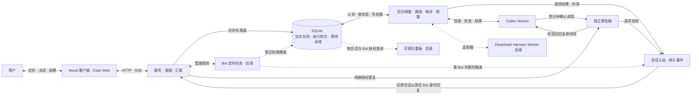

# 诺薇娅 Bot 与会话调度需求

## 产品目标与职责

诺薇娅（Novia）是用户的聊天和交办入口。用户一句话交代目标，Bot 在授权范围内组织执行，完成后在原对话汇报。需要用户判断风险、授权、改变方向或补充关键信息时，Bot 主动询问。日常工作在聊天里完成，看板用于追踪、介入和调试。

诺薇娅主应用负责两件事。**聊天**负责理解意图、保持连续会话和自然语言回复。**交办与汇报**负责持久受理、后台派发、跟踪、审批关联和结果回传。写代码、执行命令、运行工具和管理执行上下文由专业 Worker 负责。Codex、DeepSeek Harness 都可以作为独立执行端。诺薇娅通过适配器连接它们，各执行端沿用自己的模型、工具、权限和原生会话。

诺薇娅作为独立项目维护自己的前端、后端、数据和协议。首个 Worker 使用 Codex，DeepSeek Harness 作为后续 Worker 接入。Aion 提供现有使用场景和回归用例参考。已独立部署的服务按各自协议接入。Novia 自身的推理回传规则由后端模型适配层处理。

## 产品范围与交付顺序

**首版以真实 Codex 的最小可用闭环为交付目标。** 用户从一条持续私聊交办，Bot 快速确认已落盘，后台派给配置好的 Codex。执行中用户可以继续聊天、查看状态、回应必要审批或停止指定任务。Codex 完成、失败或状态不明时，结果回到原对话，客户端断线或服务重启后仍能查到。首个开发批次从后端连续对话开始，首版发布以 03F 联验为准。

- **一个 Bot 对应一条持续私聊。** Bot 是人设入口，内置 `novia`（诺薇娅）固定在首位。后续用户可创建不同人设，分别设置名称、角色、聊天模型和授权范围。服务端按用户与 Bot 唯一绑定私聊，并发首次打开也返回同一会话 ID。切换 Bot 时进入对应私聊，切回前台、换设备和重启后继续原会话。后续群聊是单独的共享会话，由用户邀请多个 Bot 加入。Codex 执行线程留在 Worker 侧，按任务需要新开或续接。
- **上下文管理。** 原始消息、附件和交办引用完整保留。首个闭环从最近消息构造聊天上下文。页头压缩入口和 `/new`、`/clear`、`/reset`、`/compact` 统一压缩原会话，保存摘要与覆盖边界，之后使用摘要与最近消息。压缩与聊天共用轮次控制，忙时提示稍后重试；失败保留原上下文并在原对话反馈。
- **交办与结果。** 用户通过聊天交办、补充、追问、撤回或审批。Bot 确认已受理后继续聊天。任务完成、失败或无法自动恢复时，在原对话给出自然语言反馈与可访问的成果。用户只在追问或调试时查看交办详情。
- **后续交付。** 定时任务与 Mem0 仍是产品需求，放在首版手动交办闭环之后。自建 Bot、群聊、可视化看板、更多 Worker 与原生通知也分别验收。首版保留可回放的消息和交办数据，后续功能从相同入口和状态接入。

## 首版对话与汇报质量

用户在同一条私聊里可以闲聊、讨论方案、请 Bot 查证或执行，再回来追问结果。各 Bot 的称呼、语气和表达方式由各自角色定义决定。它们共用同一套交互行为：接住话题、延续前文约束、判断是否交办、跟踪任务并汇报结果。角色扮演与真实世界信息分别表达，涉及实际查询、操作和结果的说法以可核对证据为准。

| 用户意图 | Bot 应有的表现 |
| --- | --- |
| 闲聊、问方案、表达看法 | 直接接话或回答。用户在讨论部署、比较方案或说「我觉得可以」时，结合前文判断是在交流还是在明确委托。 |
| 请求查证或执行 | 区分一般解释、需要外部证据的查证和有副作用的操作。可直接解释的先回答。需要检查实时资料、机器或文件时，按已配置的能力和权限交办，回报注明实际证据及适用范围。缺少能力时说明可确认的部分和需要补的证据。 |
| 补充、追问、同意、重试、停止 | 结合当前会话的相关消息、任务状态和有效审批，判断指代的是方案、交办还是某项操作。例如「重试」关联原交办，「我已重启」先理解为用户报告的状态，「允许执行」只有指向有效的具体审批时才能提交授权。目标或权限有实质歧义时，问一个能消除歧义的问题。 |
| 一条消息包含聊天与交办 | 自然回应聊天部分，并按持久受理结果说明交办状态。单次答复可以同时包含回应与交办，普通聊天部分无需创建任务。 |

首版上下文由最近对话和当前话题明确引用的记录组成。服务端按同一会话权限补取原请求、关联结果及未完成交办或有效审批。Bot 解释用户指代，服务端校验引用和当前状态。一般的长历史搜索与长期记忆按 06A–06C 交付。

对于后台工作，受理后简短说明接下来的动作。执行中有实质新进展、遇到阻碍、需要用户决定，或用户主动追问时，按已记录的状态给更新。最后由责任 Bot 汇报实际结论、核对依据、仍未解决的事项和可用的产物。遇到失败或部分完成，具体交代已做到哪一步以及用户可以怎么继续。受理、执行中、等待和终态分别由对应状态支撑。Worker 转述可以压缩日志并解释含义，引用的文件、命令结果、来源或验证范围都应能追溯到这次执行。

## 首版界面与后续跨端布局

- **首版基本操作。** 先交付可持续聊天的 Expo Web 页面，以桌面浏览器和手机视口模拟验收。页面能发送、查看历史、显示受理与结果、回应审批和停止任务。重连后补读已落盘的反馈。固定插画、深紫配色和完整双抽屉按 01E 单独验收。插画延伸到屏幕底部，聊天控件之间露出背景，卡片用局部半透明面板保证文字可读。原生键盘与安全区留在原生构建验收。 [移动端参考图](novia/mobile-reference.jpg)
- **左抽屉是业务与状态，右抽屉是系统与设置。** 左侧随功能交付开放 Bot 列表、对话记录、交办记录和定时任务，右侧放已实现的设置。常态收起抽屉，保留完整聊天视野。交办结果和待审批事项优先以消息或卡片进入原对话，点击卡片可以查看结果或原操作。可视化看板后续从左抽屉进入。
- **PC 端沿用移动端的视觉和导航。** 优先从同一 Expo 工程验证桌面浏览器版。中间保留沉浸聊天，两侧可收起。宽屏下左侧可停靠业务导航，右侧按需打开设置或当前交办详情。初版详情只放状态、执行者和结果，后续可以扩展进度、执行记录和产物列表。较窄时恢复抽屉。 [PC 端设计图](novia/desktop-concept.png)

### 背景与主题的扩展边界

背景素材、界面主题和对话内容分开管理。移动端与 PC 共用主题语义色，包括文字、面板、边框、主操作和各类状态色。背景单独记录素材引用及构图焦点，客户端按窗口比例裁切。对比度由各控件自身的面板底色和透明度控制，面板外完整露出插画。图片加载失败时回退到默认背景色，弱化透明效果时仍保有可读面板。

后续动态生图作为异步任务产生新背景素材，完成后经同一素材入口加载。自动取色从图片生成候选配色，再检查文字和操作控件对比度，保留默认主题作为回退。更换背景或主题只更新外观配置，原对话、任务与导航状态可继续使用。生图和取色均排在首期之后。

## 首版技术选型

| 部分 | 建议选型 | 落地边界 |
| --- | --- | --- |
| 运行方式 | **Node.js 24 LTS + TypeScript + pnpm** | 一个应用工程和一个 Novia 服务进程。服务端和客户端共用语言与数据类型，执行端由适配器独立启动和管理。 |
| 客户端 | **Expo + React Native + TypeScript** | 首版用同一工程的 Web 导出验证聊天、派活和回传。浏览器模拟手机宽度和网络切换，桌面宽屏验证导航与详情布局。原生通知独立验收。 [Expo Web 发布](https://docs.expo.dev/guides/publishing-websites/) |
| 服务端 | **Fastify + HTTP JSON + SSE** | HTTP 异步受理输入，服务端独立完成生成。SSE 提供会话快照、增量和终态。浏览器重连时通过持久游标补读已落盘事件，再从快照接续当前回复。聊天、调度和 Worker 对接在同一进程内按模块组织。 [Fastify TypeScript 文档](https://fastify.dev/docs/latest/Reference/TypeScript/) |
| 持久化 | **SQLite + `node:sqlite`** | 用短事务保存聊天、交办、审批、定时触发和待反馈事件。交办表兼作持久队列，同一事务提交终态与待反馈。固定并验证 Node 24 版本，`node:sqlite` 在该版本线处于发布候选阶段。 [Node 24 SQLite 文档](https://nodejs.org/download/release/latest-v24.x/docs/api/sqlite.html) · [SQLite 事务隔离](https://www.sqlite.org/isolation.html) |
| 聊天模型 | **Vercel AI SDK Core + Novia 薄封装** | 先接一个可配置的模型端点，支持连续对话，再接 Bot 业务工具和结果转述。交办通过聊天中的工具调用提出，由服务端校验参数与权限。首版单 Worker 可按配置派发。 |
| 首个 Worker | **本机 `codex app-server`，经 stdio JSON-RPC** | 沿用 Codex 原生配置和登录。保存 thread ID 和 turn ID，按原线程续接、订阅终态并回答对应审批请求。固定验收通过的 CLI 版本。 [OpenAI Docs 的 Codex App Server](https://learn.chatgpt.com/docs/app-server) |

首版部署目标是单机和单用户。服务端运行依赖为 Node.js、内置 SQLite 和已安装的 Codex。手机只访问 Novia API，服务端完成身份校验和授权。Codex 的启动参数、凭据、允许的工作目录、沙箱和审批策略由部署配置提供。Bot 选择已授权的配置，模型文本不能授予新的工作目录或权限。后台服务提供独立启动、停止、重启、状态与健康检查。

### Chat Completions 推理回传

- Novia 自身使用 OpenAI 兼容 Chat Completions 时，同一个用户轮次内，模型调用工具并收到工具结果后，续跑请求保留本轮产生的推理及工具记录。推理字段按供应商协议映射，通常为 `reasoning_content`，网关使用 `reason_content` 时适用同一规则。
- 收到下一条普通用户消息时，发给模型的新请求过滤全部历史推理，包括之前工具轮的推理。正文、工具调用 ID、参数和工具结果按原顺序保留。如果新轮后来调用工具，续跑只回传新轮自身的推理。过滤作用于发送给模型的请求副本，保留原始会话记录。
- 该规则在 Novia 后端的模型适配层执行。其他模型协议和外部 Worker 沿用各自的回传策略。网关拒绝时按现有错误路径反馈。

### Expo 源码与发布边界

- 手机和 PC 共用一套 Expo 工程、聊天页面、主题和 API 客户端。布局用 `useWindowDimensions` 在运行时响应窗口宽度，切换抽屉或停靠面板时保留当前对话与输入。确有平台差异的推送、凭据存储等能力通过独立的平台模块接入。 [React Native 窗口尺寸](https://reactnative.dev/docs/useWindowDimensions) · [Expo 平台模块](https://docs.expo.dev/router/advanced/platform-specific-modules/)
- 开发时安装一次包含所需原生模块的开发构建，聊天布局和样式用开发服务器迭代。发布时分别构建 iOS、Android 和 Web 产物。兼容现有原生运行时的界面代码与资源可在配置 Expo Update 后单独发布，新增原生模块或修改原生配置时重新构建 App。背景素材和主题配置后续可由服务端提供，客户端运行时加载。 [Expo 开发流程](https://docs.expo.dev/get-started/start-developing/) · [Expo Update 运行时版本](https://docs.expo.dev/eas-update/runtime-versions/)

### 原生客户端与通知

- 客户端在前台用 `expo/fetch` 订阅 SSE。受理后的异步轮次在浏览器断开时继续生成。切回前台或重连时，按持久游标补读事件，再用快照接回在途文本和实时增量。服务进程退出时，未完成轮次保留原话并标为中断，由用户明确重试。Web 使用 Better Auth 的预置账号与 HttpOnly Cookie。原生阶段通过 HTTPS 调用同一 API，凭据保存在 `expo-secure-store`。接入 GitHub OAuth 时由已有用户显式绑定，沿用原用户 ID 和会话。 [Expo 流式 Fetch](https://docs.expo.dev/versions/latest/sdk/expo/#expofetch-api) · [Expo SecureStore](https://docs.expo.dev/versions/latest/sdk/securestore/)
- 交办结果和待审批问题先写入原对话，再用 `expo-notifications` 提醒手机用户。通知使用简短提示和消息标识，点击后打开原对话并从服务端读取详情。手机锁屏、App 退出或通知权限关闭期间，交办和定时仍由服务端执行，打开 App 后可补读结果。 [Expo 推送配置](https://docs.expo.dev/push-notifications/push-notifications-setup/)
- 第一个闭环用 Expo Web 连到实际服务。07 在具备设备时用原生开发构建验证锁屏收通知、点击通知回到原对话、拒绝通知权限后回前台补读。远程推送使用目标平台的推送凭据。 [Expo 开发构建 FAQ](https://docs.expo.dev/develop/development-builds/faq/#remote-push-notifications)

## 架构图

## Bot、私聊与群聊的数据边界

Bot 保存人设和能力配置，会话保存可见历史和输入顺序。私聊与群聊使用同一会话 ID、消息契约和 SSE 机制。首版只创建内置 Bot 的私聊，先确定以下主键、关联和权限边界。群成员管理、@ 解析和群聊入口随 09F 交付。

| 记录 | 关系与约束 |
| --- | --- |
| Bot | 有独立 `bot_id`、所有者和人设配置。私聊绑定约束为每个 `(user_id, bot_id)` 唯一，并发创建时复用已有记录。 |
| 会话与参与者 | 会话有独立 `conversation_id`、所有者与类型 `direct` 或 `group`。群聊通过成员关系关联有权限的人和 Bot，同一个 Bot 可以参加不同群。成员权限由服务端校验。首轮群聊按一个用户与多个 Bot 验收。 |
| 消息 | 保存所属会话、稳定消息 ID、会话内顺序、明确的作者身份及同会话回复引用。作者类型区分用户、Bot 与系统。群聊可增加经过校验的 @ 对象。历史、草稿与 SSE 游标按会话处理。 |
| Bot 轮次 | 保存目标会话、应答 Bot、触发消息或可信后台事件。触发与应答 Bot 的关联可去重，运行时读取本会话授权的历史。群聊上下文和摘要按群保存，私聊历史和私有 Mem0 留在私聊权限范围内。 |
| 交办与回传 | 区分提出任务的用户、负责的 Bot、来源会话与来源消息或定时触发，受理时确定回传会话。Worker 执行记录另存。结果、审批与异常沿已保存的会话和 Bot 路由，发布前再次检查权限。 |

群聊初版以用户显式 @ 一位 Bot 为触发。被点名的 Bot 以自己的身份在群中回复，并可用同一交办入口派给 Codex。Bot 的发言与任务反馈只追加群消息，自动触发由受控入口决定，避免群成员相互唤起。群内补充、停止和审批关联具体交办，校验请求人及相应授权。原群权限发生变化时先保留待处理记录，避免把群内容自动发往私聊或其他群。多人授权、一次 @ 多位 Bot 与主动协作的规则后续另定。

## 异步交办与 Worker 对接

1. **受理。** Bot 在当前对话中判断是否需要交办。有独立工作时调用交办工具，每次提交一项，立即拿到受理回执或可处理的错误。模型可在同一个用户轮次内根据工具结果继续提交下一项，然后向用户汇报本轮的受理情况。普通聊天可直接回复。服务端校验目标、来源、工作目录授权及续作引用。每项独立提交，部分失败按项说明，已入队的事项照常推进。
2. **派发。** 调度模块按序作出路由决策，先记录决定，再异步投递。需要等待某个线程或外部结果时，记录等待条件并继续处理其他交办。调度依序消费与 Worker 在不同线程执行是两个阶段；同一线程一次只执行一轮。用户通过 Bot 交办，后续看板的补充和撤回也经过同一队列。
3. **执行。** 适配器提供启动或续接、读取运行状态、处理原调用审批和取消等实际支持的能力。Novia 保存交办 ID 与执行端的线程、轮次和请求标识。执行端事件只更新对应的执行记录。新增第二种 Worker 时，按两个执行端的实际差异确定共享接口。
4. **结算。** 成功、失败、撤回及需处理的异常都进入来源会话的统一入站，由负责的 Bot 汇报。每项任务独立结算，先完成的先汇报。首版至少返回实际执行摘要及配置工作目录内有用的相对路径，适用时包含验证结果或失败原因。聊天中的状态以持久执行记录为准。涉及外部异步产物时，等产物可交付后再结算成功。

### 交办工具与初始任务包

每次调用提交一份可独立理解的任务包。Bot 摘出完成这一项任务所需的上下文，服务端受理时保存快照，供后台调度和 Worker 使用。

| 信息 | 首版内容 |
| --- | --- |
| 目标与交付 | 要做什么、预期交付物、需要遵守的条件。例如「先检查备份，只有失败才重试」。 |
| 用户原话 | 摘抄和本项任务直接相关的原输入，保留具体要求、约束和专有名词。原话与 Bot 的整理分开保存。服务端按来源消息校验摘录及权限。 |
| 必要背景与引用 | 提取当前对话中会改变执行方式的背景。已有相关且授权可用的记忆、附件、原交办或产物可以随包引用，注明来源。首版从已加载上下文取用，自动检索和长历史补全随记忆功能迭代。 |
| 归属与授权 | 请求用户、责任 Bot、来源与回传会话、来源消息或定时触发、单项标识和已授权的工作目录由服务端绑定。原话、背景和记忆作为任务材料，权限与审批仍由服务端判断。 |

客户端重试复用原消息 ID。服务端为每项已接收的工具调用分配稳定标识，将交办和受理回执一并持久化。调用重放复用原回执，模型续跑中断时从已保存的调用和工具结果恢复。参数不完整或权限校验失败时，工具返回明确错误，Bot 可补齐信息或请用户澄清。工具返回交办 ID 和当前受理状态，Worker 的实际执行及结果走后台。工具续跑设有次数上限，达到上限时按已经拿到的回执回复。

### 交办看板数据

看板首先是 SQLite 中供调度和恢复读取的业务状态，从 **02A 持久受理、02B 模拟派发** 开始建设。一项交办对应一张卡。同一来源拆出的任务有独立的状态与结果，可按来源一起查询。交办记录同时作为持久队列；Bot 查进度、后台核对和后续可视化看板读取同一套记录。

| 记录 | 调度与恢复所需信息 |
| --- | --- |
| 交办 | 交办 ID、请求用户、责任 Bot、来源与回传会话、来源消息或定时触发、去重标识、受理顺序、初始任务包、当前状态及等待条件、已选 Worker 与线程、结果引用。 |
| 执行记录 | 交办 ID、Novia 执行 ID、Worker 与线程、执行端轮次和请求 ID（取得后保存）、实际状态、时间、错误与结果。一次交办可有多次执行记录，只有当前关联的执行能推进交办状态。 |
| Worker 与受管线程 | Worker 的配置与调度资格、适配器报告的可用性、线程归属、最后活动时间和恢复引用；由当前认领与执行端状态核对线程是否占用。每次投递前核对资格、线程状态和可用额度。 |
| 关联事项 | 审批、用户答复、定时触发、异步产物、异常和待反馈事件保留稳定引用，由各自模块保存明细，交办通过引用得知在等什么或如何恢复。 |

最低状态包括**待分配、待执行、执行中、等待、待核对、已完成、失败、已取消**。等待记录具体条件，例如目标线程忙、待审批、待材料、待产物；只有条件解除后才推进。审批期间若原轮仍运行，则继续占用原线程；已结束轮次仅等待外部产物时，按真实线程状态判断是否可接下一轮。目标忙按同线程受理顺序等待；没有合格 Worker 与 Worker 暂忙分别处理。认领和建立 Novia 执行记录在短事务中完成，外部投递在事务外执行。已发送但未确认的请求先核对原执行，再决定是否恢复，避免重复副作用。

可视化看板先校验来源会话权限，再按会话或责任 Bot 筛选，按 Worker 分列，未分配的任务单列。一张卡展示进度、等待原因、当前执行和结果，可定位原请求及有权限访问的成果。需要时可从卡片补充或撤回，动作仍进入统一交办入口。是否开放 Worker 原生会话跳转与直聊，按执行端能力单独决定。Novia 的交办默认独立推进和结算。

### 调度分工与路由

| 子任务 | 归属与职责 |
| --- | --- |
| 队列与推进 | 代码负责持久受理、按序认领、等待条件、去重和恢复。 |
| 交办决策 | 读取原请求和有权续用的候选，区分新目标、补充、替换和撤回，建议 Worker 与线程。首个 Codex 闭环使用配置和明确关联做路由；需要更复杂语义时接入独立的后台决策实现。 |
| 执行控制 | 代码校验权限、Worker 资格、目标线程和当前轮次，再保存决定并投递或取消。 |
| 生命周期维护 | 代码周期性核对受管 Worker、线程、轮次和后台任务，补齐遗漏事件，执行已定义的恢复规则。 |
| 异常决策 | 代码先记录事实，涉及换 Worker、改变执行方案或请求用户决策时，由独立决策接口提出建议。 |
| 反馈投递 | 代码把结算、异常和待决事项写入 Bot 统一入站，Bot 负责自然语言汇报。 |

交办决策与异常决策分别定义输入和输出，可共用同一个后台模型，也可逐步分到不同 Agent。后台决策在调度模块内运行，拥有独立于 Bot 聊天的执行生命周期，无需独立聊天入口。后续在 Bot 的「调度与看板」设置中管理候选 Worker、通用兜底及调度模型，模型默认跟随 Bot，可单独覆盖。决策超时或建议失效时，该项保留可恢复状态；代码维护、已完成的反馈和其他不受影响的交办继续运行。

首版独立任务新开 Codex 线程，明确引用原交办的续作沿用原线程。复用时核对来源会话、责任 Bot 和工作目录授权，并验证启动与恢复采用相同权限策略。前一项已保存的路由可供后一项续接，目标线程忙时记录等待。原线程失效时回原会话说明并请用户决定是否新开。后续再支持按主题选择合适的职能 Worker 或已配置的通用 Worker，候选不明时由 Bot 澄清。没有可用 Worker 且无法自动恢复时，登记异常并回来源会话。首版支持撤回排队项和停止指定执行。后续的自动替换先核对和停止指定轮次，确认终止后才优先派发替换项，其他等待项保留。

### 生命周期核对与统一反馈

- **恢复与核对。** 重启后继续待分配、待执行和未汇报的任务。断连或重启时先按已知线程与轮次核对。已发送但未收到确认、拿不到可验证的执行结果且可能有副作用时，标记待核对并提示用户，保留原执行记录，等待明确处理。迟到事件只更新对应记录，不能覆盖新轮次。后续巡检再覆盖长期无进展及不同执行端的后台任务。
- **异常与反馈。** 成功、失败、取消和受管 Worker 的异常生成持久事件，按交办关联回传。已自动恢复的异常可随结果说明。重复探测复用事件，交办终态与待反馈事件一起提交。已落盘的结果可补读，即使手机断网或模型转述失败也有一条基于执行记录的可见反馈。
- **粘滞消息。** 后台事件带稳定 ID、可信来源及会话、Bot、交办或审批关联。目标会话忙时保留，空闲后按序以负责 Bot 身份开启独立轮次。汇报持久保存后确认消费，失败或重启可恢复，同一事件最终只产生一条反馈。展示授权结果与状态，用户询问进度时按来源查询。需用户决定的业务问题关联原交办重新入队，工具授权走审批链。

### Worker 身份与归档恢复

Worker 是可持续使用的职能身份，同一个执行端可以配置多位 Worker，各有职责边界、Profile 或原生配置引用、适用 Bot 和独立线程。保留工作方式、输出约定、风格及确认过的参考资料引用。恢复时沿用身份与原线程，读取已保存的进度、成果和必要历史。配置和模型可变更，执行记录保留实际使用的版本或引用，便于排查恢复后表现差异。角色规则、技能与工具归各自执行端；接入可变更的配置时，验收下一轮生效、已有会话覆盖和变更可追溯。共享项目事实如需开放，明确项目 scope 和访问权限；Worker 职能和会话恢复仍依赖自己的配置及记录。Bot 与 Worker 的记忆各自授权。

保留原设计的后台 LRU 归档与续接目标。适配器确认支持归档、释放和按原线程恢复后，由维护任务基于看板状态挑选最久未活动且可安全恢复的受管线程，复用执行端归档。执行中、待投递或审批、尚有未保存内容或结果不明的线程跳过。记录自动与手动归档的来源；自动归档可在再次命中时恢复原线程，手动归档由用户恢复。适配器能力未验证前保留线程和恢复引用，归档与原生实例管理交给执行端。恢复失败通过统一入站反馈。模型请求、工具执行和底层 Provider 调度仍由各执行端管理。

### 独立审批链

Worker 的审批请求先登记，关联原会话、用户、责任 Bot、交办、线程、轮次和请求 ID，再由 Bot 说明操作和影响。首版支持对明确请求批准或拒绝，可通过绑定该请求的卡片操作或明确答复。多个可能的对象或答复含糊时先澄清。服务端校验认证身份、会话权限、原审批及活跃调用，记录原答复与处理结果，把一次性决定送回原请求。已取消、过期或重启后已失效的请求向用户说明，后续操作如需审批重新发起。等待审批期间，用户可继续聊天。

### Bot 定时任务与长期记忆

- 用户在对话里创建、查看、修改、暂停、恢复和删除定时任务。明确任务内容、时区与下次执行时间，含糊时先澄清。到期以「任务 ID + 计划触发时间」持久登记，重启后补处理尚未消费的触发。Bot 或目标会话忙时保留等待；同一定时任务的上次执行尚未结束时，后续触发按顺序等待。需要 Bot 判断或直接回复的触发进统一入站，需要 Worker 执行的工作走同一交办队列。一次触发可关联多项交办，各项分别回原对话汇报。运行记录可定位本次触发及其交办，调度的状态核对由维护任务独立触发。
- 内置及自建 Bot 都使用现有 Mem0，按可信用户和 Bot 身份隔离，保留记忆开关、工具权限和删除确认；已授权定时轮次也按执行时的同一权限和开关访问。长期事实优先查 Mem0，关闭、服务不可用或结果不足时回查原消息。用户问原话、精确参数时可直接查当前固定会话，返回有限摘录及原消息引用，两处都找不到时请用户补充。Worker 的记忆按其自身配置管理。 [Aion 已有记忆能力](memory-roadmap.md#当前能力) · [MCP 接入与验收](memory-mcp-backlog.md)

## 独立实现与外部服务

Novia 自己维护会话、交办队列、审批、执行记录和客户端。首版直接对接 Codex App Server。Aion 只作为现有交办、终态、审批和重启场景的对照，其 Web、Rust 后端、数据库和 Team 看板不列为构建或运行依赖。实现时可参考实际投递和线程恢复的边界。 [Aion 投递路径](../AionCore/crates/aionui-session-message/src/service.rs) · [Aion Codex 协议接入](../AionCore/crates/aionui-session/src/backend/codex_conn.rs)

后续按协议接入独立运行的 Mem0 MCP 与异步生图 MCP。Dots Bridge 作为可选渠道接到统一入站。 [Mem0 记录](memory-mcp-backlog.md) · [生图 MCP](../aion-openai-image-mcp/README.md) · [Dots 接入](../AionCore/DOTS-BRIDGE.md)

DeepSeek Harness 后续作为独立 Worker，通过其 TypeScript SDK 或已验证的进程接口接入。接入时验证线程续接、结果归属、审批和重启恢复。 [Harness 本地 SDK 说明](../../dsh/deepseek-harness/packages/sdk/client/README.md)

### 异步产物交付

以已有异步生图 MCP 为首个验收。提交前保存稳定请求 ID，拿到任务 ID 后关联交办与 Worker 轮次。Worker 可以结束本轮，交办在产物可访问前仍等待。恢复按原 ID 查状态和取结果，遇到 `submission_uncertain` 先核对，不自动重复发起付费生成。成功后产物、来源会话和原图引用可供同一 Bot 追问或续编，读取按归属校验。由哪个适配器消费后台任务状态，接入时结合 Worker 能暴露的事件决定；独立生图服务保持原接口。

## 旧版需求对照与待决事项

对照早期 Aion 方案（`03fda17`）和切换为独立轻量应用前的完整 PRD（`858b5af`）。保留原版的产品行为，按下表区分交付时点和实现变更。

| 旧版能力 | 当前处理 |
| --- | --- |
| 长期 Bot、固定会话、连续上下文 | 一个 Bot 唯一对应一条持续私聊。先验证内置 Bot，随后加自建与切换。同一人设可成为多个群的成员，各群有独立历史。 |
| 调度 Agent、队列、生命周期维护 | 保留职责和扩展点。首条链路由代码处理明确路由，后续再接可配置后台决策；队列、维护、反馈保持独立运行。 |
| 看板、结果回查、异常与用户介入 | 看板数据从交办首批开始，调度、查进度与恢复直接使用；可视化分列与卡片后置。保留逐项汇报、独立审批、异常统一入站和待核对。 |
| 职能 Worker、会话顺序、归档 | 保留职能身份与原线程续接。原先复用 Aion 或 Harness 宿主归档；现在按执行端能力接入。共用项目事实须另定授权边界。 |
| 定时、Mem0、异步生图、Dots | 定时和 Mem0 在首版手动交办闭环之后独立交付。生图和 Bridge 按服务协议接入，分别验收恢复、权限和去重。 |
| 固定 Aion Bot 后端、Harness 统一运行时、Provider 队列 | 实现已调整：Novia 独立运行，Codex 先接，Harness 作为 Worker 后接。沿用模型端正常会话策略；底层模型通信和并发调度不在本需求内。 |

以下决策不阻塞首条聊天和交办闭环。开放相关功能前明确：

- **自建 Bot 停用与删除。** 建议先支持停用，停止新交办和新触发，已受理工作及回报仍保留在原 Bot；删除如何处理在途工作、历史和长期记忆，另定明确策略。
- **Worker 会话的直接访问。** 可视化看板先提供状态、原消息和成果定位。是否允许跳到原生会话直聊，取决于适配器能否校验归属、观测原生轮次占用并避免与队列冲突；Bot 交办始终经过队列。
- **Worker 的项目 scope 与归档能力。** 先用 Bot、Worker 的现有记忆分区和显式授权附件。项目共享记忆的访问和写入规则、各执行端能否实际释放并恢复原线程，都需要单独验证后开放。
- **群聊触发与授权。** 先按一个用户、多个 Bot、每条用户消息点名一位 Bot 设计。开放多用户协作前，再确定哪些人能审批、查看任务结果和管理成员。Bot 之间主动交接的触发方式与次数限制也需另定。

## 实施计划

### 首版 Codex 垂直闭环

01A 完成后开始 01B，01C 可以与基础页面并行，持久聊天和身份校验通过后再接真实交办。02A–02C 打通持久受理、调度状态和结果入站，03A 换成真实 Codex。随后分别验收续接恢复、审批与取消，以 03F 为首版发布门槛。

| 工作项 | 前置 | 内容与目标 | 验收标准 |
| --- | --- | --- | --- |
| 01A Provider 与后端连续对话 | 起点 | 接入真实聊天模型和薄封装，给内置 Bot 加载固定人设。先用独立会话 ID 验证连续对话，首批可用进程内存。 | 同一私聊能自然承接闲聊，也能回答带前文约束的技术追问。模拟超时有明确反馈，其他会话的历史不会混入。 |
| 01B 基础聊天页面与 SSE | 01A | Expo Web 接入异步发送与独立 SSE 订阅。使用内存保存当前轮次、会话快照与受理回执。 | 连发两轮并看到逐步生成。浏览器断开或刷新后，后台生成继续。重新连接可接回在途文本或最终结果，重试丢失的回执只触发一次生成。 |
| 01C SQLite 与会话恢复 | 01A，和 01B 联验 | 在 01B 的异步与订阅边界上落 SQLite。保存私聊绑定、作者、顺序、提交去重与可补读事件。通过 Better Auth 预置账号登录，使用稳定用户 ID 校验会话归属。 | 并发打开返回同一会话 ID。重复发送只受理一次。重启后补读已落盘消息，在途轮次标为中断。未登录或其他用户无法读取。 |
| 01F Chat Completions 推理回传 | 01A | 在模型适配层实现兼容 Chat Completions 的同轮工具续跑和新用户轮推理过滤。 | 实际发出的请求在本轮工具续跑时保留推理，新用户轮过滤历史推理，工具调用和结果完整。 |
| 02A 持久交办受理 | 01C，按 Provider 适用 01F | 给 Bot 接入单项交办工具。每次调用提交初始任务包并持久入队，在同一用户轮次内可以调用多次。 | 普通聊天无需调用工具。明确交办时，队列中有目标、必要原话和上下文。输入两项明确工作时得到两个回执，其中一项写入失败时保留另一项。重放复用回执，后台暂停消费时仍可受理。 |
| 02B 模拟 Worker 派发与结算 | 02A | 用模拟 Worker 驱动同一看板数据，验证认领、执行关联、等待、结算和待反馈。 | 每项只认领一次，同线程忙时按序等待，另一线程可先完成。任务终态与待反馈同时持久化，无 Worker 可追踪。 |
| 02C 回原对话汇报 | 02B | 将持久状态与结果送入来源会话，由责任 Bot 转述。区分实质进展、等待与终态，保留实际证据和产物引用。前端补读使用 01B 和 01C。 | 待执行、部分完成和失败的回复符合已知状态，成功回报给出可核对结果。结果先落盘，断线后补读。重复事件、崩溃重启或转述失败不会导致漏报或重复汇报。模拟多项时先完成先汇报。 |
| 02D 对话内查询交办进度 | 02B | 按原消息、任务 ID 或会话中能明确解析的指代查看状态、等待原因、执行摘要和授权成果。首版可从聊天回复的任务引用查看。 | 用户问「刚才那个到哪了」能查对任务。多个候选时先澄清。运行中、等待、完成、失败可区分，用户能找到原请求及结果。其他会话的任务无法越权读取。 |
| 03A Codex 真实执行 | 02B、02C | 用 Codex App Server 替换模拟执行端。记录线程、轮次和实际结果，验证聊天到真实执行的后台闭环。 | 经正式 HTTP 入口让 Codex 在授权测试目录修改文件并验证。用户在执行中可继续聊天。原会话收到有实际执行内容的反馈。 |
| 03B 原线程续接与恢复核对 | 03A | 明确引用原交办时续用原 Codex 线程。断连与启动恢复按执行记录核对原线程与轮次。 | 同一任务补充沿用原线程。分别模拟派发回执丢失、终态回传丢失和服务重启。已确认结果补回，副作用不明进入待核对。 |
| 04A 聊天审批 | 01B、03A | 接实际 Codex 审批请求。用户从原对话确认或拒绝绑定具体请求的一次性授权。 | 真实审批可同意或拒绝，模糊答复先澄清，重复或失效答复不能批准其他轮次。等待审批时仍可聊天。 |
| 04B 取消交办 | 01B、03A | 从原对话撤回排队项或停止指定 Codex 轮次，收到确认后更新状态。 | 只停止指定任务或轮次。并发完成时保留真实终态，取消结果不明可核对。 |
| 03F 首版 Codex 派活联验 | 01B、01C、02D、03B、04A、04B | Expo Web 与真实服务全链路验收。提供本机启停、状态和健康检查，记录版本及测试配置。 | 在桌面与手机视口一句话交办并继续聊天。验证实际修改或命令结果、审批、拒绝或停止、失败回报，以及模拟断线和服务重启后的补读。用 CLI 经相同 HTTP 和 SSE 复核。 |

Expo Web 联验从普通用户入口发起。用一个可验证的测试任务覆盖「发送 → 已受理 → 后台执行 → 原会话收到结果」，再分别触发审批、失败、取消、重连和服务重启。恢复时确认没有重复派发，状态不明的任务可查。日志保留交办、线程和轮次的关联、状态、原因及耗时，省略请求正文、记忆内容、附件和凭据。

首版联验还要覆盖一段交错的私聊。用户先闲聊和讨论方案，中间明确交办，在执行期间继续聊，最后用一句简短的话追问进度。检查 Bot 能否承接前文、区分讨论和交办、正确关联任务，以及用实际证据说清结果。这些验收条件适用于不同角色的 Bot。

### 实现依据

| 对应工作项 | 已验证、可复用的做法 | 正式实现仍需验收 |
| --- | --- | --- |
| 01A | AI SDK 通过兼容端点访问 DeepSeek Flash。两轮标记回查、流式增量和超时已实跑，模型偶尔返回空文本。 | 通过正式 HTTP 入口验证连续对话，给空文本和超时提供可辨认的失败状态。 |
| 01B、01C | 导出的 Expo Web 页面通过 `expo/fetch` 消费 SSE。浏览器模拟断网后按最后处理的事件 ID 重连，补回离线期间的消息，并跳过重复送达的事件。 | 接入持久消息和会话鉴权，验收断流、重启后补读和前台恢复。 |
| 01C、02B、02C | SQLite 以一个事务保存任务终态和待反馈事件。真实进程在提交前退出时两者都回滚，提交后退出时两者都可读。反馈落盘后、确认前退出时，按事件 ID 重放可复用原消息，按消息游标仍能补读。 | 用正式服务验证任务归属、并发认领、重启补读及反馈失败恢复。 |
| 01F | 兼容端点接受同轮工具推理回传和跨轮过滤。工具轮可能没有推理字段，后续普通轮仍需保留工具调用和结果。 | 在正式适配层核对实际请求体及多次工具调用的历史。 |
| 02A、02D、02E | 模型按需调用交办工具，拿到一项回执后再提交下一项。保存原话、背景和授权引用。已有调用重放复用回执，首项入队失败可继续第二项。后续普通追问能读回两项编号。 | 恢复整个会话工具轮，按权限查询进度，并验证多项真实 Worker 执行与独立汇报。 |
| 02C、03F | 受理、进展、部分完成、失败、成功和待核对均可转述。真实 Flash 与 Codex 已完成执行中聊天、追问和文件结果回传。 | 在 Expo Web 使用持久会话、真实回执和实际执行结果复核。 |
| 03A、03B | Codex App Server 能返回线程、轮次与可核对的文件结果。断连后曾读到轮次中断但文件已写入，需分别核对执行状态与实际副作用。 | 通过正式调度与反馈链路验证断连恢复，避免在副作用不明时重复执行。 |
| 04A、04B | 真实批准和拒绝均已实跑，旧答复未作用于新审批。按轮次中断时以真实终态结算，完成后迟到的中断保留完成结果。 | 在原会话验收请求绑定、身份和过期处理，以及停止与终态竞争。 |

### 后续独立交付

后续工作按前置安排。跨端外观、定时、长期记忆、群聊和可视化看板在首版闭环之外验收。对话和交办的数据边界随 01C 与 02A 确立，等到 09F 再交付群聊的成员管理与触发能力。

| 工作项 | 前置 | 内容与目标 | 验收标准 |
| --- | --- | --- | --- |
| 01D 历史分页 | 01B、01C | 为固定会话增加向上加载旧消息和滚动位置恢复。 | 多页历史可连续加载，加载后阅读位置稳定，期间收到新消息也可正常浏览。 |
| 01E 沉浸式聊天与双抽屉 | 01B | 按参考图实现固定背景、半透明卡片和双抽屉，适配键盘与安全区。 | 打开键盘或切换抽屉仍保留草稿。插画延伸至屏幕底部，素材加载失败时控件仍可辨认。 |
| 02E 一条消息拆分多项交办 | 02A、02C、02D、03A | 在逐项入队基础上，改进对复杂混合请求的拆分与上下文选取，用真实 Worker 验收多项执行与反馈。 | 能区分多个独立目标和同一目标的步骤，分别保留适用的原话及约束。独立任务先完成先汇报，一项执行失败时其他项继续。 |
| 03C 生命周期巡检与异常回报 | 03B、02C | 周期核对受管 Worker、线程、轮次和已接入的后台任务，补齐遗漏状态，向原 Bot 报告异常。 | 模拟启动失败、失联、遗漏事件和自动恢复；同一异常去重上报，副作用不明不重发，调度决策不可用时仍能核对并回报。 |
| 03D Worker 职能与按 Bot 配置 | 03A | 维护持久 Worker 身份、职责、执行配置引用、可用范围及通用兜底，投递前核对最新资格。 | 同一执行端下两个职能身份能绑定不同线程；禁用一个后不再分派新任务；原身份、历史和配置可追溯。 |
| 03E 后台语义调度 | 03D、03C | 分离交办路由和异常判断接口，支持按 Bot 配置模型与候选 Worker。 | 同主题续用，独立目标新开，候选歧义请 Bot 澄清；模型超时或返回越界目标不阻塞巡检和反馈。 |
| 04C 补充与替换交办 | 03B、04B | 普通补充按序等待，明确替换先核对和终止旧轮次，之后在原线程优先执行。 | 忙时补充按序推进；要求重做只替换指定工作，轮次刚结束或取消结果不明时不误伤新轮次。 |
| 05A 对话管理定时规则 | 01C | 支持创建、查看、修改、暂停、恢复和删除定时任务。 | 原对话可管理规则，展示时区与下次执行时间，含糊时间先澄清。 |
| 05B 持久触发与调度 | 05A、02A、02C | 将到期事件持久化，按需进入 Bot 统一入站或交办队列，保存运行记录与各项交办的关联。 | 跨过触发时间后重启，同一触发只受理一次。Bot、Worker 或前次运行忙时分别等待；一次触发拆多项后分别回原对话。 |
| 06A 固定会话回查 | 01C | 支持定位当前固定会话的原话和精确参数。 | 能从旧消息中找到指定内容并定位原消息。 |
| 06B 上下文压缩 | 01C | 在原会话保存摘要与覆盖边界，页头和兼容命令走同一入口。 | 保留会话 ID、原消息和附件。忙时有提示，压缩失败仍能使用原上下文。 |
| 06C Mem0 长期记忆 | 06A，联验定时需 05B | 接入现有 Mem0 MCP，并以固定会话回查兜底。 | 聊天和定时轮次均受当前 Bot 权限与开关约束，删除需确认；关闭、不可用或结果不足时能回查历史。 |
| 07 原生通知 | 01B、01C、02C、04A | 注册已登录设备，将结果和待审批消息映射到通知及对话跳转。 | 锁屏时收到通知，点击后打开原消息。通知关闭或连接中断时，回到 App 仍能补读。 |
| 08 PC 版布局验证 | 01E、02D | 复用 Expo 工程导出 Web，验证宽屏停靠面板、窄屏抽屉和连续可见的背景插画。 | 拖动窗口时可在两种布局间切换，保留当前对话和草稿。两种浏览器视口打开同一固定对话时，消息与交办状态一致。 |
| 09A 自建 Bot 与切换 | 01B、01C、02C。定时与记忆联验需 05B、06C | 通过 Bot 列表创建及切换不同人设，内置 novia 固定在首位。每个 Bot 只有一条持续私聊。 | 创建第二个 Bot 后分别聊天和交办，刷新或重启后各回原私聊。反馈与历史隔离。接入定时及记忆后验证相同的归属。 |
| 09B 可视化交办看板 | 02D、03B，分 Bot 联验需 09A | 在后续阶段把 02A–03C 的同一份数据展示为分列和卡片，接入已交付的交办操作。 | 两个 Bot 共享 Worker 时只看到自己的卡。一条消息拆出的任务分卡显示；刷新恢复状态，可定位原消息，从卡片撤回仍经原队列。 |
| 09C DeepSeek Harness Worker | 03B、04A | 用第二种真实执行端验证 Worker 适配边界。 | 通过同一队列完成交办，验证原线程续接、审批、结果归属和重启核对。 |
| 09D 异步产物交付 | 03B、02C | 接入已有生图 MCP 的异步任务引用、产物恢复和结果访问。 | Worker 结束后仍等待生图，重启后查同一任务，产物可访问才汇报；提交状态不明时不重复生成。 |
| 09E Worker 归档与恢复 | 03C，适配器支持归档与恢复 | 验证适配器能力后，维护任务按看板状态归档并释放安全的空闲线程。 | 跳过执行中或待核对的线程；自动归档后续用原线程，手动归档按原入口恢复；验证与新消息竞争以及恢复失败上报。 |
| 09F 多 Bot 群聊 | 09A、02C、03B、04A、04B | 增加群聊成员、消息作者、明确 @ 触发和群内交办回传，沿用统一消息与 SSE。 | 创建一个用户和两个 Bot 的群。仅被点名者响应，可派活、审批、停止并回群汇报。验证私聊和其他群内容隔离、反馈不自动唤起 Bot，移除成员后不会越权回传。 |
| 后续扩展 | 按各能力安排 | Dots Bridge、项目共享记忆、动态背景和自动取色按需排期。 | 分别验收入口与数据归属、项目授权边界及背景加载失败后的回退。 |
