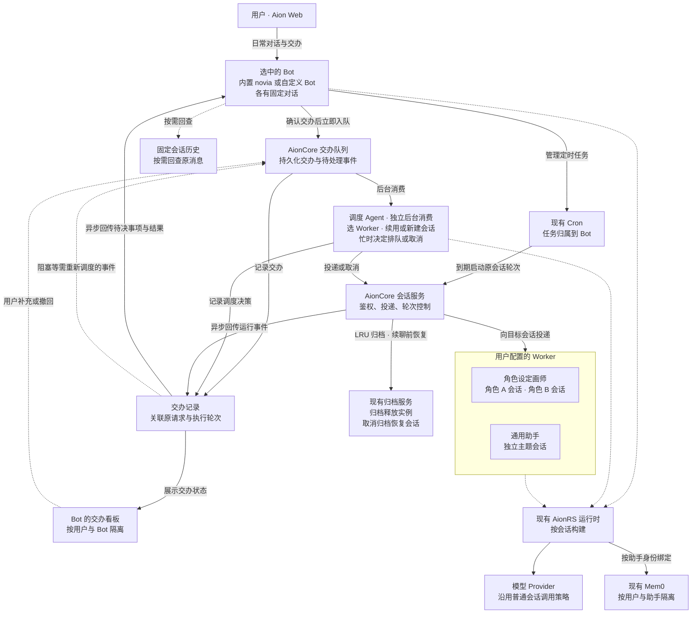

# Aion Bot 与会话调度需求

## 产品目标与首版范围

Aion 的 Bot 是用户的对话和交办入口，按老板与秘书的方式协作：用户一句话交代目标，Bot 在授权范围内组织执行、处理可自行解决的问题，并在完成或确认无法完成时汇报。只有涉及需要用户判断的风险、授权、方向变更或关键缺失信息时，才主动请用户决定。日常使用在 Bot 对话里完成；需要追踪细节或调试时再打开看板。

每个 Bot 有一条固定对话、自己的交办看板，并接入 Mem0 长期记忆。首个 Bot 是固定内置的 `novia`（诺薇娅），用户也可以创建其他 Bot。所有 Bot 使用同一套能力，名称、角色定义、模型和技能等可按 Bot 配置。

首版面向登录后的 Aion Web 用户，Bot、调度 Agent 和 Worker 都使用 AionRS。用户手动创建职能助手和通用兜底助手，为各 Bot 配置可用的 Worker。每次交办由后台调度选择合适的助手和会话。一个 Worker 对应一个已有助手身份，可以有多个独立主题会话。

## 首版入口与详情页

- **侧栏入口。** 在侧栏设置与普通对话、Team 同级的 Bot 区域，列出 Bot 并提供「新建 Bot」入口。内置 Bot 固定列在首位，中文界面显示「诺薇娅」，英文界面显示 `novia`。新建 Bot 复用助手编辑器，保存独立的助手定义并绑定内置 Bot 后端。 [现有侧栏](../AionUi/packages/desktop/src/renderer/components/layout/Sider/index.tsx) · [现有助手编辑器](../AionUi/packages/desktop/src/renderer/hooks/assistant/useAssistantEditor.ts)
- **详情页。** 点击 Bot 进入 `/bots/:id`，直接打开它的固定聊天。复用现有会话布局、消息列表和 AionRS 输入框。页头显示 Bot 名称，提供「交办看板」和「压缩上下文」，从页头菜单可查看该 Bot 的定时任务及运行记录。打开看板时在同一详情页切换内容，返回时接着看原消息。交办后的简短确认、需用户决定的事项和结果都回到聊天。用户主动追问时，Bot 可以查看交办记录并汇报进度。
- **固定对话。** 参考 Hermes Bot Mode，点击同一个 Bot 始终回到同一条对话。服务端按登录用户和 Bot 身份首次创建并绑定会话，并发打开时返回同一个会话 ID。打开已有对话时显示最新消息，向上滚动加载旧消息并保持阅读位置。刷新、换设备或重启后继续原会话。 [Hermes Bot Mode](https://hermes-agent.nousresearch.com/docs/user-guide/bot-mode) · [消息列表向上分页](../AionUi/packages/desktop/src/renderer/pages/conversation/Messages/MessageList.tsx)

### 连续会话与上下文压缩

- 原始消息、附件引用和交办记录随每个 Bot 的固定会话保留。AionRS 按现有策略自动压缩模型上下文，旧消息仍可向上翻阅。压缩完成后，下一轮在原会话中使用压缩后的上下文。
- 「压缩上下文」与 `/compact` 走同一个操作。Bot 输入框中的 `/new`、`/clear`、`/reset` 也转到该操作。服务端按固定会话身份处理兼容命令和重置入口，保证操作只压缩上下文。压缩共用会话的轮次控制。当前轮忙时提示完成后再试，压缩结果在原对话中反馈。
- 以原会话身份恢复运行实例。压缩失败时保留原有上下文并反馈。会话保留机制须保有每个 Bot 的恢复状态，旧存档数量清理应避开固定会话的恢复数据。普通会话与 Worker 的归档、删除和新建入口管理各自的会话。 [现有压缩命令](../aionrs/crates/aion-agent/src/commands/compact.rs) · [现有清空命令](../aionrs/crates/aion-agent/src/commands/clear.rs) · [会话重置与历史服务](../AionCore/crates/aionui-conversation/src/service.rs) · [会话存档保留](../aionrs/crates/aion-agent/src/session.rs)

## 架构图

调度创建的 Worker 会话参与 LRU。因 LRU 归档的会话可在续聊时恢复，用户手动归档的会话由用户恢复。

## Bot 后端

在 AionCore 注册一个内置 Bot 后端，所有 Bot 共用。以现有 Aion CLI 对应的内置 AionRS 后端为基础，使用独立的后端 ID 和相同的 AionRS 运行类型，复用引擎构建、普通会话、工具权限和记忆接入。服务端按会话绑定的后端身份启用 Bot 的交办能力，按助手定义区分各 Bot。Worker 使用现有 AionRS 后端。

Bot 后端负责日常聊天、确认交办并写入队列、管理定时任务，以及在发起交办的对话里汇报结果和提出需要用户决定的问题。调度 Agent 是由 AionCore 管理的独立后台消费者，有自己的执行生命周期，复用同一套 AionRS 运行能力。它不作为 Bot 聊天轮次的子 Agent。每次消费按交办归属读取当前用户与 Bot 的配置，通过现有会话和归档服务检查权限、投递、取消与恢复。首版随 AionCore 运行，无需单独部署或提供独立对话入口。

在「助手 → 对应 Bot → 调度与看板」配置可参与调度的 Worker、通用兜底助手和调度模型。调度模型默认跟随该 Bot，可从已有模型中单独选择。配置按用户与 Bot 保存，由后台调度按交办归属读取。

## 异步交办

Bot 自行处理日常对话和可及时完成的操作；耗时工作或需要专门助手处理的工作必须交办。一旦确认需要交办，就把目标、原始请求引用、必要背景和有权使用的附件引用写入 AionCore 的持久队列。在同一次受理中保存交办记录和待消费状态，关联所属用户与 Bot、来源消息或定时触发记录，以及已明确指向的原交办。Bot 在入队成功后简短确认「已接收」并结束当前轮次，用户可继续聊天。入队失败时说明未受理。Worker 的选择、会话准备和实际执行均在后台进行。

Bot 对话中的新交办和后续指令、定时任务发起的交办，以及看板上的补充和撤回，统一入队，由调度 Agent 消费并决定下一步。明确指向已有交办时，将卡片或会话关联作为调度依据。界面不提供绕过调度直接派发给 Worker 的入口。用户仍可打开已有 Worker 会话普通直聊；这种直聊独立于 Bot 交办流程。

调度决策先写入交办记录，再异步投递到目标会话；会话通过运行事件回传进展、阻塞和结果。进展写入交办记录，需用户决定的事项和终态结果作为独立消息写回原 Bot 对话并关联原请求，无需占用或打断正在进行的聊天轮次。用户在聊天中回答待决问题时，由 Bot 关联原交办后重新入队。界面事件推送用于刷新，重新打开聊天或看板时可以从已保存的数据恢复显示。

参考 [DeepSeek Super-agent 的 Stored work](https://github.com/deepseek-ai/dsh-superagent-prototype/blob/main/docs/003-execution.md#stored-work) 将工作先记录再执行。Aion 在 Bot 确认交办后就落盘，由独立的后台调度 Agent 消费，调度结果也先记录再投递。

## 调度与会话决策

调度 Agent 消费交办后依次判断：

1. **能否续用会话。** 按主题、目标和具体对象判断是否延续已有工作。候选是当前用户下由当前 Bot 调度创建、仍可继续的 Worker 会话。用户在这些会话中的直聊也纳入后续判断。用户手动创建的会话通过直聊入口使用。多个候选会导致实质不同的结果且无法判定时，由当前 Bot 请用户澄清。
2. **交给哪位助手。** 明确延续时，回到原助手和原会话。因 LRU 自动归档的会话可先恢复再投递。主题或目标独立时，从当前 Bot 配置的职能助手中选择并新开会话。没有匹配职能时交给该 Bot 的通用兜底助手。如果没有可用助手，由当前 Bot 说明原因。
3. **何时投递。** 目标会话空闲时直接投递。会话忙时，调度 Agent 根据用户意图和执行状态选择等待或取消。补充参考、约束或细节时按接受顺序等待。明确改换或撤销当前目标时，取消指定运行轮次。轮次进入终态后，有替换指令时在原会话优先执行，仅要求停止时反馈取消结果。已有等待项中，仅撤销被明确替代的项，其余按原顺序保留。取消失败或目标轮次已变化时，重新检查状态并反馈，确保后续动作仍对应正确轮次。

例如，用户请角色设定画师补同一角色的侧视图，调度应回到原角色会话。如果侧视图已经在生成，此时补一张衣领参考图，可以排在当前轮之后。如果用户明确说「停止这版，按新轮廓重画」，则在原会话取消当前轮并优先处理新指令。另一角色或一项独立的商品图工作另开会话。角色画师的不同主题会话也可以并行。

## 交办看板

首版每个 Bot 有独立看板，供需要追踪、介入或调试时查看。一张卡对应一项交办，关联原始请求、负责的 Worker、目标会话和实际轮次。按 Worker 分列，尚未分配的卡片归入「待分派」。卡片显示排队、执行、待处理及终态，用户可打开原会话、补充要求或撤回待执行的交办。同一 Worker 可被多个 Bot 选用，各 Bot 的卡片和续用候选按发起交办的 Bot 区分。

- **执行状态。** AionCore 根据投递及实际轮次事件更新卡片。完成、失败或取消事件按关联的交办和轮次写回，旧轮次的事件不能覆盖后续执行。看板以交办记录为数据来源。
- **需要判断的事件。** 卡片上的用户补充、撤回和需要进一步处理的 Worker 阻塞事件进入交办队列。调度按交办所属 Bot 读取相关交办和会话状态，优先在现有授权范围内解决问题；确需用户决定时，通过原 Bot 对话说明风险、待决问题和可选方案。
- **定时核对。** 服务端定时检查未结算的交办，按会话状态补齐遗漏事件或重启后的状态。长时间无进展等情况需要判断下一步时，提交事件给同一个后台调度 Agent。已结算的交办保留供用户回看。

现有团队看板服务于同一目标下的成员协作，按团队成员列出消息、任务和依赖。交办看板跟踪由同一入口发出、可以独立完成的多项工作。两者可以复用适用的状态展示组件与事件推送机制，各自使用所属业务的数据来源。后续如有一项交办需要多个角色围绕共同目标协作，可由一张交办卡关联一个 Team，用户从团队看板查看内部任务依赖。 [团队任务归属](../AionCore/crates/aionui-team/src/task_board.rs) · [现有团队看板](../AionUi/packages/desktop/src/renderer/pages/team/activity/TeamActivityView.tsx)

## Bot 定时任务

- **通过对话管理。** 定时任务是首版核心能力。用户可在 Bot 对话中用自然语言创建、查看、修改、暂停、恢复和删除任务。Bot 使用现有 Cron 服务，按当前用户和 Bot 的固定会话核对任务归属并反馈操作结果。创建、修改或查看时展示任务内容、调度时区和下次执行时间。时间或任务指向不明确时在原对话澄清。
- **到期执行。** AionCore 在服务端运行调度器，按现有 Cron 规则处理定时、认领和运行记录。任务到期在所属 Bot 的固定会话启动轮次，沿用该 Bot 的配置和轮次控制。需要交办的任务在该轮次入队后结束，由后台继续执行。会话忙时使用 Cron 的有限重试，达到上限后在运行记录中显示未执行。目标会话异常时记录失败并保留任务归属。Bot 详情页复用现有定时任务列表，按当前固定会话筛选。
- **结果归属。** 普通定时回复在所属 Bot 的聊天与运行记录中查看。交办经同一队列进入该 Bot 的看板，Cron 运行记录关联交办并区分已交办和实际完成。Worker 的最终结果或待决事项异步回到原聊天，便于继续追问。Bot 的定时任务与看板的后台状态核对分别使用各自的触发条件。

## Bot 长期记忆与会话回查

- **Mem0 长期记忆。** 内置和自建 Bot 都接入现有 Mem0 工具与开关，按用户和助手定义使用各自分区，沿用现有读写权限及删除确认。定时轮次按已授权的 Bot 任务进入原固定会话，按执行时的 Bot 权限和开关使用该分区。Worker 会话继续使用该 Worker 自己的记忆分区。
- **轻量回查与兜底。** 当前上下文已足够时直接使用。用户问旧原话、精确参数等可定位的细节时，可以直接回查固定会话。长期偏好、事实或约定优先查 Mem0，关闭、不可用或返回内容不足时，再查固定会话的原始消息。回查只读当前 Bot 的可见消息，返回有限摘录和可定位的原消息引用，供当前轮使用。两处都找不到时请用户补充。

## 会话顺序与恢复

- **会话顺序。** 同一交办的补充按接收顺序处理。同一会话的直聊与交办使用同一轮次生命周期，一次最多执行一轮；不同会话可以并行，即使属于同一 Worker。某个会话在忙或某项交办在等用户答复时，后台可继续处理其他交办。
- **认领与结果。** 交办记录区分已入队、已分派和执行终态。同一队列项同时只能由一个消费者认领，重复处理时复用已记录的调度决定和执行关联，避免重复开会话、执行或反馈。Bot 的接收回执、调度完成和会话轮次结束各自记录；若仍有影响交付的后台工作，交办保持未结算。
- **重启恢复。** 已受理的交办恢复到相应阶段：未调度的继续调度，已分派但未执行的按目标会话顺序继续投递，已经有结果的补齐尚未写回的结果。开始执行后被重启打断的交办标记为中断，工具副作用或交付结果不明时先核对，仍无法确认时由用户决定是否重试。目标会话失效或投递最终失败时，在发起交办的 Bot 对话明确反馈。
- **LRU 归档。** 达到配置的调度会话运行实例上限时，从调度创建的 Worker 会话中选择最久未活动且可安全恢复的一条，调用现有会话归档流程移出活跃列表并释放运行实例。执行中、仍有未落盘消息、工具结果不明或尚未形成可恢复状态的会话跳过本次回收。自动归档的会话进入现有归档列表，沿用该列表的恢复和删除操作。会话 ID、历史、进度、参考资料和成果引用随会话保留。
- **恢复归档会话。** 因 LRU 归档的会话再次被调度命中，或收到用户的直聊续接请求时，先走现有取消归档流程，再按原会话 ID 构建运行实例并继续。用户手动归档的会话由用户从归档列表恢复。自动归档时记录触发来源，归档和恢复使用原会话的生命周期控制，处理与新消息或并发恢复的竞争。若归档已写入但实例尚未释放，待释放完成后才计入 LRU 回收结果。恢复失败时向用户反馈，保留可恢复的会话数据。

## 模型与 Provider

Bot、调度 Agent 和 Worker 的模型调用沿用普通 AionRS 会话的模型与 Provider 配置、请求、流式响应、错误和重试策略。本需求的调度范围是交办投递与会话轮次，模型通信和请求调度使用现有路径。

## 现有能力与实现缺口

- **助手与会话。** 现有会话保存助手定义和有效配置快照。普通会话的创建和发消息路径已有归属校验、消息落盘、轮次占用和取消入口。调度沿用这些入口，在交办路径补足候选会话来源、主题匹配和结果关联。AionUi 复用现有会话视图呈现 Worker 直聊。 [会话路由](../AionCore/crates/aionui-conversation/src/routes.rs) · [会话服务](../AionCore/crates/aionui-conversation/src/service.rs) · [助手快照](../AionCore/crates/aionui-db/src/models/conversation.rs) · [AionRS 发送框](../AionUi/packages/desktop/src/renderer/pages/conversation/platforms/aionrs/AionrsSendBox.tsx)
- **Bot 后端。** AionCore 现有后端绑定可解析注册身份、后端和 Agent 类型。Web 内置 AionRS 和 Aion CLI 使用同一个 `AgentBootstrap` 初始化引擎。新增共用的 Bot 后端注册身份和调度能力注入，复用助手定义、AionRS 工厂、宿主工具注册及现有会话配置。 [后端绑定](../AionCore/crates/aionui-db/src/agent_binding.rs) · [AionCore 构建入口](../AionCore/crates/aionui-ai-agent/src/factory/mod.rs) · [Web AionRS 初始化](../AionCore/crates/aionui-ai-agent/src/manager/aionrs/agent.rs) · [Aion CLI 初始化](../aionrs/crates/aion-cli/src/bootstrap.rs) · [宿主工具注册](../aionrs/crates/aion-agent/src/bootstrap.rs)
- **交办队列与跨会话投递。** 现有跨会话投递需要已知目标，目标忙时可能进入内存队列，普通停止会清除目标会话的等待投递。首版需要在目标未选定前持久受理、重启恢复、按交办去重，以及只撤销指定的等待项。由 AionCore 的 Bot 交办路径负责队列和记录，认领与恢复参考现有 Cron 实现，投递复用会话归属校验和轮次控制。普通发送和停止沿用现有行为。 [投递服务](../AionCore/crates/aionui-session-message/src/service.rs) · [现有队列](../AionCore/crates/aionui-session-message/src/queue.rs) · [停止回调](../AionCore/crates/aionui-session-message/src/hook.rs) · [Cron 认领](../AionCore/crates/aionui-cron/src/service.rs)
- **看板同步与定时。** 复用 AionCore 的事件推送和定时触发机制。交办服务从关联轮次同步交办记录，重启后核对未结算记录，并将需要判断的事件放入交办队列。 [任务变更事件](../AionCore/crates/aionui-team/src/events.rs) · [定时触发](../AionCore/crates/aionui-cron/src/scheduler.rs)
- **Bot 与 Cron 的绑定。** 现有 Cron 已支持按会话创建、查询、修改和执行任务。会话助手入口需补上 Bot 任务的暂停、恢复和删除。多个任务可通过 Cron 任务记录指向同一个 Bot 固定会话。现有会话绑定会写入单个 `cron_job_id`，且普通 Cron 可在目标会话缺失时建替代会话。Bot 路径通过任务记录保持归属，避免把固定聊天标记成普通 Cron 会话，并在原会话不可用时报告失败。 [Cron 管理与触发](../AionCore/crates/aionui-cron/src/service.rs) · [Cron 会话绑定与执行](../AionCore/crates/aionui-cron/src/executor.rs)
- **记忆授权。** 现有会话服务为已登录用户的可见轮次构造 Mem0 绑定，绑定校验普通 AionRS 后端身份并排除带 Cron 标记的会话。Bot 固定会话以及经授权的 Bot 定时轮次需走明确的 Bot 资格判断，复用现有分区、开关与工具权限。交办到 Worker 时按目标助手的授权接入 Mem0。 [会话服务](../AionCore/crates/aionui-conversation/src/service.rs) · [Mem0 绑定](../AionCore/crates/aionui-ai-agent/src/mem0_config.rs)
- **固定会话回查。** 现有消息搜索按用户查询，历史读取支持按消息定位。Bot 的回查能力复用消息存储，在检索入口按当前用户与固定会话限域，并返回对应原消息引用。 [消息搜索与历史定位](../AionCore/crates/aionui-conversation/src/service.rs) · [消息查询](../AionCore/crates/aionui-db/src/repository/sqlite_conversation.rs)
- **归档和恢复。** 现有归档服务把会话移入归档列表、取消置顶，并调用运行实例停止流程。取消归档使会话回到活跃列表，AionRS 能按会话 ID 载入存档。LRU 复用这套流程，补充 Worker 会话选择、可恢复性检查和归档触发来源。AionRS 另有按数量清理旧存档的逻辑，仍可调度的会话需保有可用于恢复的上下文。 [会话归档服务](../AionCore/crates/aionui-sidebar/src/service.rs) · [归档的实例清理](../AionCore/crates/aionui-app/src/router/state.rs) · [AionRS 会话载入](../AionCore/crates/aionui-ai-agent/src/factory/aionrs.rs) · [会话存档保留](../aionrs/crates/aion-agent/src/session.rs)

调度、归档和恢复在关键状态变化时记录关联 ID、原因、状态和耗时。日志省略请求正文、记忆内容、附件和凭据。

## 验收场景

| 场景 | 预期结果 |
| --- | --- |
| Bot 入口和固定会话 | Bot 区域与普通对话、Team 同级，首位为内置 novia。创建第二个 Bot 后，两者可独立配置并从各自入口打开。并发首次打开、刷新和重启均复用该 Bot 的固定会话，向上滚动可查看旧消息。 |
| 连续会话压缩 | 页头操作、`/compact`、`/new`、`/clear` 和 `/reset` 都压缩同一会话的模型上下文，历史、附件和交办引用仍可查看。忙时提示等待，压缩失败可重试。运行实例重建后可继续原会话。 |
| 聊天交办与快速交接 | 内置和自建 Bot 都能用一句话接收交办。即使后台调度暂停或 Worker 长时间执行，成功入队后 Bot 也能确认并继续聊天。入队失败明确告知未受理，后台恢复后可处理已接收的交办。 |
| 汇报与用户决策 | 用户无需打开看板即可收到结果或最终失败说明。常规进展和可自行处理的阻塞不打断聊天。遇到需授权或决定的风险时，Bot 在原对话说明问题；用户答复关联原交办并重新入队。用户追问可获取进度。 |
| 续用、新建和澄清 | 同一角色续图回原会话，独立目标开新会话。调度创建的会话支持直聊后续用。手动创建的会话可直聊，并排除在调度候选之外。难以区分候选时询问用户。 |
| 忙时补充、取消和并发 | 补充按序等待。改变方向只取消指定轮次和被替代的等待项。同会话直聊和交办串行，同助手不同会话可并行。取消失败或轮次变化时保留正确的运行状态。 |
| 重复投递和服务重启 | 重复处理同一队列项时复用既有状态。确认入队、记录分派和写回结果之间分别重启，恢复时不丢交办、不重复执行或汇报。副作用无法确认时等待核对，不自动重做。后台工作尚未结束时，轮次结束不算交办完成。 |
| 多项交办的看板监控 | 一个 Bot 的独立交办分卡展示，其中一项等待材料时其余照常推进。用户可按 Worker 筛选、打开原会话或撤回排队。两个 Bot 选用同一 Worker 时，各自的看板、续用候选和结果回传仍按发起 Bot 区分。 |
| 统一调度与定时核对 | 对话和看板上的后续指令即使明确指向卡片，也必须入队并由调度 Agent 决定何时投递或取消。旧轮次事件不覆盖当前状态，定时检查能按关联会话补齐遗漏。后台调度在 Bot 轮次结束后仍能执行，模型可跟随该 Bot 或单独配置。 |
| Bot 定时任务管理与执行 | 从 Bot 聊天创建和修改任务，再暂停、恢复和删除。两个 Bot 各自管理任务，同一 Bot 可拥有多个定时任务。到期轮次在原固定会话执行；需要 Worker 时入队后即释放 Bot 轮次，运行记录区分已交办和实际完成，结果回原聊天。覆盖会话忙时重试、重启后的重复触发以及目标会话不可用。 |
| Bot Mem0 和权限 | 内置和自建 Bot 可在各自分区按现有权限使用 Mem0。一个 Bot 创建多个任务后，直聊和已授权的定时轮次仍按同一个记忆开关访问各自分区。其他 Bot、Worker 和用户的数据按各自权限隔离。 |
| 固定会话回查 | 压缩后能从原消息找回精确参数。直接回查以及 Mem0 关闭、不可用或结果不足时的兜底均可用，结果只来自当前 Bot 的固定会话并能定位原消息。 |
| 模型调用兼容 | Bot、调度 Agent 和 Worker 使用普通会话的模型与 Provider 选择、流式响应、错误和重试行为。 |
| LRU 归档与恢复 | 达到上限时归档最久未活动且可安全恢复的 Worker 会话，归档列表可见且运行实例已释放。新交办或直聊续接自动归档的原会话，手动归档由用户恢复。覆盖归档与新消息竞争、归档后清理未完成、并发恢复，以及会话数超过旧存档保留上限时的上下文恢复。 |
