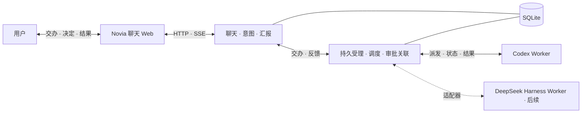

# 诺薇娅 Bot 与会话调度需求

## 产品目标与职责

诺薇娅（Novia）是用户的聊天和交办入口。用户一句话交代目标，Bot 在授权范围内组织执行，完成后在原对话汇报。需要用户判断风险、授权、改变方向或补充关键信息时，Bot 主动询问。日常工作在聊天里完成，看板用于追踪、介入和调试。

诺薇娅主应用负责两件事。**聊天**负责理解意图、保持连续会话和自然语言回复。**交办与汇报**负责持久受理、后台派发、跟踪、审批关联和结果回传。写代码、执行命令、运行工具和管理执行上下文由专业 Worker 负责。Codex、DeepSeek Harness 都可以作为独立执行端。诺薇娅通过适配器连接它们，各执行端沿用自己的模型、工具、权限和原生会话。

诺薇娅独立运行。Aion 的代码、已部署服务和测试是复用来源，按功能逐项核对入口、依赖和权限语义。首个 Worker 使用 Codex，DeepSeek Harness 作为后续 Worker 接入。此前的推理过滤插件计划已取消。

## 首版范围与交互

- **固定聊天。** 首版建议先开放内置 Bot `novia`，数据从第一天按用户、Bot 和固定会话归属保存。手机浏览器打开后进入最新消息，向上加载历史，刷新、换设备和重启后继续同一对话。自建 Bot、切换入口和每 Bot 独立看板可在闭环稳定后加入。 [Hermes Bot Mode](https://hermes-agent.nousresearch.com/docs/user-guide/bot-mode) · [Aion 消息列表](../AionUi/packages/desktop/src/renderer/pages/conversation/Messages/MessageList.tsx)
- **上下文管理。** 原始消息、附件和交办引用完整保留。首个闭环从最近消息构造聊天上下文。需要压缩时，在同一会话保存摘要和覆盖边界，之后使用摘要与最近消息。对话里的 `/new`、`/clear`、`/reset` 与 `/compact` 统一走上下文压缩入口，历史仍可回查。
- **交办与结果。** 用户通过聊天交办、补充、追问、撤回或审批。Bot 确认已受理后继续聊天。任务完成、失败或无法自动恢复时，在原对话给出自然语言反馈与可访问的成果。用户只在追问或调试时查看交办详情。
- **定时与记忆。** Bot 管理定时任务属于首版核心能力，在首条手动交办跑通后接入同一条链路。长期记忆复用已有 Mem0 MCP，按 Bot 归属访问，固定会话回查提供轻量入口和兜底。

## 首版技术选型

| 部分 | 建议选型 | 落地边界 |
| --- | --- | --- |
| 运行方式 | **Node.js 24 LTS + TypeScript + pnpm** | 一个应用工程和一个 Novia 服务进程。服务端和 Web 共用语言与数据类型，执行端由适配器独立启动和管理。 |
| 前端 | **React + Vite**，移动优先的单页 Web | 开发时用 Vite，发布时由 Novia 服务同源提供静态页面和 API。先实现聊天、审批、结果和历史分页。 [Vite 静态构建](https://vite.dev/guide/build.html) |
| 服务端 | **Fastify + HTTP JSON + SSE** | HTTP 提交输入和查询历史。SSE 推送新消息和状态，重连按持久消息游标补读。聊天、调度和 Worker 对接在同一进程内按模块组织。 [Fastify TypeScript 文档](https://fastify.dev/docs/latest/Reference/TypeScript/) |
| 持久化 | **SQLite + `node:sqlite`** | 用短事务保存聊天、交办、审批、定时触发和待反馈事件。交办表兼作持久队列，同一事务提交终态与待反馈。固定并验证 Node 24 版本，`node:sqlite` 在该版本线处于发布候选阶段。 [Node 24 SQLite 文档](https://nodejs.org/download/release/latest-v24.x/docs/api/sqlite.html) · [SQLite 事务隔离](https://www.sqlite.org/isolation.html) |
| 聊天模型 | **一个可配置的模型 HTTP API** | 在 Novia 里完成聊天、结构化交办意图和结果转述。服务端校验模型输出的动作、目标和权限。路由决策与状态更新写成可测试的独立函数，首版单 Worker 可按配置派发。 |
| 首个 Worker | **本机 `codex app-server`，经 stdio JSON-RPC** | 沿用 Codex 原生配置和登录。保存 thread ID 和 turn ID，按原线程续接、订阅终态并回答对应审批请求。固定验收通过的 CLI 版本。 [OpenAI Docs 的 Codex App Server](https://learn.chatgpt.com/docs/app-server) |

首版部署目标是单机和单用户。应用运行依赖收敛为 Node.js、内置 SQLite 和已安装的 Worker。服务端完成登录与数据归属校验，浏览器只访问 Novia，Worker 连接和凭据留在服务端。工作目录、执行端及权限由服务端配置。后台服务按 Aion 的本机运维约定提供启动、停止、重启、状态和健康检查。

## 架构图

## 异步交办与 Worker 对接

1. **受理。** 一次 Bot 对话可以产生零项、一项或多项交办。每项独立保存目标、必要背景、授权附件、来源消息或定时触发，以及明确指向的原交办。按来源与该项稳定标识去重。提交成功才回复已受理，部分失败时按项说明，已入队的事项照常推进。
2. **派发。** 后台按序认领并记录目标。明确续作时使用原 Worker 线程，独立目标新开线程。目标忙时按受理顺序等待，不同线程可在配置的并发范围内执行。无可用 Worker 时记录异常并通知 Bot。交办、补充、替换和撤回都走同一个入口，取消前核对目标轮次。
3. **执行。** 适配器提供启动或续接、读取运行状态、处理原调用审批和取消等实际支持的能力。Novia 保存交办 ID 与执行端的线程、轮次和请求标识。执行端事件只更新对应的执行记录。新增第二种 Worker 时，按两个执行端的实际差异确定共享接口。
4. **结算。** 成功、失败、撤回及需处理的异常都进入原 Bot 的统一入站。每项任务独立结算，先完成的先汇报。若任务有尚未可读取的产物，等产物可交付后再结算成功。用户可按原请求追问单项或整体进度。

### 恢复与统一反馈

- 已受理的任务和待反馈事件保存在 SQLite。Bot 忙时，反馈在统一入站等待，空闲后作为标记来源的独立输入处理。回复落盘后确认消费。结果事件去重，浏览器断线重连可补读已落盘消息。
- 认领、派发和终态分开记录。重启后继续处理未派发任务和未汇报的终态。发送执行请求后失联，按已记录的线程和轮次查询原执行端，结果或副作用仍不明时标记待核对，由 Bot 报告并请用户决定下一步。已发出的操作以原执行记录为准。
- Worker 的会话压缩、模型请求、工具调度和实例生命周期由执行端管理。后续看板从交办、审批和执行记录读取状态，按 Bot 隔离。需要人工介入的异常直接回原对话。

### 独立审批链

Worker 的审批请求先登记，关联用户、Bot、交办、线程、轮次和请求 ID，再通知原 Bot。Bot 说明操作和影响，理解明确的允许或拒绝。答复含糊或有多个可能的审批对象时先澄清。服务端校验答复归属与活跃调用后，把一次性决定送回原请求。已取消、过期或重启后已失效的请求向用户说明，后续操作如需审批重新发起。审批等待期间，聊天与其他交办继续。

### Bot 定时任务与长期记忆

- 用户在对话里创建、查看、修改、暂停、恢复和删除定时任务。明确任务内容、时区与下次执行时间。到期以「任务 ID + 计划触发时间」持久登记，重启后补处理尚未消费的触发。Bot 或目标会话忙时保留等待。同一定时任务的上次执行尚未结束时，后续触发按顺序等待。需要执行的工作使用同一交办队列，结果回到原对话。
- Mem0 按可信用户和 Bot 身份隔离，保留记忆开关与删除确认。用户问原话、精确参数时可直接查固定会话。长期事实优先查 Mem0，服务不可用或结果不足时回查原消息。Worker 的记忆按其自身配置管理。 [Aion 已有记忆能力](memory-roadmap.md#当前能力) · [MCP 接入与验收](memory-mcp-backlog.md)

## Aion 复用范围

| 已有能力 | 诺薇娅的接法 |
| --- | --- |
| **Web 消息列表和产物体验** | 评估抽取历史分页、附件预览、移动端操作和重连相关的独立组件或函数。以新页面的接口为准，优先复用依赖范围清晰的部分。 [消息列表](../AionUi/packages/desktop/src/renderer/pages/conversation/Messages/MessageList.tsx) · [Aion Web 开发](../AionUi/docs/contributing/development.md) |
| **消息队列、归属校验、定时与审批** | 复用经过验证的状态语义、边界用例和可独立接入的逻辑。首版应用服务用 TypeScript 落地队列和协议映射。 [队列](../AionCore/crates/aionui-session-message/src/queue.rs) · [会话与审批](../AionCore/crates/aionui-conversation/src/service.rs) · [Cron](../AionCore/crates/aionui-cron/src/executor.rs) |
| **异步生图 MCP** | 复用独立服务。接入生图 Worker 时关联 `image_submit` 返回的任务 ID、原交办和可访问的产物引用。按原 ID 查状态并取结果，遇到 `submission_uncertain` 进入待核对。 [生图 MCP](../aion-openai-image-mcp/README.md) · [异步生图验收](../AionCore/crates/aionui-app/tests/async_image_e2e.rs) |
| **Mem0 和 Dots Bridge** | Mem0 直接接入已有服务。需要 Dot 入口时，适配既有 Bridge 到统一入站，复用消息去重与附件归属的经验。 [Mem0 记录](memory-mcp-backlog.md) · [Dots 接入](../AionCore/DOTS-BRIDGE.md) |
| **角色、提示词、Skill 和模型配置** | Bot 只保留聊天与交办所需的角色设定。Worker 的工具、Skill、模型和会话由其原生配置提供，后续按实际需求接入现有 Aion 助手或抽取配置能力。 [助手配置刷新](../AionCore/crates/aionui-conversation/src/assistant_runtime.rs) · [Aion 提示词组装](../aionrs/crates/aion-agent/src/context.rs) |
| **工具链、归档和看板** | 复用长工具链、断流与结果核对的验收用例。执行端负责会话归档，Novia 保存可续接的引用。后续看板可复用 Aion 的卡片、分列和状态呈现。 [推理回传旧实现](../aionrs/crates/aion-agent/src/reasoning_history.rs) · [归档](../AionCore/crates/aionui-sidebar/src/service.rs) · [团队看板](../AionUi/packages/desktop/src/renderer/pages/team/activity/TeamActivityView.tsx) |
| **独立本机服务** | 沿用 Aion 的进程管理、健康检查、日志和本地数据隔离约定。 [Aion 服务管理脚本](../manage-services.py) |

DeepSeek Harness 后续作为独立 Worker，通过其 TypeScript SDK 或已验证的进程接口接入。接入时验证线程续接、结果归属、审批和重启恢复。 [Harness 本地 SDK 说明](../../dsh/deepseek-harness/packages/sdk/client/README.md)

## 实施计划

按可独立验收的工作项推进。先跑通一个用户、一条固定聊天和一个真实 Worker，再把定时、记忆和其他执行端接到同一条链路。

| 工作项 | 内容与目标 | 验收标准 |
| --- | --- | --- |
| 01 固定聊天与持久化 | 建立单页 Web、HTTP 服务和 SQLite。实现 Novia 固定聊天、历史分页和连接恢复。 | 手机浏览器能聊天。刷新、重启和重连后回到同一对话，历史及新消息顺序正确。 |
| 02 交办队列与模拟 Worker | 完成受理、按序认领、逐项结算和持久反馈。用可控的 Worker 结果验证链路。 | 同一消息拆两项。入队后能继续聊天，先结束的事项先汇报。重试和重启后每项仍只有一条交办记录和一份结果汇报。 |
| 03 Codex Worker | 接入真实执行、续接、状态和结果。使用已授权的测试工作目录。 | 聊天里交代一项代码工作，确认后继续聊天，完成时自动收到结果。追问或补充能续接原线程。执行端断开时可按 ID 核对，无法确认时报告待核对。 |
| 04 审批与取消 | 连接 Worker 的原生审批和取消接口，闭合聊天决策路径。 | 在原对话批准或拒绝一个实际请求。含糊答复先澄清，重复或已失效的答复无法授权别的调用。取消只作用于指定轮次。 |
| 05 Bot 定时任务 | 接入定时管理与持久触发，复用任务队列和反馈。 | 用聊天建一项定时任务，停机跨过触发时间后恢复，只受理一次。前次未结束时按规则等待，完成后回原聊天。 |
| 06 记忆与历史回查 | 先实现有归属限制的历史回查，再接入 Mem0 和压缩入口。 | 回查能定位原消息。Mem0 不可用时仍可查历史。压缩后继续原会话并能查看完整旧记录。 |
| 后续扩展 | 接入 DeepSeek Harness 与异步生图 Worker，再按实际需要开放自建 Bot、隔离看板和原生移动端。 | 第二种 Worker 通过同一交办路径返回结果。不同 Bot 的会话、交办和反馈按归属隔离。 |

首版联验以「手机发一句话 → Novia 确认 → 用户继续聊天 → Codex 执行 → 结果回到原对话」为第一条主线，再覆盖真实审批、定时触发、记忆回查和重启恢复。日志记录交办、线程和轮次的关联、状态、原因及耗时。
