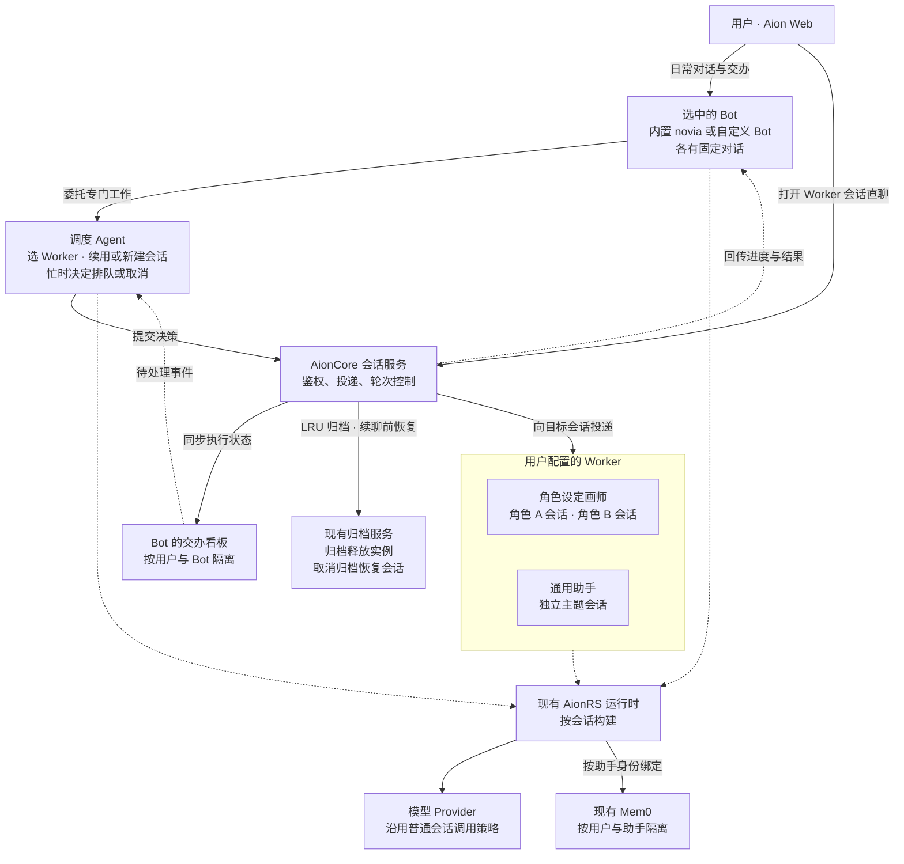

# Aion Bot 与会话调度需求

## 产品目标与首版范围

Aion 的 Bot 是用户的对话和交办入口，负责日常聊天、分派工作和回传结果。每个 Bot 有一条固定对话和自己的交办看板。首个 Bot 是固定内置的 `novia`（诺薇娅），用户也可以创建其他 Bot。所有 Bot 使用同一套聊天、调度和看板能力，名称、角色定义、模型和技能等可按 Bot 配置。

首版面向登录后的 Aion Web 用户，Bot 和 Worker 都使用 AionRS。用户手动创建职能助手和通用兜底助手，为各 Bot 选择可调度的 Worker。一个 Worker 对应一个已有助手身份，可以有多个独立主题会话。用户可从看板查看进度，并进入 Worker 的原会话直接续聊。

## 首版入口与详情页

- **侧栏入口。** 在侧栏设置与普通对话、Team 同级的 Bot 区域，列出 Bot 并提供「新建 Bot」入口。内置 Bot 固定列在首位，中文界面显示「诺薇娅」，英文界面显示 `novia`。新建 Bot 复用助手编辑器，保存独立的助手定义并绑定内置 Bot 后端。 [现有侧栏](../AionUi/packages/desktop/src/renderer/components/layout/Sider/index.tsx) · [现有助手编辑器](../AionUi/packages/desktop/src/renderer/hooks/assistant/useAssistantEditor.ts)
- **详情页。** 点击 Bot 进入 `/bots/:id`，直接打开它的固定聊天。复用现有会话布局、消息列表和 AionRS 输入框。页头显示 Bot 名称，提供「交办看板」和「压缩上下文」。打开看板时在同一详情页切换内容，返回时接着看原消息。聊天中显示回复、交办状态和结果，用户可从交办状态打开对应的 Worker 会话。
- **固定对话。** 参考 Hermes Bot Mode，点击同一个 Bot 始终回到同一条对话。服务端按登录用户和 Bot 身份首次创建并绑定会话，并发打开时返回同一个会话 ID。打开已有对话时显示最新消息，向上滚动加载旧消息并保持阅读位置。刷新、换设备或重启后继续原会话。 [Hermes Bot Mode](https://hermes-agent.nousresearch.com/docs/user-guide/bot-mode) · [消息列表向上分页](../AionUi/packages/desktop/src/renderer/pages/conversation/Messages/MessageList.tsx)

### 连续会话与上下文压缩

- 原始消息、附件引用和交办记录随每个 Bot 的固定会话保留。AionRS 按现有策略自动压缩模型上下文，旧消息仍可向上翻阅。压缩完成后，下一轮在原会话中使用压缩后的上下文。
- 「压缩上下文」与 `/compact` 走同一个操作。Bot 输入框中的 `/new`、`/clear`、`/reset` 也转到该操作。服务端按固定会话身份处理兼容命令和重置入口，保证操作只压缩上下文。压缩共用会话的轮次控制。当前轮忙时提示完成后再试，压缩结果在原对话中反馈。
- 以原会话身份恢复运行实例。压缩失败时保留原有上下文并反馈。会话保留机制须保有每个 Bot 的恢复状态，旧存档数量清理应避开固定会话的恢复数据。普通会话与 Worker 的归档、删除和新建入口管理各自的会话。 [现有压缩命令](../aionrs/crates/aion-agent/src/commands/compact.rs) · [现有清空命令](../aionrs/crates/aion-agent/src/commands/clear.rs) · [会话重置与历史服务](../AionCore/crates/aionui-conversation/src/service.rs) · [会话存档保留](../aionrs/crates/aion-agent/src/session.rs)

## 架构图

调度创建的 Worker 会话参与 LRU。因 LRU 归档的会话可在续聊时恢复，用户手动归档的会话由用户恢复。

## Bot 后端

在 AionCore 注册一个内置 Bot 后端，所有 Bot 共用。以现有 Aion CLI 对应的内置 AionRS 后端为基础，使用独立的后端 ID 和相同的 AionRS 运行类型，复用引擎构建、普通会话、工具权限和记忆接入。服务端按会话绑定的后端身份启用 Bot 的交办能力，按助手定义区分各 Bot。Worker 使用现有 AionRS 后端。

Bot 后端负责日常聊天、调用内置调度 Agent，以及把需要用户处理的问题与最终结果关联回发起交办的 Bot 对话。调度 Agent 在同一后端按需执行，使用发起交办的 Bot 配置来选择 Worker、判断续用或新建会话，并处理忙时补充及看板上的待决事项。AionCore 通过现有会话和归档服务执行投递、取消、恢复与权限检查。

在「助手 → 对应 Bot → 调度与看板」配置可参与调度的 Worker、通用兜底助手和调度模型。调度模型默认跟随该 Bot，可从已有模型中单独选择。配置按用户与 Bot 保存，调度运行由共用后端承载。

## 交办与会话决策

Bot 自行处理日常对话。需要专门处理时，将用户原始请求、必要背景和有权使用的附件交给调度 Agent。发起交办的 Bot 对话展示负责的助手、目标会话以及交办状态，用户可以从那里打开目标会话直接续聊。进度、成果或失败反馈关联到原请求。

调度 Agent 依次判断：

1. **能否续用会话。** 按主题、目标和具体对象判断是否延续已有工作。候选是当前用户下由当前 Bot 调度创建、仍可继续的 Worker 会话。用户在这些会话中的直聊也纳入后续判断。用户手动创建的会话通过直聊入口使用。多个候选会导致实质不同的结果且无法判定时，由当前 Bot 请用户澄清。
2. **交给哪位助手。** 明确延续时，回到原助手和原会话。因 LRU 自动归档的会话可先恢复再投递。主题或目标独立时，从当前 Bot 配置的职能助手中选择并新开会话。没有匹配职能时交给该 Bot 的通用兜底助手。如果没有可用助手，由当前 Bot 说明原因。
3. **何时投递。** 目标会话空闲时直接投递。会话忙时，调度 Agent 根据用户意图和执行状态选择等待或取消。补充参考、约束或细节时按接受顺序等待。明确改换或撤销当前目标时，取消指定运行轮次。轮次进入终态后，有替换指令时在原会话优先执行，仅要求停止时反馈取消结果。已有等待项中，仅撤销被明确替代的项，其余按原顺序保留。取消失败或目标轮次已变化时，重新检查状态并反馈，确保后续动作仍对应正确轮次。

例如，用户请角色设定画师补同一角色的侧视图，调度应回到原角色会话。如果侧视图已经在生成，此时补一张衣领参考图，可以排在当前轮之后。如果用户明确说「停止这版，按新轮廓重画」，则在原会话取消当前轮并优先处理新指令。另一角色或一项独立的商品图工作另开会话。角色画师的不同主题会话也可以并行。

## 交办看板

首版每个 Bot 有独立看板，按用户与 Bot 读取和更新交办。看板以发起交办的 Bot 为归属，一张卡对应一项交办，关联原始请求、负责的 Worker、目标会话和实际轮次。按 Worker 分列，尚未分配的卡片归入「待分派」。卡片显示排队、执行、待处理及终态，用户可打开原会话、补充要求或撤回待执行的交办。同一 Worker 可被多个 Bot 选用，各 Bot 的卡片和续用候选按发起交办的 Bot 区分。

- **执行状态。** AionCore 根据投递及实际轮次事件更新卡片。完成、失败或取消事件按关联的交办和轮次写回，旧轮次的事件不能覆盖后续执行。看板以交办记录为数据来源。
- **需要判断的事件。** 新交办、卡片上的用户补充、Worker 报告阻塞等事件交给内置调度 Agent。调度按交办所属 Bot 读取相关卡片和会话状态，沿用续用、排队和取消的决策链。需要用户澄清或提供材料时，从发起交办的 Bot 对话询问。
- **定时核对。** 服务端定时检查未结算的交办，按会话状态补齐遗漏事件或重启后的状态。长时间无进展等情况需要判断下一步时，再调用调度模型。已结算的交办保留供用户回看。

现有团队看板服务于同一目标下的成员协作，按团队成员列出消息、任务和依赖。交办看板跟踪由同一入口发出、可以独立完成的多项工作。两者可以复用适用的状态展示组件与事件推送机制，各自使用所属业务的数据来源。后续如有一项交办需要多个角色围绕共同目标协作，可由一张交办卡关联一个 Team，用户从团队看板查看内部任务依赖。 [团队任务归属](../AionCore/crates/aionui-team/src/task_board.rs) · [现有团队看板](../AionUi/packages/desktop/src/renderer/pages/team/activity/TeamActivityView.tsx)

## 会话顺序、记忆和恢复

- **会话顺序。** 同一会话的直聊与交办使用同一轮次生命周期，一次最多执行一轮。不同会话可以并行，即使属于同一 Worker。交办的状态和结果关联原请求、目标会话及实际执行轮次。重复投递同一交办时沿用已有记录，避免重复开会话、执行或反馈。
- **重启恢复。** 已确认排队且尚未开始的交办在服务重启后按原顺序继续投递。重启时已经开始的交办标记为中断，工具副作用或交付结果不明时标记为待核对，由用户决定是否重试。目标会话失效或投递失败时，在发起交办的 Bot 对话明确反馈。服务只有在保留了恢复所需的信息后才确认交办已排队。
- **助手记忆。** 复用现有 Mem0 的用户与助手分区。每个 Bot 按各自的助手定义使用记忆。同一 Worker 的会话沿用该 Worker 的记忆分区。Profile 决定工作配置，Mem0 开关独立生效。记忆关闭时，助手继续使用当前会话的历史、附件和成果。调度只传递当前交办所需的背景。
- **LRU 归档。** 达到配置的调度会话运行实例上限时，从调度创建的 Worker 会话中选择最久未活动且可安全恢复的一条，调用现有会话归档流程移出活跃列表并释放运行实例。执行中、仍有未落盘消息、工具结果不明或尚未形成可恢复状态的会话跳过本次回收。自动归档的会话进入现有归档列表，沿用该列表的恢复和删除操作。会话 ID、历史、进度、参考资料和成果引用随会话保留。
- **恢复归档会话。** 因 LRU 归档的会话再次被调度命中，或收到用户的直聊续接请求时，先走现有取消归档流程，再按原会话 ID 构建运行实例并继续。用户手动归档的会话由用户从归档列表恢复。自动归档时记录触发来源，归档和恢复使用原会话的生命周期控制，处理与新消息或并发恢复的竞争。若归档已写入但实例尚未释放，待释放完成后才计入 LRU 回收结果。恢复失败时向用户反馈，保留可恢复的会话数据。

## 模型与 Provider

Bot、调度 Agent 和 Worker 的模型调用沿用普通 AionRS 会话的模型与 Provider 配置、请求、流式响应、错误和重试策略。本需求的调度范围是交办投递与会话轮次，模型通信和请求调度使用现有路径。

## 现有能力与实现缺口

- **助手与会话。** 现有会话保存助手定义和有效配置快照。普通会话的创建和发消息路径已有归属校验、消息落盘、轮次占用和取消入口。调度沿用这些入口，在交办路径补足候选会话来源、主题匹配和结果关联。AionUi 复用现有会话视图呈现 Worker 直聊。 [会话路由](../AionCore/crates/aionui-conversation/src/routes.rs) · [会话服务](../AionCore/crates/aionui-conversation/src/service.rs) · [助手快照](../AionCore/crates/aionui-db/src/models/conversation.rs) · [AionRS 发送框](../AionUi/packages/desktop/src/renderer/pages/conversation/platforms/aionrs/AionrsSendBox.tsx)
- **Bot 后端。** AionCore 现有后端绑定可解析注册身份、后端和 Agent 类型。Web 内置 AionRS 和 Aion CLI 使用同一个 `AgentBootstrap` 初始化引擎。新增共用的 Bot 后端注册身份和调度能力注入，复用助手定义、AionRS 工厂、宿主工具注册及现有会话配置。 [后端绑定](../AionCore/crates/aionui-db/src/agent_binding.rs) · [AionCore 构建入口](../AionCore/crates/aionui-ai-agent/src/factory/mod.rs) · [Web AionRS 初始化](../AionCore/crates/aionui-ai-agent/src/manager/aionrs/agent.rs) · [Aion CLI 初始化](../aionrs/crates/aion-cli/src/bootstrap.rs) · [宿主工具注册](../aionrs/crates/aion-agent/src/bootstrap.rs)
- **跨会话投递。** 现有服务验证归属后经普通会话服务投递，忙时进入内存队列。普通用户停止会清除该会话的等待投递。首版调度需要可恢复的等待记录、重复投递识别，以及只撤销指定等待项的取消语义。由调度交办路径承担这些行为，普通发送和停止继续按现有约定处理。 [投递服务](../AionCore/crates/aionui-session-message/src/service.rs) · [现有队列](../AionCore/crates/aionui-session-message/src/queue.rs) · [停止回调](../AionCore/crates/aionui-session-message/src/hook.rs)
- **看板同步与定时。** 复用 AionCore 的事件推送和定时触发机制。交办服务负责从关联轮次同步卡片、在重启后核对未结算记录，并将需要判断的事件提交给内置调度 Agent。 [任务变更事件](../AionCore/crates/aionui-team/src/events.rs) · [定时触发](../AionCore/crates/aionui-cron/src/scheduler.rs)
- **记忆授权。** 现有会话服务从已登录用户的可见轮次构造 Mem0 绑定，通用跨会话投递走后台来源。交办需要由服务端验证用户授权和目标助手归属后，复用目标助手的现有 Mem0 开关、绑定及工具权限。通用后台来源继续沿用现有授权。 [会话服务](../AionCore/crates/aionui-conversation/src/service.rs) · [Mem0 绑定](../AionCore/crates/aionui-ai-agent/src/mem0_config.rs)
- **归档和恢复。** 现有归档服务把会话移入归档列表、取消置顶，并调用运行实例停止流程。取消归档使会话回到活跃列表，AionRS 能按会话 ID 载入存档。LRU 复用这套流程，补充 Worker 会话选择、可恢复性检查和归档触发来源。AionRS 另有按数量清理旧存档的逻辑，仍可调度的会话需保有可用于恢复的上下文。 [会话归档服务](../AionCore/crates/aionui-sidebar/src/service.rs) · [归档的实例清理](../AionCore/crates/aionui-app/src/router/state.rs) · [AionRS 会话载入](../AionCore/crates/aionui-ai-agent/src/factory/aionrs.rs) · [会话存档保留](../aionrs/crates/aion-agent/src/session.rs)

调度、归档和恢复在关键状态变化时记录关联 ID、原因、状态和耗时。日志省略请求正文、记忆内容、附件和凭据。

## 验收场景

| 场景 | 预期结果 |
| --- | --- |
| Bot 入口和固定会话 | Bot 区域与普通对话、Team 同级，首位为内置 novia。创建第二个 Bot 后，两者可独立配置并从各自入口打开。并发首次打开、刷新和重启均复用该 Bot 的固定会话，向上滚动可查看旧消息。 |
| 连续会话压缩 | 页头操作、`/compact`、`/new`、`/clear` 和 `/reset` 都压缩同一会话的模型上下文，历史、附件和交办引用仍可查看。忙时提示等待，压缩失败可重试。运行实例重建后可继续原会话。 |
| Bot 后端与交办 | 内置和自建 Bot 均通过共用的 Bot 后端调用调度 Agent。交办显示负责的助手和会话，用户可直接进入。进度、成果或错误回到发起交办的 Bot。 |
| 续用、新建和澄清 | 同一角色续图回原会话，独立目标开新会话。调度创建的会话支持直聊后续用。手动创建的会话可直聊，并排除在调度候选之外。难以区分候选时询问用户。 |
| 忙时补充、取消和并发 | 补充按序等待。改变方向只取消指定轮次和被替代的等待项。同会话直聊和交办串行，同助手不同会话可并行。取消失败或轮次变化时保留正确的运行状态。 |
| 重复投递和服务重启 | 重复投递同一交办时复用既有状态，不启动第二次执行。已确认且尚未开始的交办按序恢复。中断执行或副作用不明时提示用户核对，已完成结果可追溯。 |
| 多项交办的看板监控 | 一个 Bot 的独立交办分卡展示，其中一项等待材料时其余照常推进。用户可按 Worker 筛选、打开原会话或撤回排队。两个 Bot 选用同一 Worker 时，各自的看板、续用候选和结果回传仍按发起 Bot 区分。 |
| 看板事件与定时核对 | 普通轮次事件直接更新所属 Bot 的卡片，旧轮次结果不覆盖当前状态。用户补充和需要判断的阻塞触发调度，定时检查能按关联会话补齐遗漏。调度模型可跟随该 Bot 或单独配置。 |
| Mem0 和权限 | 同一助手的会话可使用其已启用的记忆。不同助手和用户按各自权限访问，关闭记忆后仍能续用会话。无法访问目标会话时返回交办失败。 |
| 模型调用兼容 | Bot、调度 Agent 和 Worker 使用普通会话的模型与 Provider 选择、流式响应、错误和重试行为。 |
| LRU 归档与恢复 | 达到上限时归档最久未活动且可安全恢复的 Worker 会话，归档列表可见且运行实例已释放。新交办或直聊续接自动归档的原会话，手动归档由用户恢复。覆盖归档与新消息竞争、归档后清理未完成、并发恢复，以及会话数超过旧存档保留上限时的上下文恢复。 |
